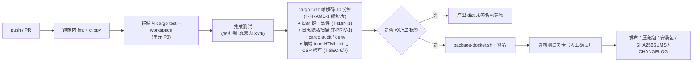

# Cross-SystemConnect 构建发布流程

> 文档版本：v2.0 · 对应软件 v0.2.2
> 相关文档：[README](README.md) · [测试用例](测试用例.md) · [CHANGELOG](CHANGELOG.md)
> 标注说明：**[现行]** = v1.1 已采用；**[v2 新增]** = 优化方案确定的改动；**[建议/TBD]** = 尚未确定，需要决策

---

## 1. 原则

- **[现行]** 发布程序只由 Docker 镜像 `cross-systemconnect-packager` 生成：Linux 本机目标 + Windows `x86_64-pc-windows-gnu`。**不使用 MSVC，不在两端分别编译**。
- **[现行]** 一条命令同时生成 Windows 与 Linux 产物，保证两端二进制来自同一份源码和同一套依赖版本（`Cargo.lock` 必须提交）。
- **[v2 新增]** 发布包必须签名（Windows Authenticode），降低杀毒软件把键盘钩子误报为键盘记录器的概率。
- **[v2 新增]** 供应链：依赖经 `cargo audit` + `cargo deny`（许可、来源、重复版本）检查；Docker 基础镜像按 digest 固定；更新清单用 minisign 签名（§5.1）。
- **[v2 新增]** Linux 发布同时面向 X11 与 GNOME Wayland：同一套二进制运行时判定会话（架构设计 §13.6），GNOME Shell 扩展随包发布（§6.1）。

## 2. 工具链

| 组件 | 版本 | 说明 |
|---|---|---|
| Rust | TBD（建议在 `rust-toolchain.toml` 固定） | Edition 2021 |
| Linux 目标 | TBD（`x86_64-unknown-linux-gnu`，glibc 基线 TBD；需覆盖 Ubuntu 24.04 与 Deepin 当前版本） | 运行时动态加载 `libX11.so.6`、`libXtst.so.6`、`libXi.so.6`、`libXfixes.so.3`（仅 X11 会话需要），缺库时进程仍能启动；Wayland 路径经 D-Bus（zbus）与 EIS 套接字，不链接额外 C 库 |
| Windows 目标 | `x86_64-pc-windows-gnu` | 镜像内 MinGW-w64 交叉编译 |
| Docker 基础镜像 | TBD | 镜像定义位于 `packaging/` |
| 签名 | `osslsigncode` **[v2 新增]** | 在镜像内完成 Authenticode 签名 |
| 打包 | 见 §6 **[建议/TBD]** | MSI / deb / AppImage |
| 更新清单签名 | `minisign` **[v2 新增]** | 公钥内嵌在 UI 二进制；私钥只在 CI 受保护密钥中（密钥 TBD） |
| 供应链检查 | `cargo-audit`、`cargo-deny` **[v2 新增]** | `deny.toml` 放在仓库根目录 |
| Shell 扩展 | `gnome-extensions pack`（或 zip）**[v2 新增]** | 扩展源码位于 `packaging/gnome-shell-extension/`，ESM 格式（GNOME 45+） |

主要 crate：tokio、serde/serde_json、tracing/tracing-subscriber、rustls/tokio-rustls（仅启用 TLS 1.3）、rcgen（Ed25519 自签证书）、windows/windows-core、x11rb、ashpd（xdg-desktop-portal：InputCapture / RemoteDesktop / Clipboard / GlobalShortcuts）、reis（libei/EIS 协议的纯 Rust 实现）、zbus（与 Shell 扩展通信）、tao/wry/tray-icon、gtk（Linux 文件对话框）、xxhash-rust、socket2、crossbeam-channel、uuid、zeroize（密钥与配对 nonce 清零）、minisign-verify（UI 验证更新清单）、notify/inotify（占位定位）。具体版本以 `Cargo.lock` 为准；ashpd 对 InputCapture 的支持版本 TBD 核对。

## 3. 本地开发

构建使用 Docker 镜像 `cross-systemconnect-packager`，不在开发机上直接 `cargo build` 出发布程序，也不使用 MSVC。

```bash
bash scripts/package-docker.sh
```

已有镜像时直接复用，不因为 `packaging/Dockerfile` 较新而重建。镜像不存在，或需要按当前 Dockerfile 重做工具链时：

```bash
bash scripts/package-docker.sh --image
```

单元测试与静态检查同样只用这套镜像，不在开发机上执行：

```bash
bash scripts/check-docker.sh
```

推送前按 CI 摸底（不访问 GitHub，不打标签，不发布 Release）。默认只跑 check；`--build` 在 check 通过后编译两端并写出 `dist/SHA256SUMS`，与 `ci.yml` 的 build 步骤相同，只是不上传、不发布：

```bash
bash scripts/ci-local.sh
bash scripts/ci-local.sh --build
```

镜像不存在时会按 `packaging/Dockerfile` 构建；要按当前 Dockerfile 重做镜像加 `--image`。镜像复用规则与发布构建相同。容器内依次执行 `cargo test --workspace --locked`、`cargo clippy --workspace --locked -- -D warnings`、`cargo fmt --all -- --check`、`cargo audit`、`cargo deny check`（`deny.toml` 在仓库根目录）。clippy、rustfmt、`cargo-audit`、`cargo-deny` 都在镜像里，检查时不再下载。只有还在用旧镜像时，才会补一次。

要在 GitHub 上跑真正的 check（仍不发布）：`gh workflow run ci.yml`。发布只由推送 `v*` 标签触发。

Wayland 本地调试：在 Ubuntu 24.04 GNOME Wayland 会话中运行；扩展用 `gnome-extensions install --force dist/linux/csc-shell@<域名 TBD>.shell-extension.zip` 安装，注销重新登录后 `gnome-extensions enable` 启用（GNOME Wayland 不能热重载 Shell）。可用嵌套会话 `dbus-run-session -- gnome-shell --nested --wayland`（GNOME 49 起参数可能改为 `--devkit`，TBD 核对）调试扩展。

## 4. 发布构建

### 4.1 一键构建 [现行]

```bash
bash scripts/package-docker.sh
```

产物：

```
dist/
├── linux/
│   ├── Cross-SystemConnect          # 界面
│   └── Cross-SystemConnect-core     # 内核
├── windows/
│   ├── Cross-SystemConnect.exe
│   └── Cross-SystemConnect-core.exe
├── Cross-SystemConnect-linux-x86_64.tar.gz
└── Cross-SystemConnect-windows-x86_64.zip
```

GNOME Shell 扩展 zip 随包发布为 **[v2 新增]**，当前镜像编译步骤尚未生成。

### 4.2 脚本内部步骤

1. 使用镜像 `cross-systemconnect-packager:latest`。镜像已存在则复用；不存在或传入 `--image` 时才执行 `docker build -f packaging/Dockerfile`。
2. 挂载源码与 Cargo 缓存（registry、git、`target`），在容器内运行 `packaging/compile.sh`：
   - `cargo build --release --locked -p csc-core -p csc-ui`（Linux）
   - `cargo build --release --locked --target x86_64-pc-windows-gnu -p csc-core -p csc-ui`（Windows GNU，链接器为镜像内的 MinGW）
3. 拷贝到 `dist/linux/`、`dist/windows/`，并生成上面两个压缩包。
4. **[v2 新增]** 按 §4.3 嵌入 Windows 资源；打包 GNOME Shell 扩展（`metadata.json` 的 `shell-version` = `["46","47","48","49","50"]`，版本号与软件版本同步）。
5. **[v2 新增]** 前端资源检查：禁止 `innerHTML`/`insertAdjacentHTML`/`document.write` 的 lint；校验每个 HTML 含架构设计 §14.1 规定的 CSP meta。
6. **[v2 新增]** 签名 Windows 二进制（§5），并生成 `SHA256SUMS`。

### 4.3 Windows 资源与清单 [v2 新增]

- 两个 exe 都嵌入 manifest：`<dpiAwareness>PerMonitorV2</dpiAwareness>`（多显示器与混合 DPI 坐标正确）。
- `Cross-SystemConnect.exe` 使用 Windows 子系统（不弹控制台）；`Cross-SystemConnect-core.exe` 子系统 TBD。
- 嵌入版本信息（`FileVersion` = 软件版本）与图标（`resources/`）。

### 4.4 运行时依赖

| 平台 | 依赖 |
|---|---|
| Windows | WebView2 Runtime（设置窗；Evergreen） |
| Linux X11 | `libx11-6`、`libxtst6`、`libxi6`、`libxfixes3`；界面需要 WebKitGTK 与 GTK 运行库（包名 TBD）；StatusNotifierItem 托盘宿主 |
| Linux GNOME Wayland | `xdg-desktop-portal`（InputCapture 会话持久化需 ≥ 1.21，GNOME 侧支持 TBD）与 `xdg-desktop-portal-gnome`（GNOME 45+ 提供 InputCapture、RemoteDesktop+EIS、Clipboard）；Ubuntu 24.04/26.04 默认已安装；GNOME Shell 扩展（随包）；托盘需要 AppIndicator 扩展（Ubuntu 默认自带 `ubuntu-appindicators`） |

## 5. 签名 [v2 新增]

```bash
osslsigncode sign \
  -pkcs12 "$SIGN_PFX" -pass "$SIGN_PASS" \
  -n "Cross-SystemConnect" -i "<项目主页 TBD>" \
  -t http://timestamp.digicert.com \
  -in  target/x86_64-pc-windows-gnu/release/Cross-SystemConnect-core.exe \
  -out dist/windows/Cross-SystemConnect-core.exe
osslsigncode verify dist/windows/Cross-SystemConnect-core.exe
```

- 证书来源（OV/EV）、时间戳服务器：TBD。
- `SIGN_PFX`/`SIGN_PASS` 只在 CI 的受保护密钥中保存，不进仓库、不进镜像层。
- Linux：发布 `SHA256SUMS` 并用 GPG 签名（密钥 TBD）。

### 5.1 更新清单签名 [v2 新增]

```bash
minisign -S -s "$MINISIGN_KEY" -m update.json -t "csc 0.2.1"   # 生成 update.json.minisig
minisign -V -p resources/update.pub -m update.json
```

- 清单字段：`version`、`released_at`、`notes`（纯文本 ≤ 4 KiB）、`download_url`（主机名须在 UI 内置白名单，白名单 TBD）。
- UI 先下载 `update.json` 与 `update.json.minisig`，验签失败报 `update_signature_invalid`，不显示结果（架构设计 §12.5）。
- 私钥只在 CI 受保护密钥中；公钥随 UI 二进制发布；轮换方案 TBD。
- 每次发布后把签名的安装包提交给主要杀毒厂商做误报预检（至少 Microsoft Defender，其余厂商 TBD）；发布说明附上 SHA256 与签名证书信息，供用户和企业 IT 加白名单（用户手册 §13）。

## 6. 打包 [建议/TBD]

v1.1 只发布压缩包。下列安装包格式为计划项，工具选择需要决策：

| 格式 | 建议工具（可在 Docker 内运行） | 内容 | 注意 |
|---|---|---|---|
| Windows MSI | TBD（候选：msitools `wixl`） | 安装到 `%ProgramFiles%\Cross-SystemConnect\`；开始菜单快捷方式（带 AppUserModelID，供系统通知使用）；卸载时询问是否删除配置与数据（默认保留），删除自启项、计划任务、防火墙规则、`%TEMP%\Cross-SystemConnect\`；可选写 `HKCU\...\Run` 自启；防火墙规则按程序（`Cross-SystemConnect-core.exe`）放行而不是按端口号，这样用户在设置中改端口后仍然有效（默认端口 TCP 24900/24901、UDP 24900）；**规则只作用于“专用”和“域”配置文件，不放行“公用”网络**（架构设计 §9） | 程序目录不可写，日志自动回退到 `%APPDATA%`；WebView2 引导安装 TBD；MSI 本身也需签名 |
| Linux deb | TBD（候选：`cargo-deb`） | `/opt/cross-systemconnect/`；`Depends: libx11-6, libxtst6, libxi6, libxfixes3, <WebKitGTK 包名 TBD>`；`Recommends: xdg-desktop-portal, xdg-desktop-portal-gnome`；GNOME Shell 扩展解包到 `/usr/share/gnome-shell/extensions/csc-shell@<域名 TBD>/`（仍需用户启用并重新登录）；自启由向导或设置写 `~/.config/autostart/cross-systemconnect.desktop`；附带 `cross-systemconnect-core.service`（systemd --user，可选） | Ubuntu 24.04/26.04（GNOME Wayland）与 Deepin/UOS（X11）为主要目标；`remove` 删除程序和系统扩展目录，`purge` 不能删除各用户家目录下的数据，用户数据清理用 `Cross-SystemConnect-core --uninstall --purge`（用户手册 §14） |
| AppImage | TBD（候选：`appimagetool`） | 两个二进制 + 依赖库 + 扩展 zip | 程序目录只读，日志回退 `~/.local/state/cross-systemconnect/`；自启 `.desktop` 指向 AppImage 实际路径；扩展由 UI「安装/启用扩展」装到 `~/.local/share/gnome-shell/extensions/` |

## 7. 版本号规则

| 版本 | 规则 | 当前值 |
|---|---|---|
| 软件版本 | SemVer `MAJOR.MINOR.PATCH`：协议不兼容或配置不可逆变更 → MAJOR；新功能 → MINOR；修复 → PATCH。预发布用 `-rc.N` | 0.2.2 |
| 协议版本 | 帧头 `ver` 与 `HELLO.proto`；只在不兼容时 +1；兼容扩展用 `caps` 位 | 2 |
| 配置版本 | `config_version`；每次需要迁移时 +1，迁移只向前 | 5 |
| Git 标签 | `vX.Y.Z` | — |

workspace 内所有 crate 版本号一致；`Cargo.toml` 版本 = 标签 = exe 版本信息 = CHANGELOG 标题。

## 8. CI 流水线

### 8.1 GitHub Actions [现行]

工作流在 `.github/workflows/`，全部使用与本地相同的工具链镜像（`packaging/Dockerfile`），镜像推送在 GHCR：`ghcr.io/<owner>/<repo>-toolchain`（小写，本仓库为 `ghcr.io/hadyliu/cross-systemconnect-toolchain`）。

流水线结构：**image → check → build**，三个 job 在同一个 `ci.yml` 中按 `needs` 串联。

| 文件 / job | 触发 | 内容 |
|---|---|---|
| `ci.yml` → `image` | 每次 ci 运行 | 调用可复用工作流 `toolchain-image.yml`：镜像标签为 `toolchain-<packaging/Dockerfile 内容 sha256 前 12 位>`，先 `docker manifest inspect` 判断该标签是否已在 GHCR；**已存在则跳过，不存在才构建并推送**（同时更新 `:latest`，仅作参考，CI 不使用）。job 输出完整镜像名，供 `check`/`build` 作为 `container.image`。因此 Dockerfile 不变时永不重建，Dockerfile 改动后的第一次推送自动重建一次。仅此 job 有 `packages: write` |
| `ci.yml` → `check` | 所有分支 push、`v*` 标签 push、PR、手动 | 等 `image` 完成后在镜像容器内执行 `packaging/check.sh`（test、clippy、fmt、audit、deny） |
| `ci.yml` → `build` | **仅推送 `v*` 标签**（`if: startsWith(github.ref, 'refs/tags/v')`），且 `check` 通过 | 执行 `packaging/compile.sh`（Linux + Windows GNU），生成 `SHA256SUMS`，上传 artifact，直接发布 GitHub Release（`tag_name` 为当前标签），产物挂在对应标签上（未签名）。仅此 job 有 `contents: write` |
| `toolchain-image.yml` | 被 `ci.yml` 调用（workflow_call）；手动（workflow_dispatch） | 镜像构建逻辑本体；手动运行时勾选 `force` 可强制重建当前哈希标签并覆盖 `:latest` |

- 发版：`git tag v1.2.3 && git push origin v1.2.3`，跑完 check 后自动 build 并直接发布 Release，产物挂在对应标签上；普通推送只跑 check。
- 修改 `packaging/Dockerfile` 会改变哈希标签，下一次推送自动构建新镜像，无需手动操作；旧标签镜像不再被使用，可保留。仅当 Dockerfile 未变但需刷新（如基础镜像安全更新）时，到 Actions → `toolchain-image` → Run workflow，勾选 `force`。
- 镜像基于固定版本 `rust:1.99.1-bookworm`，并显式 `rustup component add clippy rustfmt`（官方 rust 镜像为 minimal profile，默认不含这两个组件）。升级 Rust 版本即修改 Dockerfile 的 `FROM` 行。
- 缓存：`actions/cache` 缓存 cargo registry/git、`/opt/cargo-tools`（cargo-audit、cargo-deny）与 `target/`，键为 `Cargo.lock` 的哈希。
- 仓库设置：Settings → Actions → General → Workflow permissions 设为 **Read and write permissions**，否则首次无法推送镜像、也无法创建 Release；镜像包默认私有，由本仓库工作流推送时自动关联本仓库，CI 可直接拉取。
- 历史代码的 fmt 与 clippy 警告已清理，`packaging/check.sh` 本地可通过。

#### 8.1.1 分支与标签去重

同一个 commit 同时推送分支和 `v*` 标签（如 `git push origin master v0.2.1`）时，GitHub 会触发两个 run。为避免整套流水线跑两遍：

- `ci.yml` 最前面有轻量 job `plan`，`image`、`check`、`build` 都 `needs: plan` 且要求 `needs.plan.outputs.run == 'true'`。
- **标签 run、PR、手动触发**：`plan` 直接输出 `run=true`，完整执行（标签 run 才会 build）。
- **分支推送 run**：`plan` 检出完整历史与标签，若 `git tag --points-at HEAD` 已有 `v*` 标签则 `run=false`；否则每 10 秒用 `git ls-remote --tags origin 'refs/tags/v*'` 查一次远端，共 4 次（约 40 秒），发现指向本 commit 的标签（轻量或附注 `^{}`）就 `run=false`，整套跳过；始终没有则 `run=true`，照常跑 image → check。
- `concurrency` 按 `工作流名-ref` 分组：同一分支的新推送会取消旧的分支 run；标签 run 的 ref 不同，不会被分支 run 取消，标签 run 自身也不开启 `cancel-in-progress`。

时序推演：

| 情况 | 分支 run | 标签 run | 结果 |
|---|---|---|---|
| 标签先到 / 同时到 | plan 立即或重试中看到标签 → 跳过 | 完整 image → check → build | 只跑一套 |
| 分支先到，标签在约 40 秒内到 | 重试中看到标签 → 跳过 | 完整执行 | 只跑一套 |
| 分支先到，标签超过 40 秒后才推 | 已判定 run=true，跑 image → check | 完整执行 | 多跑一次 check（无 build） |

残余竞争窗口只有第三种：失败方向是“多跑一次 check”，而不是“漏掉 build”——因为标签 run 从不查询、从不跳过，也不会被分支 run 取消，build 只由标签 run 负责。
- 本地摸底：`bash scripts/ci-local.sh` 跑 check；`bash scripts/ci-local.sh --build` 再编译并生成 `dist/SHA256SUMS`。两者与 CI 执行同一组脚本（`packaging/check.sh`、`packaging/compile.sh`），不推送、不发布。`bash scripts/check-docker.sh` 与 `bash scripts/package-docker.sh` 仍可单独使用。远程只跑 check：`gh workflow run ci.yml`。

### 8.2 远期规划 [建议/TBD]

建议阶段：



- PR：B–E 必过，其中 fmt、clippy、`cargo test`、`cargo audit`、`cargo deny` 由 `scripts/check-docker.sh` 在镜像内执行；集成测试在 Linux 容器内用 Xvfb 跑 X11 相关部分；Wayland 相关的 portal/libei 路径用 mock D-Bus 服务做单元/集成测试，真实 GNOME Wayland 只在真机关卡跑（无头 GNOME CI 方案 TBD）；Windows 平台集成测试的运行环境 TBD。
- 标签：执行完整构建与签名；真机关卡对应 [测试用例](测试用例.md) 中的 P0/P1 真机用例。
- 构建缓存、镜像推送仓库：见 §8.1。

## 9. 发布检查清单

**代码与版本**
- [ ] 所有 crate 版本号、Git 标签、exe 版本信息、CHANGELOG 标题一致
- [ ] CHANGELOG `[Unreleased]` 内容移到新版本并写日期
- [ ] `Cargo.lock` 已提交；`cargo audit` 无高危、`cargo deny check` 通过；Docker 基础镜像 digest 已记录
- [ ] 协议或配置版本有变化时：迁移代码、`bad_version` 提示、用户手册升级说明已更新

**测试**
- [ ] `bash scripts/ci-local.sh --build` 通过（测试、clippy、fmt、audit、deny，并生成两端压缩包与 `dist/SHA256SUMS`；不发布）
- [ ] 测试用例 P0 全部通过；P1 全部通过或有书面豁免
- [ ] 按[架构设计](架构设计.md) §12.15 的标准环境执行 T-BENCH-1～3：延迟 P50 < 1 ms、P99 < 2 ms（传文件时 P99 < 3 ms），吞吐 ≥ 100 MB/s；CSV 与摘要附在发布记录中，不达标不发布
- [ ] T-PRIV-1（日志无按键/剪贴板/文件内容）、T-UNINST-1/2（卸载与清理）通过
- [ ] T-SEC-1～16、T-UX-1～12 的 P0/P1 通过
- [ ] T-WL-1～10 在 Ubuntu 24.04 LTS（GNOME 46 Wayland）与 Ubuntu 26.04 LTS（GNOME 50，仅 Wayland）真机通过（P2 可豁免）
- [ ] 两份 i18n 资源键一致，新增文字已翻译
- [ ] T-SOAK-1（7 天）在 MAJOR/MINOR 版本前完成

**产物**
- [ ] Windows exe（及 MSI，若有）签名并 `osslsigncode verify` 通过
- [ ] manifest 含 PerMonitorV2；UI 不弹控制台
- [ ] `SHA256SUMS` 生成并签名；`update.json` 已用 minisign 签名并用内嵌公钥验证通过
- [ ] Shell 扩展 zip 的 `metadata.json` `shell-version` 覆盖目标 GNOME 版本（46–50），版本号与软件一致
- [ ] 在干净的 Windows 10、Windows 11、Ubuntu 24.04 LTS（默认 Wayland 会话）、Ubuntu 26.04 LTS（Wayland）、Deepin（X11）上解压/安装即可运行（缺 WebView2 / 缺库 / 未授权 / 扩展未启用时提示正确）；Ubuntu 24.04 的“Ubuntu on Xorg”会话抽测
- [ ] MSI 防火墙规则只作用于专用/域配置文件
- [ ] 杀毒软件扫描（产品 TBD）无误报

**文档**
- [ ] README、用户手册中的默认端口（控制 TCP 24900、数据 TCP 24901、发现 UDP 24900）、热键（`Ctrl+Alt+/`、`Ctrl+Alt+Shift+L`、`Ctrl+Alt+Shift+K`、`Ctrl+Alt+Shift+P`）、支持平台、版本与本次发布一致
- [ ] T-PORT 系列（端口校验、在线换端口、各机不同端口互连）通过
- [ ] 已知限制更新
