# Cross-SystemConnect 架构设计（含通信协议）

> 文档版本：v2.0（基线 = 设计方案 v1.1 + 优化方案 v1.0）
> 日期：2026-10-02 · 对应软件 v0.2.2· 协议版本 2 · 配置版本 5
> 语言：Rust 2021 · 平台：Windows 10/11、Linux X11 会话、Linux Wayland 会话（GNOME 46+，含 Ubuntu 24.04 / 26.04 默认会话；其他合成器见 §13.7）
> 相关文档：[PRD](PRD.md) · [界面设计](界面设计.md) · [测试用例](测试用例.md) · [构建发布流程](构建发布流程.md)

---

## 1. 总览

| 组件 | 二进制 | crate | 职责 |
|---|---|---|---|
| 内核 core | `Cross-SystemConnect-core` | `csc-core` | 键鼠捕获/注入、切换状态机、剪贴板、文件传输、中转、跨机网络、配置、日志；无界面，可独立运行 |
| 界面 ui | `Cross-SystemConnect` | `csc-ui` | 托盘（含绿点状态）、设置窗、接收进度窗、配对窗；不碰钩子和网络，全部经 IPC 调 core |
| GNOME Shell 扩展 | `csc-shell@cross-systemconnect.org`（JS） | — | 仅 GNOME Wayland：焦点/全屏/文件管理器识别、本机态热键、光标隐藏、剪贴板变化通知；经会话 D-Bus `org.csc.Shell1` 与 core 通信（§13.4） |
| 协议 | — | `csc-proto` | 跨机帧编解码、IPC 类型 |
| 配置 | — | `csc-config` | 配置读写与迁移 |
| 平台 | — | `csc-platform` | 平台 trait 与 Windows / X11 实现 |

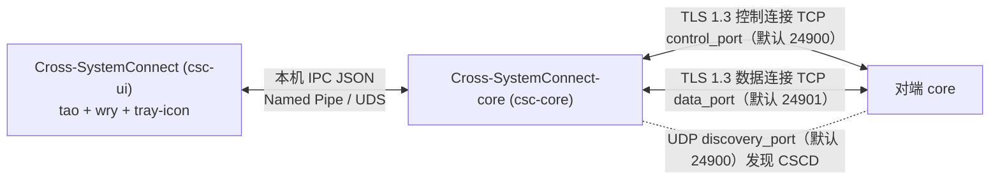

- UI 技术栈：tao（窗口）+ wry（WebView2 / WebKitGTK）+ tray-icon；Clash 风格 HTML 静态资源内嵌；前端以 `invoke` 风格桥接到 Rust 再转发 IPC。不监听本机 HTTP 端口，不打开系统浏览器（只有用户点击「打开下载页」时用默认浏览器打开白名单域名）。WebView 加固见 §14.1。
- UI 启动时若 IPC 连不上则拉起同目录下的 core 再重试；已有 core 运行则直接连接。
- 三个网络端口（控制 TCP、数据 TCP、发现 UDP）都可在设置页「网络」中修改，规则见 §10.1.1。

## 2. core 分层

```
┌──────────────────────────────────────────────────────────┐
│ IPC 服务（本机 JSON API，请求/响应 + 订阅推送）              │
├──────────────────────────────────────────────────────────┤
│ 核心层：切换 │ 配对 │ 剪贴板/共享剪贴板 │ 文件传输 │ 中转 │ 进度 │
├──────────────────────────────────────────────────────────┤
│ 网络层（Tokio）：发现 │ 会话 │ 控制连接 │ 数据连接 │ 链路监督     │
├──────────────────────────────────────────────────────────┤
│ 平台抽象层（trait + 函数）                                    │
│ 输入捕获/注入 原始位移 焦点 会话事件 剪贴板(含延迟渲染)          │
│ 显示器 网卡 通知（vdrag 接口保留但不使用，见 §4.6）              │
├──────────────────┬───────────────────┬───────────────────┤
│ Windows          │ Linux X11         │ Linux Wayland      │
│ LL 钩子/Raw Input │ XGrab/XI2         │ InputCapture+libei │
│ SendInput/OLE    │ XTest/XDND/XFixes │ RemoteDesktop+libei│
│ WTS/WinEvent     │ logind/_NET_*     │ Shell 扩展/portal  │
└──────────────────┴───────────────────┴───────────────────┘
```

core 业务不直接调用平台 API（少数差异用 `cfg!(windows)`）。

## 3. 进程与线程

**core**
- Tokio 多线程 runtime：每个对端的控制读/写任务、数据读/写任务；发现；IPC；传输引擎；中转转发。
- 到边检测**事件驱动**：由鼠标钩子 / XI2 / InputCapture 指针屏障事件触发，指针不动时没有任何定时唤醒（v1.1 的 8 ms 定时器已删除，满足 T-IDLE-1 的唤醒 < 20 次/s）。
- OS 线程：输入钩子（Windows 消息循环 / X11 连接 / Wayland libei 事件循环）、原始位移、剪贴板（事件驱动）、焦点与会话事件、注入线程（被控端）。
- 键鼠事件从钩子线程经有界通道（容量 1024）直接交给控制写任务，不经过定时器。

**ui**
- UI 线程：托盘（绿点，§12.18）、设置窗、进度窗、配对窗。
- IPC 订阅：接收 core 推送的 `status`、`transfers`、`pairing` 事件，不轮询。

**单实例**
- Windows：命名互斥体 `Local\Cross-SystemConnect-core`；管道首实例 `FILE_FLAG_FIRST_PIPE_INSTANCE`。
- Linux：`flock(LOCK_EX|LOCK_NB)` 锁 `$XDG_RUNTIME_DIR/cross-systemconnect-core.lock`（无该变量时 `/tmp/cross-systemconnect-$UID/`，目录 0700），拿到锁后删除残留 socket 再 bind。
- 拿不到锁的 core 直接退出，不占用控制/数据/发现端口。

## 4. 数据流

### 4.1 输入管线（主机 → 被控端）

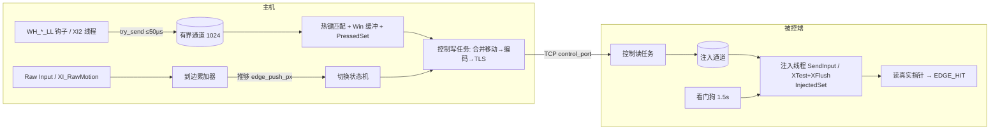

- 钩子回调只做：转 HID Usage → 判断是否吞掉 → `try_send`。保证 < 50 µs（Windows `LowLevelHooksTimeout`）。
- 写任务合并连续 `MOUSE_MOVE`（dx/dy 求和），不合并按键/按钮，顺序不变。
- 位移语义（主机加速后的逻辑像素、按 DPI 换算、每对端速度系数）、滚轮单位（1/120 格）、按键连发策略见 §12.16。

### 4.2 切换流程

1. 主机光标到达有邻居的外露边（按单块显示器计算），继续往外推过 `edge_push_px` 原始位移；沿边滑动或回移清零。无原始位移时退回碰边即切。没有对角邻居时角是死区。检测由指针事件驱动（Wayland 由 InputCapture 指针屏障激活后累计位移，§13.2）。
2. 对端 `HELLO.monitors` 非空且尺寸有效、对端已摆进布局、未处于暂停共享（§12.18）才切换。
3. 剪贴板只比较廉价序号（Windows `GetClipboardSequenceNumber`、XFixes 计数、portal/扩展变化信号），**不在切换路径上读剪贴板内容**：序号变化时由剪贴板线程异步读取（超时 100 ms），读到后立即发 `CLIP_OFFER`。切换不等待。在该 `CLIP_OFFER` 发出前，主机暂缓转发目标端的粘贴键（`Ctrl+V`、`Shift+Insert`，最多 100 ms），保证"复制后立即切屏粘贴"拿到新内容。
4. 发 `SWITCH_ENTER{edge, position_pct, locks, carry}`：`position_pct` 按多段边规则计算（§12.16.3），`carry` 为推够阈值后多出的位移（逻辑像素），对端进入后继续移动这段距离，不丢位移。锁定键同步 §12.4；切换辅助见 §12.6。
5. 主机开启抓取并**隐藏本机光标**（§12.16.2）；物理位移和按键经控制连接发给对端。
6. 被控端每次注入移动后读真实指针，压在外侧边并推够 `edge_push_px` 时：先刷新本机剪贴板（序号变化则先发 `CLIP_OFFER`，最多等 100 ms），再发 `EDGE_HIT{edge, position_pct, carry, dragging:false, corner}`（`dragging` 字段保留但恒为 `false`，跨屏拖拽已移除，见 §4.6）；主机回到本机（在映射位置显示光标）或跳到下一台。被控端失去活动状态后隐藏其光标。
7. 离开前主机补发 `PressedSet` 中的抬起并发 `INPUT_RESET`，再 `SWITCH_LEAVE`。

### 4.3 剪贴板

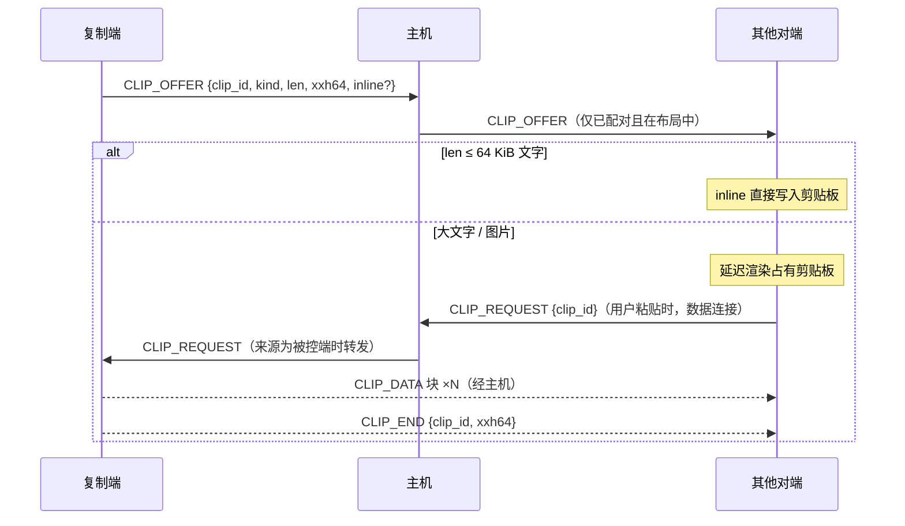

- 变化检测**事件驱动**：Windows `AddClipboardFormatListener`（`WM_CLIPBOARDUPDATE`）；X11 `XFixesSelectSelectionInput`（所有者变化事件）；Wayland 被控端用 RemoteDesktop portal 的 Clipboard 接口 `SelectionOwnerChanged` 信号，主机用 GNOME Shell 扩展转发的 `Meta.Selection owner-changed`（§13.5）。不再 400 ms 轮询。设置对端内容后记录序号，抑制回环。
- 发送时机 `clipboard.push_mode`：`immediate`（默认，变化后立即发 `CLIP_OFFER` 给 `share_scope` 内的对端）或 `on_switch`（只在切到某台电脑、或从某台电脑离开时才把当前剪贴板发给该电脑；没去过的电脑收不到，减少泄露面）。两种模式下切换与离开前都会刷新（§4.2 第 3、6 步）。
- 暂停共享（§12.18）期间不发送也不接受 `CLIP_OFFER`。
- X11 上 XFixes 不可用时不同步图片。
- 带密码管理器标记（Windows `ExcludeClipboardContentFromMonitorProcessing` / `CanIncludeInClipboardHistory=0`，X11 `x-kde-passwordManagerHint=secret`）不同步。
- 延迟渲染：Windows `SetClipboardData(fmt, NULL)` + `WM_RENDERFORMAT` 同步拉取，3 s 超时返回空并通知；X11 成为 `CLIPBOARD` 所有者，`SelectionRequest` 时拉取，大数据用 `INCR`。
- 文件复制：只发条目清单 `CLIP_OFFER{files}`，主机记录 `LastFileCopy`，不写任何电脑的剪贴板。

### 4.4 文件粘贴（存到文件管理器当前目录）

**原则**：在目标电脑的文件管理器窗口或桌面粘贴时，文件存到**该窗口当前显示的目录**（桌面即桌面目录）；只有拿不到当前目录时才存到**兜底保存目录**（§7.3）。

**失效规则**：`LastFileCopy` 在任何电脑有新复制、来源断开、超过 `clipboard.files_ttl_min`（默认 30）分钟、或暂停共享时失效。

**Windows 目标（按键拦截 + `IShellWindows`）**
1. 主机知道 `Ctrl+V` 按在哪台电脑上，以及该电脑焦点是否是文件目标（本机直接查询，被控端 `FOCUS_INFO` 上报）。
2. `should_intercept_paste`：存在有效 `LastFileCopy` 且 origin ≠ 按键电脑、按键电脑是 Windows、焦点是文件目标 → 吞掉 `Ctrl+V` 并发起传输；否则交给系统。
3. 目标电脑在收到粘贴请求的瞬间解析当前目录：前台窗口类名为 `CabinetWClass`/`ExploreWClass` 时，用 `IShellWindows` 枚举外壳窗口，找到 `HWND` 与前台窗口（或其标签页宿主）相同的 `IWebBrowser2`，经 `IServiceProvider → IShellBrowser → IShellView → IFolderView::GetFolder → IPersistFolder2` 取 PIDL 并转文件系统路径；前台为 `Progman`/`WorkerW` 时取 `FOLDERID_Desktop`。虚拟位置（“此电脑”、库、网络位置、压缩包内）拿不到文件系统路径 → 兜底保存目录，并在进度窗标注“当前位置不是普通文件夹，已存到兜底目录”。
4. 文件在主机 → 主机直接 `FILE_OFFER{dest_hint:"current_folder"}`；在被控端 → 主机发 `PASTE_REQUEST{to, offer_token}`，目标为另一被控端时经主机中转（§4.7）。同一批同一目标 3 s 内只算一次。
5. 右键菜单「粘贴」在 Windows 上不触发传输（用托盘「粘贴其他电脑复制的文件到这里」，存到兜底目录）；用 `CFSTR_FILEDESCRIPTOR`/`FILECONTENTS` 虚拟文件剪贴板支持右键粘贴列为后续选项（TBD）。

**Linux 目标（X11 与 Wayland 相同：剪贴板占位 + inotify，不拦截按键）**
1. 目标电脑本地判断"焦点是文件管理器或桌面"（X11 `_NET_ACTIVE_WINDOW` + `WM_CLASS`；Wayland 由 Shell 扩展上报 `wm_class`/`app_id`，§13.4），且存在其他电脑的有效 `LastFileCopy`（主机经 `CLIP_OFFER{kind:"files"}` 转发条目清单到当前活动或本地焦点电脑；`push_mode=on_switch` 时在切入时转发）。
2. 条件成立时 core 接管本机 `CLIPBOARD`，提供：`x-special/gnome-copied-files`（`copy\nfile:///…`）、`text/uri-list`，指向 `$XDG_RUNTIME_DIR/csc-paste/<paste_id>/<原名>` 的**占位**（文件内容为 32 字节随机令牌 + 魔数；文件夹为空目录内含 `.csc-paste-<paste_id>` 令牌文件）；同时**代理原剪贴板的文字类格式**（接管前读出的 `text/plain`、`UTF8_STRING`、`text/html`，≤ `max_inline_mb`），因此在重命名框、搜索框粘贴仍得到原来的文字。原剪贴板中的图片与其他格式在接管期间不可用（已知限制）。
3. 焦点离开文件管理器/桌面 → 立即把原剪贴板内容放回（重新成为所有者并提供原格式），不留痕迹。
4. 用户按 `Ctrl+V` **或右键「粘贴」**：文件管理器自己把占位复制到当前目录。core 用 inotify 监听：桌面、家目录一层、XDG 用户目录、用户可写挂载点（`/media/$USER/*`、`/run/media/$USER/*`、`/mnt/*`），以及（Wayland 下扩展上报的）窗口标题提示目录；3 s 未命中做一次 ≤ 2 s 有界遍历（深度 ≤ 4，跳过 `.git`/`node_modules`/`.cache`/回收站/隐藏目录），总超时 20 s → `no_target_dir`。
5. 命中后校验（§14.6）：令牌内容一致、inode 在粘贴后新建、属主为当前 uid、路径无符号链接。通过后该目录即目标目录：发 `PASTE_LOCATED{paste_id, ok}` 给主机，主机按 Windows 同样的流程发起传输（`dest_hint:"located"`）；接收端写入临时文件后 `renameat` 覆盖占位副本。
6. 同一 `paste_id` 在不同目录各命中一次视为多次粘贴，各自传输；同一目录 3 s 内去重。传输失败或取消时删除目标目录里的占位副本（先按第 5 步校验确认是自己的占位）。
7. Linux 上不再对根窗口 `XGrabKey(Ctrl+V)`（v1.1 的做法已删除；Wayland 下也不可行）。

**托盘**：「粘贴其他电脑复制的文件到这里」→ `paste_remote_files`，存到兜底保存目录。

文件目标判定（类名白名单，可用 `clipboard.paste_targets.*` 追加）：
- Windows 前台窗口类名 ∈ {`CabinetWClass`, `ExploreWClass`, `Progman`, `WorkerW`}。
- Linux `WM_CLASS` / Wayland `app_id` ∈ {`dde-file-manager`, `dde-desktop`, `org.gnome.Nautilus`, `nemo`, `caja`, `Thunar`, `dolphin`, `org.kde.dolphin`, `pcmanfm`, `pcmanfm-qt`, `xfdesktop`} ∪ **Ubuntu 桌面（Desktop Icons NG 扩展）的窗口标识（实测前 TBD；扩展也可按窗口所属进程为 DING 判定）**。

### 4.5 文件传输

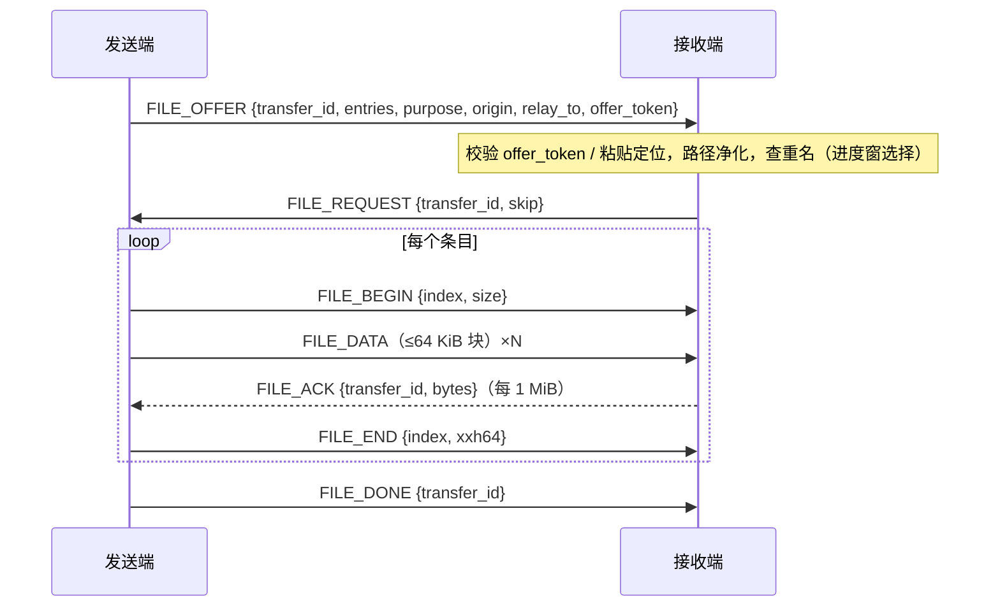

- 流控：发送端未确认超过 8 MiB 暂停。
- 替换：先写临时文件，xxHash64 校验通过后覆盖。
- 进度窗只在接收端，完成条目保留 30 s。

### 4.6 跨屏拖拽（已移除）

跨屏文件拖拽**已取消**。电脑之间传文件只用复制粘贴（§4.4：`Ctrl+C` / `Ctrl+V`，以及托盘「粘贴其他电脑复制的文件到这里」）。不实现边缘细窗、边缘投放窗、虚拟拖放源、承接窗等。

以下符号与编号**保留但不使用**（不发送、不响应、不实现行为）：

| 类别 | 保留项 |
|---|---|
| 能力位 | `CAP_VIRTUAL_DRAG=1`（可置位以兼容旧对端识别，但本端忽略；缺位无退化行为） |
| 协议消息 | `DRAG_BEGIN`(0x40)、`DRAG_CANCEL`(0x41)、`DRAG_RETARGET`(0x42) |
| `EDGE_HIT` | 字段 `dragging` 保留，发送端恒填 `false`，接收端忽略 |
| `FILE_OFFER` | `purpose` 不再使用 `"drag"`；`dest_hint` 不再使用 `"drop"` |
| IPC | `drag_enter`；状态字段 `drag_edge`（恒为不可见） |
| 平台 | `csc_platform::vdrag` 的 `DragDesc` / `DragEvent` / `supported` / `start` / `cancel` / `cleanup_stale` |

历史设计（Windows OLE 承接窗、Linux XDND/XDS、Wayland `wl_data_device`、`$XDG_RUNTIME_DIR/csc-drag/` 等）已废弃，勿再作为实现依据。

### 4.7 中转

- 被控端之间不直连。主机为每条中转建路由，改写 `transfer_id` 后按顺序转发，不落盘。
- 粘贴许可：主机发 `PASTE_REQUEST{to, offer_token}` 时登记（120 s、一次性）；源端 `FILE_OFFER{relay_to, offer_token}` 取用许可，否则拒绝。
- 流控端到端：目标端 `FILE_ACK` 由主机改写 id 后转给源端；每条中转在主机上的积压 ≤ 8 MiB + socket 缓冲。
- 任一方断开：路由和未完成传输清除，两端收到 `FILE_ERROR{code:"peer_lost"}`。

## 5. 平台实现

| 能力 | Windows | Linux X11 | Linux Wayland（GNOME 46+，§13） |
|---|---|---|---|
| 本机态到边 | 鼠标钩子事件 + Raw Input（`RIDEV_INPUTSINK`）原始位移，事件驱动 | XI2 `XI_Motion` + `XI_RawMotion`（运行时加载 `libXi.so.6`），事件驱动 | InputCapture portal 指针屏障（每条有邻居的外露边一条），激活后经 libei 累计位移 |
| 抓取（远端态） | `WH_MOUSE_LL` / `WH_KEYBOARD_LL` 钩子线程；看门狗：2 s 内 `GetLastInputInfo` 变化而钩子无回调、或 `WTS_SESSION_UNLOCK` 时重装 | `XGrabPointer` / `XGrabKeyboard` | InputCapture `Enable` 后所有输入经 libei（`reis` crate）送到 core；`Release` 时给出光标回落位置 |
| 注入 | `SendInput` 绝对坐标（`MOUSEEVENTF_ABSOLUTE|MOUSEEVENTF_VIRTUALDESK`）；前台隐藏/限制光标时改相对移动并暂停边缘离开；按键用扫描码 | 运行时打开 `libX11.so.6`、`libXtst.so.6`，XTest + `XFlush`；缺库时进程仍能启动 | RemoteDesktop portal（`SelectDevices` 键盘+指针，`persist_mode=2` 保存授权）+ `ConnectToEIS`，经 libei 注入；绝对定位是否可用以实测为准（TBD），不可用时用相对移动 + 本地指针位置估算 |
| 光标隐藏（§12.16.2） | `SetSystemCursor` 换透明光标，返回/退出/崩溃时恢复（UI 监护在 core 异常退出后调用 `SPI_SETCURSORS`） | `XFixesHideCursor(root)` / `XFixesShowCursor` | 远端态由合成器在捕获期间处理（是否隐藏以实测为准，TBD）；被控端闲置隐藏经 Shell 扩展 `SetCursorVisible`（TBD 实测） |
| 显示器 | `EnumDisplayMonitors`；`WM_DISPLAYCHANGE`/`WM_DPICHANGED`；manifest `PerMonitorV2` | RandR `XRRGetMonitors`；`RRScreenChangeNotify` | InputCapture `GetZones`/`ZonesChanged`（主机）；被控端由 Shell 扩展提供显示器矩形与缩放（`Meta.MonitorManager`） |
| 焦点 / 文件管理器识别 | `SetWinEventHook(EVENT_SYSTEM_FOREGROUND)` + 窗口类名；当前目录 `IShellWindows`（§4.4） | 根窗口 `_NET_ACTIVE_WINDOW` `PropertyNotify` + `WM_CLASS` | Shell 扩展 `FocusChanged{wm_class, app_id, title, fullscreen, pid}` 信号 |
| 会话事件 | `WTSRegisterSessionNotification` | logind `Session.Lock`、`org.freedesktop.ScreenSaver.ActiveChanged` | 同 X11（logind、`org.gnome.ScreenSaver.ActiveChanged`） |
| 锁屏 | `LockWorkStation` | 依次：Deepin `org.deepin.dde.LockFront1.Show`（旧 `com.deepin.dde.lockFront`）、GNOME、`org.freedesktop.ScreenSaver.Lock`、`loginctl lock-session`、`xdg-screensaver lock` | `org.gnome.ScreenSaver.Lock` → `loginctl lock-session` |
| 防闲置（§12.17） | 收到 `ACTIVITY` 时 `SendInput` 一次 0 位移鼠标事件（重置 `GetLastInputInfo`）+ `SetThreadExecutionState(ES_DISPLAY_REQUIRED)` | `XResetScreenSaver` + `org.freedesktop.ScreenSaver.SimulateUserActivity` | `org.gnome.SessionManager.Inhibit`（flag 8 idle）在活动期间持有，60 s 无 `ACTIVITY` 释放 |
| 剪贴板 | arboard + `AddClipboardFormatListener` + 延迟渲染 | arboard + XFixes 事件 + 选择所有者/INCR | 被控端：RemoteDesktop portal Clipboard 接口（`SetSelection`/`SelectionRead`/`SelectionWrite`）；主机：同一接口（主机另开一个只用剪贴板的 RemoteDesktop 会话，可行性 TBD）+ Shell 扩展变化通知（§13.5） |
| 文件粘贴（§4.4） | 拦截 `Ctrl+V` + `IShellWindows` 当前目录 | 剪贴板占位 + inotify | 剪贴板占位 + inotify |
| 跨屏拖拽源 | 已移除（§4.6）；`vdrag` / OLE / XDND / `wl_data_device` 接口保留不用 | 同左 | 同左 |
| 本机态热键 | 钩子内匹配 | XI2 键盘事件匹配（只观察不抓取）；远端态在抓取流中匹配 | GlobalShortcuts portal（GNOME 48+ 是否可用以实测为准，TBD）；不可用时由 Shell 扩展 `Main.wm.addKeybinding` 注册并经 D-Bus 通知；远端态在 libei 捕获流中匹配 |
| 滚轮注入 | `MOUSEEVENTF_WHEEL/HWHEEL` 直接传 1/120 单位 | 累加到 ±120 再注入按钮 4/5/6/7（XTest 无平滑滚动） | libei `scroll_discrete`（120 基）+ `scroll_delta`，支持高精度 |
| 自启 | 启动 `Cross-SystemConnect --background`（托盘后台运行并监护 core，§12.12）：`HKCU\Software\Microsoft\Windows\CurrentVersion\Run`；“管理员权限”选项用计划任务 `/RL HIGHEST /SC ONLOGON`（§14.3） | `~/.config/autostart/cross-systemconnect.desktop`（`Exec=… --background`）；可选 `systemd --user` 单元只运行 core；无 `DISPLAY` 时每 1 s 重试，最多 60 s | 同 X11（检查 `WAYLAND_DISPLAY`）；Shell 扩展随包安装并在首次运行时提示启用（§13.4） |
| 电源事件 | `WM_POWERBROADCAST`、`WM_QUERYENDSESSION` | logind `PrepareForSleep`、`PrepareForShutdown` | 同 X11 |
| 安全桌面检测 | `OpenInputDesktop` 桌面名 | 不适用（X11 锁屏可注入） | GNOME 锁屏期间 libei 注入是否被合成器拦截以实测为准（TBD）；上报 `locked` |
| 通知 | WinRT Toast | D-Bus `org.freedesktop.Notifications` | 同 X11 |
| 全屏检测 | `SHQueryUserNotificationState` + 窗口矩形 | `_NET_WM_STATE_FULLSCREEN` | Shell 扩展 `FocusChanged.fullscreen`（`Meta.Window.is_fullscreen()`） |
| 托盘绿点（§12.18） | tray-icon 角标绘点 | ksni `icon_pixmap` 绘点 | 同左（不依赖 Shell 顶栏指示） |
| 会话判定 | — | `XDG_SESSION_TYPE=x11` | `XDG_SESSION_TYPE=wayland`；桌面为 GNOME 时走本列；其他合成器见 §13.7（不满足时状态 `unsupported_session`） |

### 5.1 平台接口（Rust）

```rust
/// dx/dy：主机系统指针加速后的位移，单位为主机当前显示器的逻辑像素（物理像素 ÷ 缩放），f32 保留小数（§12.16.1）
/// wheel_v/wheel_h：1/120 格为单位的高精度滚动量（§12.16.4）
pub struct MouseEvent { pub dx: f32, pub dy: f32, pub buttons: u32, pub wheel_v: i32, pub wheel_h: i32 }
/// repeat=true 的系统自动连发按下在主机侧丢弃，不上线（§12.16.5）
pub struct KeyEvent { pub hid_usage: u32, pub down: bool, pub repeat: bool, pub modifiers: u32 }
pub enum Captured { Mouse(MouseEvent), Key(KeyEvent) }

pub trait InputCapture: Send {
    fn start(&mut self, sink: crossbeam_channel::Sender<Captured>) -> anyhow::Result<()>;
    fn set_grab(&mut self, grab: bool, park: Option<(i32, i32)>);
    fn stop(&mut self);
}
pub trait RawMotion: Send { fn start(&mut self, sink: crossbeam_channel::Sender<(i32, i32)>) -> anyhow::Result<()>; }
pub trait InputInjector: Send {
    fn mouse_move_abs(&mut self, x: i32, y: i32);
    fn mouse_move_rel(&mut self, dx: i32, dy: i32);
    fn mouse_button(&mut self, button: u32, down: bool);
    fn mouse_wheel(&mut self, v: i32, h: i32);
    fn key(&mut self, hid_usage: u32, down: bool);
}

#[derive(Serialize, Deserialize, Clone, Copy)] pub struct Rect { pub x: i32, pub y: i32, pub w: i32, pub h: i32 }
#[derive(Serialize, Deserialize, Clone)] pub struct Monitor { pub id: u32, pub rect: Rect, pub scale: f32, pub primary: bool }
pub trait ScreenInfo: Send {
    fn monitors(&self) -> Vec<Monitor>;
    fn watch(&mut self, sink: crossbeam_channel::Sender<Vec<Monitor>>) -> anyhow::Result<()>;
}
pub enum Side { Left, Right, Top, Bottom }
pub fn outer_edges(mons: &[Monitor], side: Side) -> Vec<(i32, i32, i32)>; // (from, to, coord)

pub trait FocusWatch: Send { fn start(&mut self, sink: crossbeam_channel::Sender<FocusInfo>) -> anyhow::Result<()>; }
pub struct FocusInfo { pub file_target: bool, pub class: String, pub fullscreen: bool,
                       pub folder: Option<PathBuf> /* Windows 由 IShellWindows 按需解析；Linux 为 None */ }
pub trait CursorControl: Send { fn set_visible(&mut self, visible: bool); fn restore_all(&mut self); }
pub trait IdleControl: Send { fn activity(&mut self); fn release(&mut self); }   // §12.17
pub trait PasteTarget: Send {                                                       // §4.4
    fn current_folder(&self) -> Option<PathBuf>;            // Windows IShellWindows
    fn offer_placeholders(&mut self, id: u64, names: &[String]) -> anyhow::Result<()>; // Linux 剪贴板占位
    fn restore_clipboard(&mut self);
}
pub trait SessionEvents: Send { fn start(&mut self, sink: crossbeam_channel::Sender<SessionEvent>) -> anyhow::Result<()>; }
pub enum SessionEvent { Locked, Unlocked, Suspend, Resume }

pub trait Clipboard: Send { /* watch / get_text / set_text / files … */ }
pub trait LazyClipboard: Send {
    fn offer_lazy(&mut self, kind: ClipKind, len: u64,
                  fetch: Box<dyn Fn() -> anyhow::Result<Vec<u8>> + Send + Sync>) -> anyhow::Result<()>;
}
pub trait AutoStart: Send { fn is_enabled(&self) -> bool; fn set_enabled(&mut self, on: bool, elevated: bool) -> anyhow::Result<()>; }

// 虚拟文件拖拽源 csc_platform::vdrag —— 保留符号，跨屏拖拽已移除，实现为空/恒 false（§4.6）
pub fn supported() -> bool; // 恒 false
pub fn start(desc: DragDesc, events: std::sync::mpsc::Sender<DragEvent>) -> bool; // 恒 false，不启动
pub fn cancel(id: u64); // no-op
pub fn cleanup_stale(); // no-op（不再创建 csc-drag/）
pub enum DragEvent { /* 保留变体，不会发出 */ Staged{id:u64}, Folder{id:u64, dir:PathBuf},
                     InPlace{id:u64, tops:Vec<PathBuf>}, StreamDelivered{id:u64},
                     Lost{id:u64}, Cancelled{id:u64, reason:String} }
```

键码线上格式统一为 **USB HID Usage**。原 `DragDrop` trait 与跨屏拖拽路径均已不使用。

## 6. 核心状态与数据结构

```rust
#[derive(Default)] pub struct PressedSet { keys: BTreeSet<u32>, buttons: u32 }
impl PressedSet {
    pub fn on_event(&mut self, ev: &Captured);
    pub fn contains_key(&self, hid: u32) -> bool;
    pub fn release_events(&mut self) -> Vec<Captured>;
}
pub struct ControlledWatchdog { last_rx: Instant, timeout: Duration } // 1500 ms

pub struct HotkeyMatcher { combos: Vec<Hotkey>, win_buf: WinBufState, since: Option<Instant> }
pub enum WinBufState { Idle, WinHeld, Passthrough }
pub enum MatchOut { Forward(Vec<KeyEvent>), Swallow, Action(HotkeyAction, Vec<u32>) }

pub struct LastFileCopy { pub origin: Uuid, pub entries: Vec<EntryMeta>, pub seq: u64, pub at: Instant }
/// 仅 Windows 目标返回 true；Linux 目标走剪贴板占位，不拦截按键（§4.4）
pub fn should_intercept_paste(last: Option<&LastFileCopy>, at: Uuid, at_os: TargetOs, focus: &FocusInfo) -> bool;

/// 安全检查：只拒绝会逃出目标目录的路径
pub enum PathReject { Empty, DotDot, Absolute, DriveOrUnc, TooLong /*全路径 > 32 KiB*/, Symlink }
pub fn sanitize_rel(base: &Path, rel: &str) -> Result<PathBuf, PathReject>;
/// 名字适配：把对目标系统非法但无害的名字改成合法名字（§12.8），返回新名与是否改动
pub enum TargetOs { Windows, Linux }
pub fn adapt_name(component: &str, os: TargetOs) -> (String, bool);
```

## 7. 配置

### 7.1 位置

- Windows：`%APPDATA%\Cross-SystemConnect\config.json`（兼容迁移旧 `%APPDATA%\CSC\`）
- Linux：`~/.config/cross-systemconnect/config.json`
- 本机证书与身份：配置目录 `identity.crt`、`identity.key`（Ed25519，私钥不要拷到别的电脑；v1.x 的证书若不是 Ed25519，迁移时重新生成）；`device_id` 存于 config。私钥文件权限：Linux 以 `0600` 创建、启动时检查（组/其他可读则改回 0600 并记警告）；Windows 设受保护 DACL，仅当前用户与 SYSTEM。可选 `identity.key_store=os`：Windows 用 DPAPI（用户范围 `CryptProtectData`）加密为 `identity.key.dpapi`，Linux 存入 Secret Service（libsecret，GNOME 密钥环），密钥环不可用时退回文件并提示（§14.4）。
- Wayland portal 授权令牌：配置目录 `portal-tokens.json`（0600），保存 RemoteDesktop / InputCapture 的 restore token（§13.3）。
- 日志：core 默认程序目录 `log.txt`，不可写时 `%APPDATA%\Cross-SystemConnect\Cross-SystemConnect.log` / `~/.local/state/cross-systemconnect/Cross-SystemConnect.log`；ui 为配置目录 `ui.log`。单文件 1 MB 转存 `*.1`。

### 7.2 字段

| 字段 | 默认 | 说明 |
|---|---|---|
| `config_version` | 5 | 无字段按 1；<2 文字上限改 15；<4 打开写日志、级别 info；<5 见 §7.4 |
| `name` | 本机计算机名 | 仅显示；修改不影响系统计算机名 |
| `device_id` | 首次运行生成 UUID v4 | 身份标识 |
| `role` | 首次运行向导选择；无界面首次运行为 `client` | `server` / `client` |
| `trusted_peers[]` | 空 | `{device_id, fingerprint(SHA-256 hex), name, paired_at, last_endpoint:{ip, control_port, data_port}, pointer_speed}`；`last_endpoint` 用于断线后按退避直接重拨，每次会话建立时按对端 `HELLO` 更新；`pointer_speed` 为该对端的指针速度系数，默认 1.0，范围 0.25–4.0（§12.16.1） |
| `layout` | 空 | 主机首页摆放结果，按 device_id 引用对端（名字仅显示）；**新配对的电脑不自动加入**，在画布“未摆放”区等待用户拖入；不在布局中的电脑不能切换、不收剪贴板 |
| `network.interface` | 空 | 选中网卡（`list_interfaces` 的 `id`）；发现只扫描该网卡所在 /24。空 = 只在地址为私有/链路本地的网卡上监听与发现（§14.5），并在首页提示选择网卡 |
| `network.listen_private_only` | true | 只在私有（RFC 1918、`fc00::/7`）与链路本地（`169.254/16`、`fe80::/10`）地址上监听；关闭需在配置文件中修改 |
| `network.trusted_wifi` | `[]` | `auto` 模式下允许使用的 Wi-Fi SSID（Linux 经 NetworkManager 读取 SSID）；Windows 另排除网络类别为“公用”的网卡（§12.11） |
| `network.control_port` | 24900 | 控制连接 TCP 监听端口，1024–65535 |
| `network.data_port` | 24901 | 数据连接 TCP 监听端口，1024–65535，**必须 ≠ `control_port`** |
| `network.discovery_port` | 24900 | 发现 UDP 端口，1024–65535；**所有电脑必须相同**；可与 `control_port` 数值相同（UDP 与 TCP 端口空间独立） |
| `network.heartbeat_active_ms` / `heartbeat_idle_ms` | 250 / 2000 | 超时分别 1500 / 10000 ms |
| `switch.edge_push_px` | 8 | 0–200 |
| `clipboard.max_inline_mb` | 15 | 1–15 |
| `clipboard.image` | true | |
| `clipboard.files` | true | |
| `clipboard.share_scope` | `layout` | 只发给已配对且在布局中的对端 |
| `clipboard.files_ttl_min` | 30 | 文件记录有效期 |
| `clipboard.paste_targets.windows` / `.linux` | 空 | 追加文件目标窗口类名 |
| `file_transfer.receive_dir` | 空 | **兜底保存目录**（仅配置文件）：拿不到文件管理器当前目录、托盘粘贴时使用；空=桌面 → 下载目录 → 配置目录 `received` |
| `hotkeys.return_to_server` | `Ctrl+Alt+/` | 旧值 `Ctrl+Alt+Home` 或空，读写时替换 |
| `hotkeys.lock_screen` | `Ctrl+Alt+Shift+L` | 旧值 `ScrollLock`、`Win+L`（v1.1 默认）、`Ctrl+Alt+L` 或空，迁移时替换一次（§7.4）；避开 JetBrains 等 IDE 的 `Ctrl+Alt+L` |
| `hotkeys.emergency_pause` | `Ctrl+Alt+Shift+P` | 被控端**本地键盘**按下时暂停被控（§12.18）；主机不转发这个组合 |
| `log.to_file` / `log.level` / `log.file` / `log.max_kb` | true / `info` / 空 / 1024 | 旧字段 `log_level` 同步保存 |
| `autostart.enabled` / `autostart.elevated` | true（向导完成时写入；无界面首次运行为 false）/ false | `elevated` 仅 Windows（安全约束见 §14.3）；自启目标为 `Cross-SystemConnect --background` |
| `keyboard.sync_locks` | true | 锁定键同步（§12.4） |
| `keyboard.remap` | `[]` | `[{from, to}]` HID Usage 重映射（§12.3） |
| `switch.block_modifier` | `none` | `none`/`ctrl`/`shift`/`alt`（§12.6） |
| `switch.block_when_fullscreen` | true | 前台全屏时不按边缘切换 |
| `switch.corner_dead_px` | 10 | 角落死区，0–100 |
| `hotkeys.lock_to_screen` | `Ctrl+Alt+Shift+K` | 锁定在当前屏幕开关（状态不持久化）；避开 IDE 的 `Ctrl+Alt+K` |
| `clipboard.rich` | true | 同步 HTML/RTF（§12.7） |
| `file_transfer.preserve_mtime` | true | 保留修改时间（§12.8） |
| `file_transfer.preserve_mode` | true | Linux → Linux 保留权限位 |
| `file_transfer.resume_window_min` | 30 | 断点续传保留时间，0 表示不续传 |
| `file_transfer.max_parallel` | 2 | 每个对端同时进行的传输数 |
| `notify.connect` / `notify.disconnect` / `notify.transfer` / `notify.errors` | false / true / true / true | 系统通知（§12.9） |
| `ui.language` | `auto` | `auto`/`zh-CN`/`en-US`（§12.10） |
| `network.manual_peers` | `[]` | `[{address, control_port?}]`（§12.11） |
| `network.interface_mode` | `fixed` | `fixed`/`auto` |
| `network.ipv6` | true | 双栈监听 |
| `update.check_on_start` | false | 启动时检查更新（§12.5） |
| `update.url` | TBD | 更新信息地址 |
| `limits.rss_warn_mb` / `limits.rss_restart_mb` | 200 / 500 | 内存自检（§12.12） |
| `diagnostics.bench_enabled` | false | 测量模式（§12.15） |
| `clipboard.push_mode` | `immediate` | `immediate` / `on_switch`（§4.3） |
| `pointer.match_physical_speed` | true | 按两端显示器缩放换算位移，使指针物理速度一致（§12.16.1） |
| `pointer.hide_host_cursor` | true | 控制远端时隐藏主机光标（§12.16.2） |
| `pointer.hide_inactive_cursor` | true | 被控端不是活动屏幕时隐藏其光标，本地鼠标一动即显示 |
| `power.keep_peers_awake` | true | 用户在任一电脑活动时让布局中的其他电脑不熄屏、不因闲置锁屏（§12.17） |
| `pairing.open_window_s` | 120 | 「允许新配对」开启时长，30–600 秒（§10.4） |
| `identity.key_store` | `file` | `file` / `os`（DPAPI / Secret Service，§14.4） |
| `file_transfer.mark_of_web` | true | Windows 接收的文件写 `Zone.Identifier`（§12.8） |
| `file_transfer.strip_exec_on_desktop` | true | 存到桌面的文件去掉可执行位（§12.8） |
| （已移除）`ui.controlled_indicator` | — | 屏幕被控提示已取消；改用托盘绿点与 `status.beingControlled`（§12.18） |

已删除：`clipboard.max_total_mb`、`hotkeys.toggle_enable`、`peer_fingerprints`。

### 7.3 兜底保存目录

**兜底保存目录**：`receive_dir` 非空且可写 → 用它；否则桌面（Windows `FOLDERID_Desktop`，Linux `xdg-user-dir DESKTOP`）→ 下载目录 → 配置目录 `received`。设置页只读显示，不可编辑。正常粘贴存到文件管理器当前目录（§4.4），只有拿不到该位置或托盘粘贴时才用兜底目录。

### 7.4 迁移到 v5

- `peer_fingerprints`（按名字）删除，不迁移为可信，升级后重新配对。
- `hotkeys.lock_screen` 为 `Win+L`、`Ctrl+Alt+L`、`ScrollLock` 或空时替换为 `Ctrl+Alt+Shift+L`；`hotkeys.lock_to_screen` 为 `Ctrl+Alt+K` 时替换为 `Ctrl+Alt+Shift+K`（只一次，之后可手动改回）。
- 迁移后已有的 `trusted_peers` 都不在 `layout` 中时（v1.x 没有信任库，正常情况不会出现）保持原样，不自动摆放。
- 生成 `device_id`；`log` 加 `max_kb`；补齐新字段默认值（包括 §7.2 中 F17–F34 的全部字段；v0.2.0 尚未发布，这些字段并入 v5，不再单独升版本）。
- 缺 `network.discovery_port` 时取 `network.control_port` 的值（v1.x 的发现就在控制端口号上的 UDP）；缺 `network.data_port` 时取 24901。已有的端口值原样保留，**迁移不自动修正非法值**：若迁移后 `control_port == data_port` 或超出范围，core 进入 `config_invalid`（§10.1.1），由用户在设置页修正。

## 8. 本机 IPC

| 平台 | 端点 | 访问控制 |
|---|---|---|
| Windows | `\\.\pipe\Cross-SystemConnect-core` | 仅当前用户 SID 与 SYSTEM（SDDL `D:P(A;;GA;;;<UserSID>)(A;;GA;;;SY)`），`PIPE_REJECT_REMOTE_CLIENTS`；core 以管理员权限运行时追加强制完整性标签 `S:(ML;;NWNR;;;HI)`，只允许高完整性客户端连接（§14.3） |
| Linux | `$XDG_RUNTIME_DIR/cross-systemconnect-core.sock` | 文件 0600，目录 0700；连接时用 `SO_PEERCRED` 核对 uid 与 core 相同 |

帧：`u32 LE length` + UTF-8 JSON，单帧 ≤ 4 MiB。

请求 `{"id":1,"method":"get_status","params":{}}`；响应 `{"id":1,"ok":true,"result":{…}}` / `{"id":1,"ok":false,"error":"<code>","errors":[…]?}`；推送 `{"event":"status","data":{…}}`（无 id）。

### 8.1 方法

| 方法 | 参数 | 返回 / 说明 |
|---|---|---|
| `get_status` | — | `Status`（§8.2） |
| `subscribe` | `{topics:["status","transfers","pairing"]}` | 订阅推送；`status` 变化即推（合并 50 ms），`transfers` 限频 10 Hz，`pairing` 变化即推 |
| `get_config` / `save_config` | — / Config JSON | `save_config` 执行端口校验与路径白名单（§14.3）；端口不合法时整份配置不保存，返回 `{ok:false, error:"config_invalid", errors:[…]}` |
| `validate_network_ports` | `{control_port, data_port, discovery_port}` | 只校验不保存，返回 `{valid, errors:[{field, code, message}]}` |
| `set_network_ports` | `{control_port, data_port, discovery_port}` | 校验 → 保存 → 在线重新绑定并重连（§10.1.2）；失败不做任何改动 |
| `list_interfaces` | — | `[{id, name, kind:"ethernet"\|"wifi"\|"other", up, addrs:["192.168.100.1/24", …], private, public_network?, ssid?}]`；`private`=地址全部为私有/链路本地；`public_network`=Windows 网络类别为“公用” |
| `refresh_network` | — | 立即重建网络（重新绑定、发现一轮、按 `last_endpoint` 重拨），即 v1.1 的「刷新」 |
| `set_sharing_enabled` | `{enabled}` | 暂停/恢复共享（§12.18）；不持久化，重启后为开启 |
| `set_pairing_open` | `{enabled}` | 开启「允许新配对」`pairing.open_window_s` 秒，返回 `{open_until}`（Unix 毫秒）；`enabled:false` 立即关闭 |
| `pair_confirm` | `{device_id, accepted, code?}` | 配对窗「配对」/「取消」；**被控端**必须带用户输入的 `code`（6 位数字字符串），core 常数时间比较，错 3 次即拒绝（`pair_code_mismatch`） |
| `list_peers` / `forget_peer` | — / `{device_id}` | 已配对设备（`[PeerInfo]`，§8.2） |
| `set_peer_pointer_speed` | `{device_id, factor}` | 0.25–4.0，写入 `trusted_peers[].pointer_speed`，立即生效 |
| `drag_enter` | `{peer, paths}` | **保留未用**（跨屏拖拽已移除，§4.6）；调用返回错误或不做任何事 |
| `cancel_transfer` / `dismiss_transfer` | `{transfer_id}` | |
| `resolve_conflict` | `{transfer_id, decisions:[{index, choice}]}` | `skip`/`keep_both`/`replace` |
| `paste_remote_files` | — | 托盘「粘贴其他电脑复制的文件到这里」，存到兜底保存目录 |
| `get_save_dir` | — | 返回实际生效的兜底保存目录（只读） |
| `quit` | — | 托盘「退出」 |
| `set_lock_to_screen` | `{enabled}` | 锁定在当前屏幕（§12.6） |
| `add_manual_peer` / `remove_manual_peer` | `{address, control_port?}` / `{address}` | 手动对端（§12.11） |
| `export_diagnostics` | `{path, include_crash_dumps}` | 生成诊断包（§12.12）；`include_crash_dumps` 默认 false |
| `reset_data` | `{keep_pairing}` | 清除数据并退出（§12.14） |
| `bench_run` | `{kind:"latency"\|"throughput"\|"smallfiles", peer, samples?, size?, files?}` | 测量（§12.15），需两端开启测量模式 |
| `validate_hotkey` | `{combo}` | 返回 `{conflicts:[{kind:"internal"\|"system"\|"registered"\|"ide", detail}]}`（`ide` 为已知 IDE 快捷键，黄字提示，见[界面设计](界面设计.md) §5.2） |
| `set_hotkey_recording` | `{enabled}` | 录制热键期间暂停热键匹配与 Ctrl+V 拦截；IPC 断开时自动恢复 |
| `wayland_setup` | `{step:"remote_desktop"\|"input_capture"\|"clipboard"}` | 重新发起对应 portal 授权（弹系统对话框），返回 `{granted}`；只在 Wayland 会话有效（§13.3） |

> `check_update` **不是** core 方法：由 UI 进程本地执行（§12.5，core 从不联网）。v1.1《软件架构.md §4.1》中其余未列出的方法在 v2 中删除。

### 8.2 推送与数据结构

**`Status`**（`get_status` 返回值与 `status` 推送的 `data`，每次推送完整对象）：

```json
{
  "role": "server",                       // "server" | "client"
  "first_run": false,
  "name": "win-pc", "device_id": "uuid", "app_version": "0.2.1", "proto": 2,
  "platform": {
    "os": "windows",                      // "windows" | "linux"
    "session": "windows",                 // "windows" | "x11" | "wayland"
    "desktop": "",                        // XDG_CURRENT_DESKTOP，如 "ubuntu:GNOME"
    "supported": true,                    // false → unsupported_session
    "portals": { "input_capture": "granted", "remote_desktop": "granted", "clipboard": "granted", "global_shortcuts": "unavailable" },
                                          // 各值 "granted" | "needs_consent" | "denied" | "unavailable" | "n/a"
    "shell_extension": { "state": "enabled", "version": "1" }   // "n/a" | "missing" | "disabled" | "enabled" | "outdated"
  },
  "network": { "state": "listening", "control_port": 24900, "data_port": 24901, "discovery_port": 24900,
               "interface": "eth1", "listen_addrs": ["192.168.100.1"], "errors": [ { "field": "data_port", "code": "port_in_use", "message": "TCP 24901" } ] },
  "sharing_paused": false,                // 本机暂停共享（§12.18）
  "lock_to_screen": false,
  "pairing_open_until": null,             // Unix 毫秒或 null
  "active_screen": "self",                // "self" 或对端 device_id（主机）；被控端为 "self" | "remote"
  "beingControlled": false,               // 本机正在接受远端指针（SWITCH_ENTER 后）；托盘绿点闪烁依据
  "host_state": "connected",              // 仅被控端：no_host | connected | host_sleeping | host_lost | reconnecting
  "peers": [ PeerInfo ],
  "version_mismatch": [ { "device_id": "…", "name": "dev-box", "app_version": "1.1.0", "proto_min": 1, "proto_max": 1 } ],
  "drag_edge": { "visible": false, "side": "right", "rect": {"x":0,"y":0,"w":0,"h":0}, "peer": "uuid", "mode": "virtual" },
                                       // 保留字段；跨屏拖拽已移除，visible 恒为 false（§4.6）
  "last_file_copy": { "available": true, "origin_name": "linux-pc", "count": 3 },   // 托盘粘贴可用性
  "core_crashes_recent": 0
}
```

**`PeerInfo`**：

```json
{ "device_id": "uuid", "name": "linux-pc", "fingerprint_short": "3F9A1B2C…C21B",
  "connected": true, "address": "192.168.100.2", "app_version": "0.2.1",
  "state": "normal",                      // normal | locked | secure_desktop | suspending | shutting_down
  "in_layout": true, "layout_pos": "left",// left|right|top|bottom|top_left|top_right|bottom_left|bottom_right|null
  "paused_by_peer": false,                // 被控端按了紧急暂停或暂停共享
  "pointer_speed": 1.0, "session": "wayland" }
```

**`transfers` 推送**：`{ "items": [ Transfer ] }`，`Transfer`：

```json
{ "transfer_id": "u64 字符串", "direction": "in",          // 只在接收端推送 "in"；发送端 "out" 仅用于状态行
  "purpose": "paste",                                        // "paste" | "tray_paste"（"drag" 保留字面量但不使用）
  "from": { "device_id": "…", "name": "win-pc" },
  "dest": { "kind": "current_folder", "path": "C:\\Users\\xx\\Documents" },
                                       // kind: current_folder | located | fallback（"drop"/"explorer" 保留字面量但不使用）
  "state": "running",                  // waiting_location | awaiting_conflict | running | paused_link_lost | done | error | cancelled
  "files_total": 1000, "files_done": 120, "bytes_total": 1288490188, "bytes_done": 747324416,
  "speed_bps": 117440512, "eta_s": 5,
  "conflicts": [ { "index": 3, "name": "photo.jpg", "kind": "file" } ],
  "renamed": [ { "from": "report:v2.docx", "to": "report_v2.docx" } ],
  "resume_deadline": null,             // paused_link_lost 时为 Unix 毫秒
  "error": null,                       // { "code": "no_space", "need": 2254857830, "free": 1073741824 }
  "notes": [ "long_path" ] }           // long_path | fallback_virtual_location | marked_untrusted
```

**`pairing` 推送**：`{ "items": [ PairingItem ] }`，`PairingItem`：

```json
{ "device_id": "uuid", "peer_name": "linux-pc", "address": "192.168.100.2", "peer_role": "client",
  "state": "AwaitBoth",                // AwaitCommit | AwaitBoth | AwaitPeer | AwaitLocal | Paired | Rejected
  "mode": "display",                   // 本机角色决定：主机 "display"（显示配对码）| 被控端 "enter"（输入配对码）
  "sas": "482913",                     // 仅 mode=display 时下发；mode=enter 时为 null
  "attempts_left": 3,                  // mode=enter
  "fingerprint_changed": false,        // true：该 device_id 曾配对过但证书变了（显示红色警告）
  "expires_at": 1790000000000,
  "result": null }                     // Rejected 时：pair_rejected | pair_timeout | pair_code_mismatch | commit_mismatch | pairing_closed
```

字符串字段（名字、文件名、地址）在 core 侧已按 §14.2 清洗；UI 仍必须按纯文本渲染。

## 9. 安全模型

威胁与措施总表；加固细节见 §14。

| 威胁 | 措施 |
|---|---|
| 同网段冒充对端 / 陌生机器 | 只有两端都在「允许新配对」时间窗内才处理配对（其余时间拒绝，`pairing_closed`）；未配对只允许 `HELLO/HEARTBEAT/PAIR_*`；新设备配对后不自动进布局、不收剪贴板 |
| 中间人 | 承诺-揭示配对码（§10.4），防止中间人枚举 TLS 参数碰撞配对码；被控端须**输入**主机显示的码，不能只点确认；配对后按指纹钉住；指纹变化单独警告 |
| 社会工程（误点配对） | 默认不接受配对；被控端输码；配对窗明确写出“对方将能控制本机键盘鼠标” |
| 已配对主机被攻破 | **主机等于拥有全部被控端的键鼠**（固有风险）。缓解：托盘绿点被控闪烁（§12.18）、本地紧急暂停热键、移除设备、暂停共享；被控端只接受主机方向的消息（§14.7） |
| 已配对被控端被攻破 | 只能发被控端方向的消息（`bad_direction`）；能向主机推送剪贴板内容（可能被用于"粘贴劫持"）→ `push_mode`、暂停共享；文件只能在持有主机签发的一次性令牌时发出 |
| 剪贴板泄露 | 只发 `share_scope`（已配对且在布局中）；`push_mode=on_switch` 可选；大内容按需拉取；密码管理器标记不同步；暂停共享 |
| 未经请求的文件 / 路径穿越 / TOCTOU | `offer_token` / 粘贴定位；`sanitize_rel` 拒绝 `..`、绝对路径、盘符/UNC；`adapt_name` 改名；不跟随不创建符号链接；按目录句柄 `openat`/`renameat`；占位令牌校验（§14.6） |
| 收到的文件被直接执行 | Windows 写 Mark-of-the-Web；存到桌面的文件去掉可执行位；`.desktop` 文件不标记为可信（§12.8） |
| 断点续传被他人接续 | 续传前核对发送方认证身份与 `.csc-part.json` 的 `origin_device_id`（§12.8） |
| WebView 注入（对端名字、文件名、更新说明中的脚本） | 只用 textContent 渲染、严格 CSP、禁止导航、每个窗口的桥方法白名单、名字清洗与长度限制（§14.1、§14.2） |
| 本机越权 | IPC 仅当前用户（Linux 另核对 `SO_PEERCRED`）；拒绝远程管道客户端；管理员模式下管道要求高完整性 + 路径白名单（§14.3） |
| 私钥被读取 | 0600 / 受保护 DACL；可选 DPAPI / Secret Service（§14.4） |
| 资源耗尽 / 配对刷屏 | 帧长上限；未认证连接数与握手超时；按 IP 限速；配对窗队列上限（§14.5） |
| 暴露在公共网络 | 只在选中网卡或私有地址上监听；防火墙规则只开专用/域网络；`auto` 模式排除公用网络和不受信任的 Wi-Fi（§14.5、§12.11） |
| 降级 | 只启用 TLS 1.3；协议版本在 TLS 内协商；最低协议 2 |
| 日志与诊断泄露 | 任何级别不记录按键、剪贴板、文件内容、配对码；崩溃转储默认不进诊断包（§12.12） |
| 更新渠道 | 更新清单 minisign 签名、内置公钥；只打开白名单域名（§12.5） |
| 测量消息被滥用 | `BENCH_*` 只在两端都开启 `diagnostics.bench_enabled` 时接受 |
| 发现报文伪造 | UDP 只带名字和端口；名字只作提示且经清洗；信任只在 TLS + 配对后建立；配对需本机开窗，伪造方无法弹窗刷屏 |
| 供应链 | `Cargo.lock` 提交、`cargo audit`/`cargo deny`、Docker 镜像固定摘要、发布签名与 `SHA256SUMS`（[构建发布流程](构建发布流程.md)） |

## 10. 通信协议（版本 2）

### 10.1 连接与端口

| 通道 | 端口 | 方向 | 内容 | socket 参数 |
|---|---|---|---|---|
| 发现 | UDP `discovery_port`（默认 24900） | 主机扫描选中网卡 /24 | `CSCD` 报文，带发送方名字、`control_port`、`data_port`，不加密（§10.1.3） | — |
| 控制连接 | TCP `control_port`（默认 24900） | 主机 → 被控端（连接对端通告的控制端口） | 配对、心跳、键鼠、切换、≤64 KiB 文字、焦点、显示器、锁屏 | `TCP_NODELAY`；`SO_SNDBUF=64 KiB`；Linux `TCP_NOTSENT_LOWAT=16 KiB`、`SO_PRIORITY=6`；`IP_TOS=0xB8` |
| 数据连接 | TCP `data_port`（默认 24901） | 主机 → 被控端（控制连接 Paired 后，连接对端 `HELLO.ports.data`） | 文件、大文字、图片 | `SO_SNDBUF=256 KiB`；Linux `TCP_NOTSENT_LOWAT=128 KiB`；令牌桶限速链路 92% |

每台 core 都在本机 `control_port`、`data_port`（TCP）和 `discovery_port`（UDP）上监听（两端同时重拨时双方都可能被连）。监听地址：选中网卡的地址；未选网卡时只在私有/链路本地地址上监听（§14.5），不再绑定 `0.0.0.0`/`[::]` 全部地址。控制连接与数据连接**必须使用不同端口**；不同电脑之间的控制/数据端口可以不同，发现端口必须相同。

#### 10.1.1 端口校验

| 规则 | 失败时 code |
|---|---|
| 三个端口都在 1024–65535 | `port_out_of_range` |
| `control_port ≠ data_port` | `port_conflict` |
| `discovery_port` 可等于 `control_port` 或 `data_port`（UDP 与 TCP 端口空间独立），不做相等检查 | — |
| 绑定测试：在实际监听地址（选中网卡地址；未选时为全部私有/链路本地地址）上试绑 TCP `control_port`、TCP `data_port`、UDP `discovery_port`；本 core 当前已占用的同一端口视为可用 | `port_in_use`（附占用的端口与协议） |

- **UI**：设置页「网络」输入时调用 `validate_network_ports`，有错误时在对应输入框下显示信息并禁用「保存」。
- **core 启动**：读到配置后先校验范围与相等规则；不通过则**不监听任何网络端口、不发发现**，`get_status.network.state = config_invalid`，`errors` 列出 `{field, code}`，托盘图标与设置页显示“网络配置无效”，IPC 仍正常工作以便修正。core 不改写配置文件。
- **启动时绑定失败**（端口被其他程序占用）：同样进入 `config_invalid`（code `port_in_use`），每 10 s 自动重试绑定，成功后转为 `listening`。

```rust
pub struct NetworkPorts { pub control_port: u16, pub data_port: u16, pub discovery_port: u16 }
#[derive(Serialize)] pub struct PortError { pub field: &'static str, pub code: &'static str, pub message: String }
pub fn validate_ports(p: &NetworkPorts) -> Vec<PortError>;                       // 范围 + 相等
pub fn probe_bind(p: &NetworkPorts, bind_ip: IpAddr, held: &NetworkPorts) -> Vec<PortError>; // 绑定测试
```

#### 10.1.2 在线更换端口

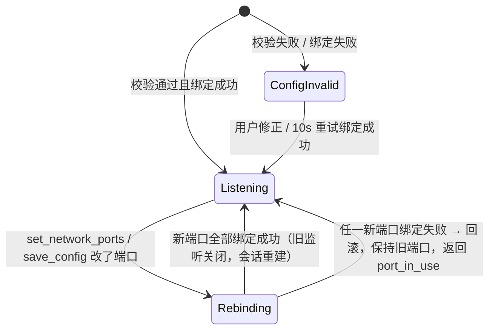

`set_network_ports` 处理顺序：
1. 校验（§10.1.1），失败直接返回错误，不改任何东西。
2. 先绑定新端口（三个都成功才继续；任一失败则释放已绑定的新端口并返回 `port_in_use`）。
3. 写入配置文件。
4. 对所有会话：主机先 `INPUT_RESET` 并收回键鼠；进行中的传输以 `FILE_ERROR{code:"cancelled"}` 结束（设置页在应用前提示“将中断正在进行的传输”）；关闭控制/数据连接。
5. 关闭旧监听。
6. 立即在新 `discovery_port` 上向选中网卡 /24 广播一次 `CSCD` 通告（kind=announce），对端据此更新 `last_endpoint`；主机随后按发现结果重连。
7. 无需重启程序；UI 通过 `status` 推送看到 `rebinding → listening`。

改动 `discovery_port` 时，其他电脑必须改成同样的值，否则彼此发现不到（已保存的 `last_endpoint` 重拨仍可用）。

#### 10.1.3 发现报文 `CSCD`

UDP 负载（小端）：

```
offset 0  magic         4B  'C' 'S' 'C' 'D'
offset 4  ver           u8  = 2
offset 5  kind          u8  1=probe（主机扫描） 2=reply（被控端回复） 3=announce（端口变更后主动通告）
offset 6  control_port  u16 发送方控制 TCP 端口
offset 8  data_port     u16 发送方数据 TCP 端口
offset 10 name_len      u8
offset 11 name          UTF-8，≤ 63 字节
```

- 主机向 /24 每个地址的 `discovery_port` 发 probe；被控端回 reply；主机用 reply 中的 `control_port` 发起控制连接。
- 校验：`control_port == data_port` 或任一为 0 的报文丢弃。
- 发现报文只是提示；会话建立后以 TLS 保护的 `HELLO.ports` 为准（两者不同时以 `HELLO` 为准，并更新 `last_endpoint`）。

- 两条连接都是 TLS 1.3（rustls，`protocol_versions = [TLS13]`，不启用 TLS 1.2），双向自签名证书：Ed25519（rcgen 生成；对端不支持时不回退，两端都是 CSC）；有效期 100 年且**不参与校验**，身份只看 SHA-256 指纹；握手阶段接受任意证书并记录指纹，由配对状态机判定。
- 未认证连接限制（§14.5）：同时最多 8 个未完成配对的连接、每个 IP 最多 2 个；TCP 接入到 TLS 完成 ≤ 5 s、TLS 完成到收到 `HELLO` ≤ 5 s，超时关闭（`handshake_timeout`）；超出数量直接关闭（`too_many_connections`）。
- 数据连接连到对端 `HELLO.ports.data`（不是本机的 `data_port`，也不是默认值）；首帧 `DATA_ATTACH{device_id, session_token, data_port}`，其中 `data_port` 为发起方连接的目标端口，接收方核对与自己当前 `data_port` 一致；`session_token = export_keying_material(b"EXPORTER-CSC-DATA-v1", 32)`（控制连接），且证书指纹必须与控制连接相同。
- 重复连接：每台电脑对每个对端只保留一条控制连接；只有正在使用的连接结束且无连接接替才算断开。多余连接关闭或配对前失败的连接不清复制记录、不取消传输、不收回键鼠。
- 自动重连：会话结束立即发一轮发现；主机按 2 s 起、最长 10 s 退避重拨 `last_endpoint`（上次的 IP 与控制端口）；选中网卡地址消失后恢复、地址变化、或长时间无会话时自动重建网络（“刷新”按钮保留兜底）。

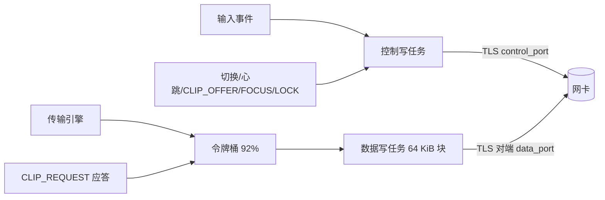

### 10.2 帧格式

小端，帧头 12 字节：

```
offset 0  magic   2B  'C' 'S'
offset 2  ver     u8  = 2
offset 3  type    u8
offset 4  flags   u32 （bit0 = payload 为二进制，否则 UTF-8 JSON；其余保留为 0）
offset 8  length  u32 payload 字节数
offset 12 payload
```

> v1.1 未定义 flags 位含义；上表 bit0 为 v2 约定，最终以 `csc-proto` 为准（TBD 核对）。

帧长上限（先校验 `length`，超限 → 关闭连接，原因 `frame_too_large`）：

| 通道 / 类别 | 最大 payload |
|---|---|
| 控制连接任意帧 | 64 KiB + 256 B |
| 数据连接块帧（`FILE_DATA`、`CLIP_DATA`） | 64 KiB + 64 B |
| 数据连接 JSON 帧（`FILE_OFFER` 等；条目多时分批） | 4 MiB |

### 10.3 消息类型

| type | 名称 | 通道 | 方向 | 负载 |
|---|---|---|---|---|
| 0x01 | HELLO | 控制 | 双向 | `{proto:2, proto_min:2, proto_max:2, app_version, device_id, name, role, monitors:[Monitor], caps, ports:{control, data}}`（版本协商 §12.5）；`ports` 为发送方当前监听端口，`control ≠ data`，否则关闭连接（`port_conflict`） |
| 0x02 | HEARTBEAT | 控制 | 双向 | 无 |
| 0x03 | PAIR_REQUEST | 控制 | 双向 | `{device_id, name, role, proto:2}` |
| 0x04 | PAIR_CONFIRM | 控制 | 双向 | `{accepted: bool}` |
| 0x05 | PAIR_RESULT | 控制 | 主机→被控端 | `{status: "paired"\|"rejected"\|"timeout"\|"role_conflict"\|"pairing_closed"\|"code_mismatch"\|"commit_mismatch"}` |
| 0x06 | DATA_ATTACH | 数据 | 主机→被控端 | `{device_id, session_token, data_port}`（token 编码：base64 或 flags bit0 二进制，TBD）；`data_port` 与接收方当前数据端口不符 → `bad_data_port` |
| 0x07 | PEER_STATE | 控制 | 双向 | `{state:"normal"\|"locked"\|"secure_desktop"\|"suspending"\|"shutting_down"}`（§12.1、§12.2） |
| 0x08 | PAIR_COMMIT | 控制 | 主机→被控端 | `{commit}`：`hex(SHA-256("CSC-PAIR-COMMIT-v2" ‖ Na ‖ device_id_host))`，Na 为 32 字节随机数（§10.4） |
| 0x09 | PAIR_NONCE | 控制 | 双向 | `{nonce}`：被控端先发 Nb；主机收到后再发 Na（揭示）（§10.4） |
| 0x10 | SWITCH_ENTER | 控制 | 主机→被控端 | `{edge, position_pct, locks:{caps, num, scroll}, carry:{dx, dy}}`（`position_pct` 多段边规则 §12.16.3；`carry` 为逻辑像素） |
| 0x11 | SWITCH_LEAVE | 控制 | 主机→被控端 | 无 |
| 0x12 | EDGE_HIT | 控制 | 被控端→主机 | `{edge, position_pct, dragging, corner, carry:{dx, dy}}`；`dragging` 恒为 `false`（跨屏拖拽已移除）；发送前先刷新剪贴板（§4.2） |
| 0x13 | FOCUS_INFO | 控制 | 被控端→主机 | `{file_target: bool, fullscreen: bool}` |
| 0x14 | SCREEN_UPDATE | 控制 | 双向 | `{monitors:[Monitor]}` |
| 0x15 | ACTIVITY | 控制 | 双向 | 无；用户在任一电脑有输入时每 30 s 一次：被控端本地有输入时发给主机，主机发给布局中其他被控端；收到方据此防熄屏/防闲置锁屏（§12.17） |
| 0x16 | CONTROL_PAUSE | 控制 | 被控端→主机 | `{paused: bool, reason:"emergency_hotkey"\|"user"}`；主机收到 `paused:true` 立即收回键鼠且不再切到该机（§12.18） |
| 0x20 / 0x21 / 0x22 / 0x23 | MOUSE_MOVE / MOUSE_BUTTON / MOUSE_WHEEL / KEY | 控制 | 主机→被控端 | 移动 `{dx, dy}`（f32，主机加速后的逻辑像素，§12.16.1；v1.1 的 `x,y` 删除）、按钮 `{button, down}`（1 左 2 右 3 中 4 后退 5 前进）、滚轮 `{v, h}`（i32，1/120 格，§12.16.4）、按键 `{hid_usage, down, modifiers}`（不发送系统自动连发，§12.16.5）。v2 按此分配；与 v1.1 源码的差异在 R0 核对后以 `csc-proto` 为准 |
| 0x24 | INPUT_RESET | 控制 | 主机→被控端 | 无；被控端释放全部已注入按下 |
| 0x30 | CLIP_OFFER | 控制 | 双向（主机转发） | `{clip_id, seq, kind:"text"\|"png"\|"files", formats:[{fmt, len, xxh64}], inline?:{fmt: 内容}, files?}`（多格式 §12.7） |
| 0x31 | CLIP_REQUEST | 数据 | 双向 | `{clip_id, fmt}` |
| 0x32 | CLIP_DATA | 数据 | 双向 | 二进制 `clip_id u64 \| offset u64 \| bytes ≤ 64 KiB` |
| 0x33 | PASTE_REQUEST | 控制 | 主机→被控端 | `{to, offer_token, paste_id?}` |
| 0x34 | PASTE_LOCATED | 控制 | 被控端→主机 | `{paste_id, ok}`：Linux 目标经剪贴板占位定位到粘贴目录（§4.4） |
| 0x35–0x36 | — | — | — | 保留 |
| 0x37 | CLIP_END | 数据 | 双向 | `{clip_id, xxh64}` |
| 0x40 | DRAG_BEGIN | 数据 | — | **保留未用**（跨屏拖拽已移除，§4.6）；收到则忽略或记警告，不启动传输 |
| 0x41 | DRAG_CANCEL | 数据 | — | **保留未用**（同上） |
| 0x42 | DRAG_RETARGET | 数据 | — | **保留未用**（同上） |
| 0x50 | FILE_REQUEST | 数据 | 接收→发送 | `{transfer_id, skip:[index], resume?:[{index, offset}]}`（续传 §12.8） |
| 0x51 | FILE_DATA | 数据 | 发送→接收 | 二进制 `transfer_id u64 \| index u32 \| offset u64 \| bytes ≤ 64 KiB`（布局 TBD 核对） |
| 0x52 | FILE_END | 数据 | 发送→接收 | `{transfer_id, index, xxh64}` |
| 0x53 | FILE_CANCEL | 数据 | 双向 | `{transfer_id}` |
| 0x54 | FILE_ERROR | 数据 | 双向 | `{transfer_id, code, message}` |
| 0x55 | FILE_OFFER | 数据 | 发送→接收 | `{transfer_id, transfer_key, entries:[{index, path, kind, size, mtime_ns, mode?, attrs?}], total_bytes, purpose:"paste"\|"tray_paste", dest_hint:"current_folder"\|"located"\|"fallback", paste_id?, origin, relay_to?, offer_token?}`（`"drag"` / `"drop"` 字面量保留但不使用） |
| 0x56 | FILE_BEGIN | 数据 | 发送→接收 | `{transfer_id, index, size}` |
| 0x57 | FILE_DONE | 数据 | 发送→接收 | `{transfer_id}` |
| 0x58 | FILE_ACK | 数据 | 接收→发送（中转时主机改写 id 后转发） | `{transfer_id, bytes}` |
| 0x59 | FILE_BATCH | 数据 | 发送→接收 | 二进制：`transfer_id u64 \| count u16 \| [index u32 \| len u32 \| xxh64 u64 \| bytes]×count`，整帧 ≤ 64 KiB+64，用于 ≤ 64 KiB 的小文件（§12.8） |
| 0x60 | LOCK_SCREEN | 控制 | 双向（主机转发） | `{reason:"hotkey"\|"user_lock"\|"host_idle"}`；被控端闲置锁屏不发送（§12.17） |
| 0x70 | BENCH_SYNC | 控制 | 双向 | `{seq, t1, t2?, t3?}`（纳秒，单调时钟；§12.15） |
| 0x71 | BENCH_ECHO | 控制 | 被控端→主机 | `{seq, t1}` |

**方向检查**：上表“方向”列是强制的。按本端角色收到不该由对端发送的消息（如主机收到 `MOUSE_*`/`KEY`/`SWITCH_*`/`PASTE_REQUEST`/`PAIR_COMMIT`，被控端收到 `EDGE_HIT`/`CONTROL_PAUSE`/`PASTE_LOCATED`）→ 关闭连接，原因 `bad_direction`，记警告日志（§14.7）。`DRAG_*` 为保留未用消息，收到不按方向关闭，忽略即可。

`FILE_OFFER` 接受规则：
- 主机收到被控端的 `FILE_OFFER`：必须带主机签发、未过期（120 s）、未使用的 `offer_token`（粘贴）。
- 被控端只接受来自主机连接的 `FILE_OFFER`（主机是会话中唯一的协调者）。
- 不满足 → `FILE_ERROR{code:"unsolicited"}`。

能力位 `HELLO.caps`：`CAP_VIRTUAL_DRAG=1`（**保留未用**，跨屏拖拽已移除）、`CAP_EDGE_REPORT=2`、`CAP_FILE_ACK=4`、`CAP_DATA_CHANNEL=8`、`CAP_LAZY_CLIP=16`、`CAP_FOCUS_INFO=32`、`CAP_MULTI_MONITOR=64`。v2 实现可置位全部位；缺位时的退化行为：缺 `CAP_VIRTUAL_DRAG` → 无影响（拖拽路径已删除）；缺 `CAP_LAZY_CLIP` → 分块推送；缺 `CAP_FOCUS_INFO` → 远端态不拦截 Ctrl+V（只能用托盘粘贴）。

### 10.4 配对握手

**前提**：两端都处于「允许新配对」时间窗内（`set_pairing_open`，默认 120 s；首次运行向导完成时自动开启；设备页与托盘「添加电脑…」可再次开启）。任一端未开窗 → 不弹窗，回 `PAIR_RESULT{pairing_closed}` 并断开；被拒绝方只收到一条系统通知（同一 IP 60 s 内最多一条）。

**承诺-揭示配对码**（防止中间人在 TLS 握手中枚举随机数碰撞出相同的码）：

1. 主机生成 32 字节随机数 Na，发 `PAIR_COMMIT{commit = SHA-256("CSC-PAIR-COMMIT-v2" ‖ Na ‖ device_id_host)}`。
2. 被控端收到承诺后生成 Nb，发 `PAIR_NONCE{Nb}`。
3. 主机收到 Nb 后发 `PAIR_NONCE{Na}`；被控端校验承诺，不符 → `commit_mismatch` 断开。
4. 双方计算 `E = export_keying_material(b"EXPORTER-CSC-SAS-v2", 32)`（本条 TLS 会话），`sas = u32_be(SHA-256("CSC-SAS-v2" ‖ E ‖ Na ‖ Nb)[0..4]) % 1_000_000`，显示为 `123 456`。

中间人必须在两段会话里分别先承诺/先发随机数，无法在看到对方随机数后再调整，碰撞概率为 10⁻⁶。

**确认方式**：
- 主机配对窗**显示**配对码，按钮「配对」/「取消」。
- 被控端配对窗**不显示**配对码，要求用户**输入**主机屏幕上的 6 位数（证明操作者看得到主机屏幕）；`pair_confirm{code}` 由 core 常数时间比较，错误 3 次 → `pair_code_mismatch`，本次配对失败。
- 两端都确认后才 `PAIR_RESULT{paired}`。指纹变化（同一 `device_id` 证书不同）时两端配对窗显示红色警告“这台电脑以前配对过，但身份已改变”。
- 配对成功后对端**不自动加入布局**（`layout` 不变），主机首页把它放在“未摆放”区；只有用户摆入布局后才可切换、才收剪贴板。

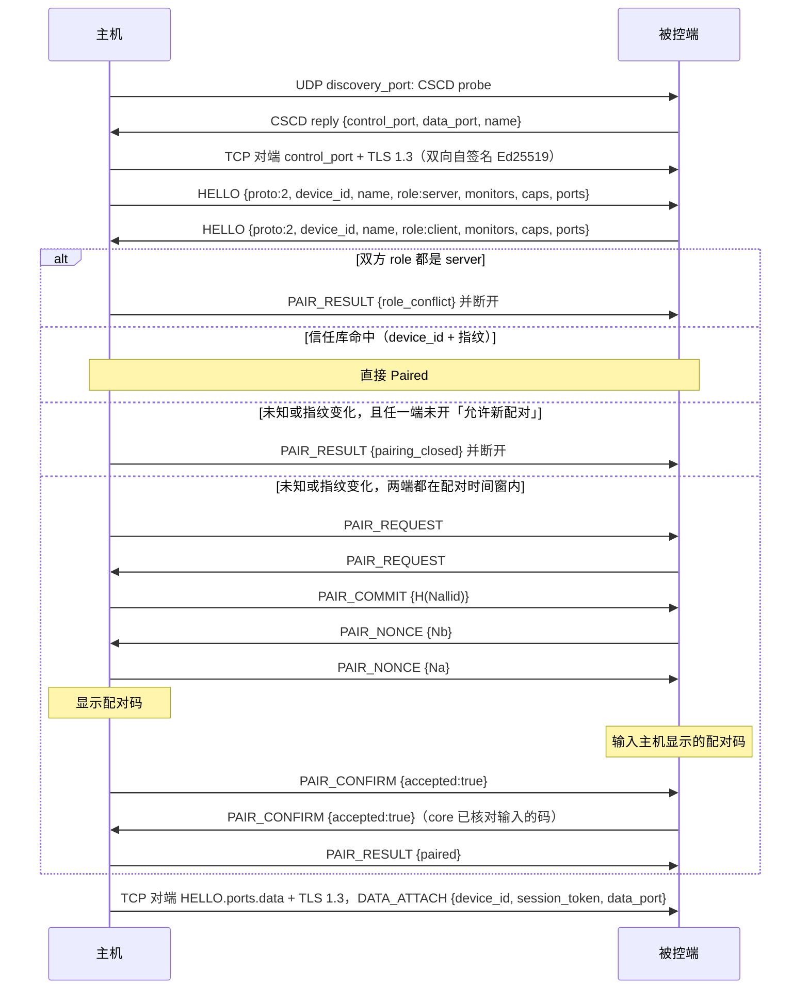

### 10.5 状态机

**会话**

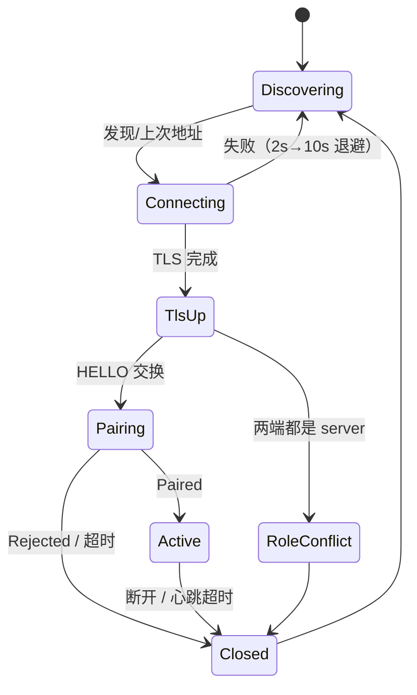

**配对**

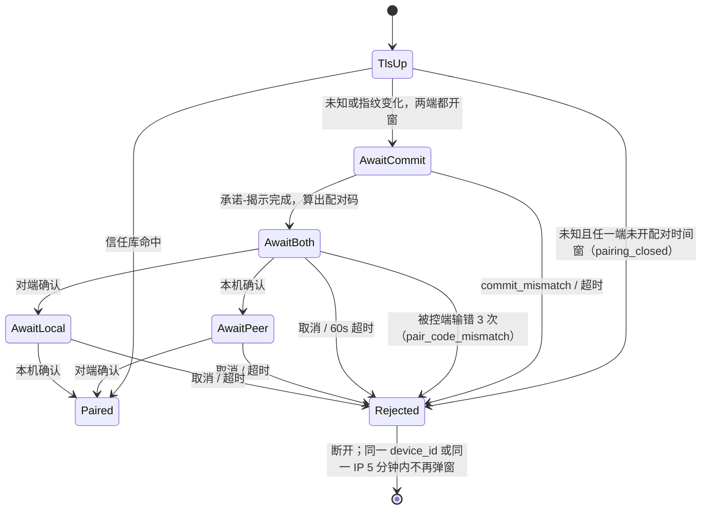

未 Paired 时收到 `HELLO/HEARTBEAT/PAIR_*` 以外的帧 → 关闭连接（`not_paired`）。

**被控端（不卡键）**

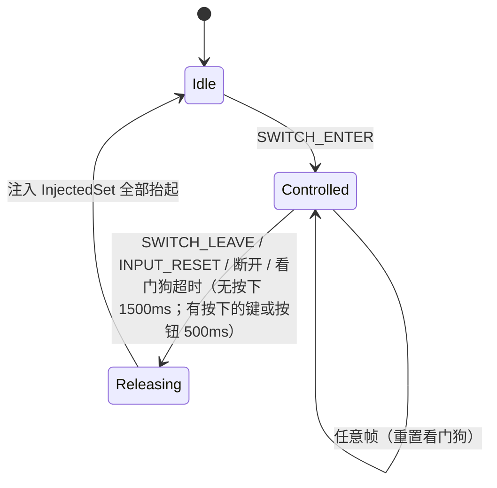

主机 `PressedSet` 规则：只转发在该对端按下过的抬起；切过去时本机按着的键，其抬起在本机处理；离开前补发全部抬起 + `INPUT_RESET`。

**Win（Super）键缓冲（远端态）**

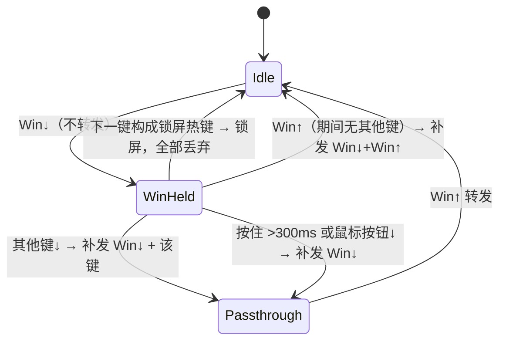

热键匹配时，已转发的修饰键补发抬起，未转发的丢弃。

**锁屏联动**（细则见 §12.17）：只联动**用户主动锁屏**（锁屏热键；任一电脑上用户按 `Win+L`/系统菜单锁屏，判定为锁屏前 2 s 内该电脑有用户输入）和**主机闲置锁屏**。被控端因闲置自动锁屏**不联动**（否则用户在主机上工作时会被被控端的闲置超时锁住）。联动时：对所有对端 `INPUT_RESET` → 收回键鼠 → 主机广播 `LOCK_SCREEN{reason}`；被控端触发时只发给主机，由主机锁屏并转给其他被控端；3 s 去重。

### 10.6 心跳与超时

| 状态 | 间隔 | 超时 |
|---|---|---|
| 被控中（Controlled / 主机 Controlling） | 250 ms | 1500 ms |
| 被控中且有按下的键或按钮 | 100 ms | 500 ms（被控端看门狗随之缩短，避免断网时连发失控） |
| 空闲 | 2 s | 10 s |
| 配对等待 | 2 s | 10 s |

### 10.7 错误码

`FILE_ERROR.code`、关闭原因（日志）使用以下字符串（`DRAG_CANCEL.reason` 保留字面量但不使用）：

| code | 含义 |
|---|---|
| `frame_too_large` | 帧长超过上限（关闭连接） |
| `bad_magic` / `bad_version` | 帧头错误 / 协议版本不是 2（关闭连接） |
| `not_paired` | 未配对时收到受限消息（关闭连接） |
| `role_conflict` | 两端都是 server |
| `pair_rejected` / `pair_timeout` | 配对被取消 / 超时 |
| `fingerprint_mismatch` | 数据连接证书与控制连接不同 |
| `bad_session_token` | `DATA_ATTACH` 令牌错误 |
| `unsolicited` | 无有效令牌或登记的 `FILE_OFFER` |
| `path_rejected` | 路径净化失败（附 `PathReject` 变体名） |
| `hash_mismatch` | xxHash64 校验失败 |
| `io_error` | 读写失败（附系统错误） |
| `cancelled` | 用户取消 |
| `peer_lost` | 中转一方或对端断开 |
| `no_target_dir` | 粘贴定位 20 s 内未找到目标目录（Linux 占位 inotify / 有界遍历） |
| `too_large` | 剪贴板超过 `max_inline_mb` |
| `config_invalid` | 网络配置无效：core 不监听网络端口（`get_status.network.state`、IPC 错误），具体原因见下列端口错误 |
| `port_conflict` | `control_port == data_port`（配置、`HELLO.ports` 或 IPC 参数） |
| `port_out_of_range` | 端口不在 1024–65535 |
| `port_in_use` | 绑定测试或绑定失败：端口被其他程序占用 |
| `bad_data_port` | `DATA_ATTACH.data_port` 与接收方当前数据端口不符 |
| `secure_desktop` | 被控端处于 Windows 安全桌面，无法注入（§12.2） |
| `no_space` | 目标磁盘空间不足（附 `need`、`free`） |
| `file_too_large_for_fs` | 目标文件系统不支持该文件大小（如 FAT32 ≥ 4 GiB） |
| `resume_mismatch` | 续传后完整文件校验不符，将从头重传 |
| `bench_disabled` | 对端未开启测量模式 |
| `bad_direction` | 收到不该由对端角色发送的消息（关闭连接，§14.7） |
| `pairing_closed` | 本端或对端未开「允许新配对」 |
| `pair_code_mismatch` | 被控端输入的配对码错误 3 次 |
| `commit_mismatch` | 配对承诺与揭示的随机数不符（可能有中间人） |
| `too_many_connections` | 未认证连接超过上限（关闭连接） |
| `handshake_timeout` | TLS 或 `HELLO` 未在 5 s 内完成 |
| `rate_limited` | 同一 IP 短时间内失败过多，暂时拒绝 |
| `sharing_paused` | 本端或对端处于暂停共享 / 紧急暂停，拒绝切换、剪贴板与新传输 |
| `placeholder_mismatch` | 定位到的占位副本未通过令牌/inode/属主/符号链接校验（§14.6） |
| `resume_origin_mismatch` | 续传发送方身份与记录不符，改为从头传 |
| `portal_denied` | Wayland portal 授权被拒绝或撤销（§13.3） |
| `extension_missing` | GNOME Shell 扩展未安装/未启用，相关功能降级（§13.4） |
| `path_not_allowed` | IPC 参数中的路径不在白名单（§14.3） |
| `forbidden` | UI 消息桥：来源窗口无权调用该方法（§14.1，UI 进程本地返回，不经 core） |

数值编码：无（字符串）。`config_invalid` 与 `port_*` 同时用于 IPC 返回的 `errors[].code` 和 `get_status.network.errors[].code`。

### 10.8 版本兼容

- 协议版本 2 与 1 不互通：`HELLO.proto ≠ 2` 或帧头 `ver ≠ 2` → 关闭连接（`bad_version`），UI 提示“对端版本过旧，请同时升级”。
- v2 内新增能力用 `caps` 位协商；未知消息类型跳过（记录 debug 日志），不影响会话。
- 以后的协议版本通过 `HELLO.proto_min/proto_max` 协商（§12.5）；最低支持协议 2（软件 0.2.0）。
- 配置 v1–v4 自动迁移到 v5（§7.4）。

## 11. 性能预算（千兆直连，单次鼠标移动）

| 环节 | 典型 | P99 |
|---|---|---|
| 钩子 → 网络任务 | 0.02 ms | 0.1 ms |
| 编码 + TLS | 0.01 ms | 0.02 ms |
| 内核发送队列 | 0.01 ms | 0.05 ms |
| 网卡排队（传文件时） | 0 | ≤ 1.0 ms |
| 线路 + 中断合并 | 0.05 ms | 0.2 ms |
| 解密 + 解码 | 0.02 ms | 0.05 ms |
| 注入 | 0.05 ms | 0.3 ms |
| **合计（空闲 / 传文件）** | ≈ 0.2 / 0.4 ms | ≈ 0.7 / 1.8 ms |

以上为估算，以 T-LAT-1 实测为准（测量方法见 §12.15）；不含鼠标 USB 回报和显示刷新。

## 12. 补充设计（F17–F34）

### 12.1 主机休眠、重启与断网（F17）

**原则**：被控端从不抓取本地物理键鼠（`set_grab` 只在主机使用），所以被控端的本地键盘鼠标在任何状态下都可用；被控中时本地输入与注入的输入并存。

**主机侧**

| 事件 | Windows | X11 / Linux | 处理 |
|---|---|---|---|
| 即将休眠 | `WM_POWERBROADCAST` / `PBT_APMSUSPEND` | logind `PrepareForSleep(true)`（持 delay inhibitor，最多 1 s） | 对所有对端 `INPUT_RESET` → 收回键鼠 → 发 `PEER_STATE{state:"suspending"}` → 正常关闭连接 |
| 关机 / 重启 / 注销 | `WM_QUERYENDSESSION` / `WM_ENDSESSION` | logind `PrepareForShutdown(true)`、会话结束 | 同上，`state:"shutting_down"` |
| 唤醒 | `PBT_APMRESUMEAUTOMATIC` | `PrepareForSleep(false)` | 立即重建网络（等同「刷新」）：重新绑定监听、发一轮发现、按 `last_endpoint` 重拨（不等 2 s 退避）；网卡尚未就绪时由链路监督在地址出现后再试 |
| 网卡断开 / 地址消失 | 链路监督 | 链路监督 | 会话按心跳超时结束；地址恢复后自动重建 |

**被控端侧状态**（`get_status.host_state`，托盘图标提示与通知 F25）：

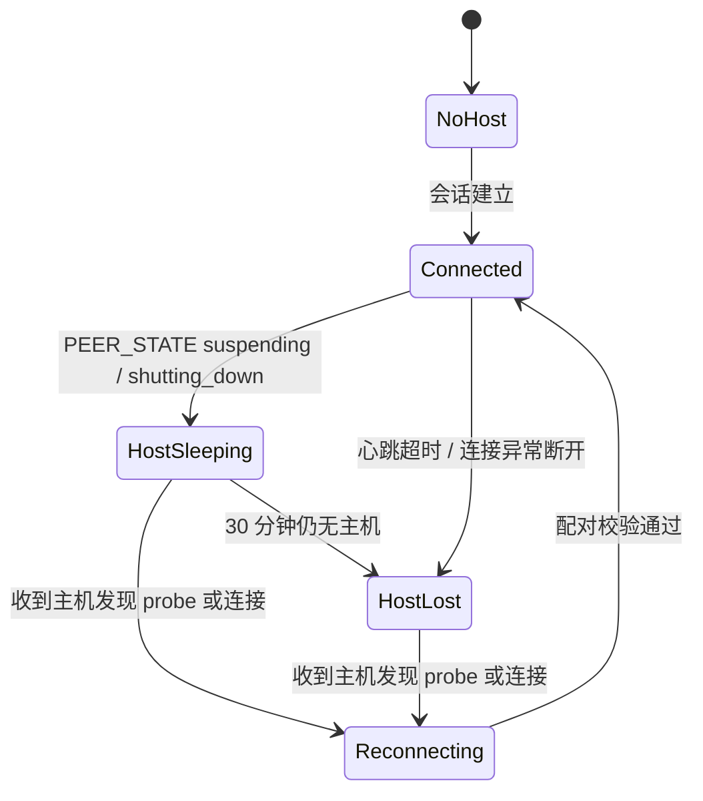

任何进入非 `Connected` 的转移都先执行 `InjectedSet` 全部抬起（§10.5）。

### 12.2 安全桌面（F18）

**决定**：v2 **不支持**在 Windows 安全桌面（锁屏、登录界面、UAC 提示、`Ctrl+Alt+Del` 界面）上注入或抓取；可选的 Windows 服务（以 SYSTEM 运行、在 Winlogon 桌面注入）列为 **M7，是否实现 TBD**。

| 角色 | 检测 | 行为 |
|---|---|---|
| Windows 被控端 | `OpenInputDesktop` 返回的桌面名不是 `Default`（每 500 ms 及 `WTS_SESSION_LOCK/UNLOCK` 时检查），或 `SendInput` 返回 0 且 `GetLastError()=ERROR_ACCESS_DENIED` | 发 `PEER_STATE{state:"secure_desktop"}`；主机收到后补发抬起 + `INPUT_RESET`，立即收回键鼠；布局中该电脑标为“安全桌面”，到边不切换；回到 `Default` 后发 `PEER_STATE{state:"normal"}` |
| Windows 主机 | `WTS_SESSION_LOCK`、桌面切换 | 低级钩子在安全桌面收不到输入：收回键鼠（锁屏联动见 §10.5） |
| Linux X11 被控端 | 屏保/锁屏 `org.freedesktop.ScreenSaver.ActiveChanged` | X11 锁屏程序是普通 X 客户端，XTest 注入可以到达锁屏程序（可远程输入解锁密码）；不上报 `secure_desktop`，上报 `PEER_STATE{state:"locked"}` 仅用于显示。各桌面环境实测结果 TBD |
| Linux Wayland 被控端（GNOME） | `org.gnome.ScreenSaver.ActiveChanged` | 上报 `locked`；锁屏期间 RemoteDesktop/libei 注入是否被合成器拦截以实测为准（TBD）。若被拦截，行为与 Windows 安全桌面相同：主机收回键鼠、到边不切换 |

`get_status.peers[].state` ∈ `normal` / `locked` / `secure_desktop` / `suspending` / `shutting_down`。

### 12.3 键盘布局与输入法（F19）

- 线上只传物理键位：`KeyEvent.hid_usage = (usage_page << 16) | usage_id`（键盘页 0x07，消费者页 0x0C 用于媒体键）。**不传字符**。被控端按自己的键盘布局和输入法产生字符；输入法开关、候选窗口都在被控端本地进行。
- 主机抓取在系统输入法之前（低级钩子 / XGrabKeyboard / InputCapture），主机输入法不参与。
- Windows 注入：`SendInput` + `KEYEVENTF_SCANCODE`（扩展键加 `KEYEVENTF_EXTENDEDKEY`），不用虚拟键码，避免受被控端布局影响。
- X11 注入：X keycode = Linux evdev 键码 + 8（xf86-input-evdev / libinput 驱动的标准规则）。
- Wayland 注入：libei 键盘事件直接使用 Linux evdev 键码；InputCapture 捕获到的 evdev 键码按同一张表反查 HID Usage。
- Windows 主机：AltGr 会产生一个系统合成的 LCtrl（`KBDLLHOOKSTRUCT.scanCode = 0x21D`），转发前丢弃。
- 可选重映射 `keyboard.remap`：`[{from: usage, to: usage}]`，在主机转发前应用（如被控端需要交换 Ctrl 与 Super），默认空。

**映射表（节选，完整表以 `csc-platform/src/keymap.rs` 为准）**

| 键 | HID Usage（页 0x07） | Windows 扫描码（Set 1） | Linux evdev | X keycode |
|---|---|---|---|---|
| A | 0x04 | 0x1E | 30 `KEY_A` | 38 |
| Enter | 0x28 | 0x1C | 28 | 36 |
| Esc | 0x29 | 0x01 | 1 | 9 |
| `` ` `` | 0x35 | 0x29 | 41 | 49 |
| `\`（美式） | 0x31 | 0x2B | 43 | 51 |
| `/` | 0x38 | 0x35 | 53 | 61 |
| 102 键 `\`（欧式） | 0x64 | 0x56 | 86 `KEY_102ND` | 94 |
| CapsLock | 0x39 | 0x3A | 58 | 66 |
| ScrollLock | 0x47 | 0x46 | 70 | 78 |
| NumLock | 0x53 | 0x45 | 69 | 77 |
| PrintScreen | 0x46 | E0 37 | 99 `KEY_SYSRQ` | 107 |
| Pause | 0x48 | E1 1D 45 | 119 | 127 |
| Menu（应用键） | 0x65 | E0 5D | 127 `KEY_COMPOSE` | 135 |
| 左 Ctrl | 0xE0 | 0x1D | 29 | 37 |
| 左 Shift | 0xE1 | 0x2A | 42 | 50 |
| 左 Alt | 0xE2 | 0x38 | 56 | 64 |
| 左 Win / Super | 0xE3 | E0 5B | 125 `KEY_LEFTMETA` | 133 |
| 右 Ctrl | 0xE4 | E0 1D | 97 | 105 |
| 右 Shift | 0xE5 | 0x36 | 54 | 62 |
| 右 Alt / AltGr | 0xE6 | E0 38 | 100 | 108 |
| 右 Win / Super | 0xE7 | E0 5C | 126 | 134 |
| 日文 Ro | 0x87 | 0x73 | 89 `KEY_RO` | 97 |
| 日文/韩文切换键（Lang1–Lang5） | 0x90–0x94 | TBD | TBD | TBD |

修饰键语义：Win ↔ Super 一一对应；Ctrl、Alt、Shift 左右分别对应；右 Alt 原样转发，是否作为 AltGr 由被控端布局决定。

### 12.4 锁定键同步（F20）

- `SWITCH_ENTER` 新增 `locks:{caps, num, scroll}`（主机当前状态：Windows `GetKeyState(VK_CAPITAL) & 1` 等；X11 `XkbGetIndicatorState`）。
- 被控端比较本机状态，不同则注入一次该锁定键按下+抬起使其一致。
- 控制远端期间，锁定键照常转发；主机按下的锁定键被吞掉，本机状态不变，主机另记 `virtual_locks`。
- 回到主机时，若 `virtual_locks` 与本机不同，主机在本机注入锁定键使其一致（用户在哪台电脑上打开的大写锁定，回来后仍是打开的）。
- `keyboard.sync_locks`（默认 true）关闭后不做任何同步。

### 12.5 版本协商与更新（F21）

- `HELLO` 新增 `app_version`（SemVer 字符串）、`proto_min`、`proto_max`（v0.2.0 均为 2，`proto` 字段保留等于选定版本）。
- 选定协议 = 双方区间交集的最大值；无交集 → 关闭连接 `bad_version`，并把双方 `app_version` 与区间写入 `get_status.version_mismatch[]`，两端 UI 显示“对端版本 x.y.z 不兼容，请把两台电脑升级到同一版本”（F25 通知）。
- 收到 v1 帧（帧头 `ver=1`）→ 关闭连接，显示“对端版本过旧（协议 1）”。
- 协议兼容但 `app_version` 的 MAJOR.MINOR 不同 → 正常工作，设置页提示“建议升级到相同版本”。
- **更新检查**：默认关闭（`update.check_on_start=false`）；设置页「检查更新」按钮由 **UI 进程**以 HTTPS GET `update.url`（地址 TBD）获取更新清单 `update.json` 及其 minisign 签名 `update.json.minisig`；用编译时内置的公钥（密钥 TBD）验签，失败 → 显示“更新信息签名无效”（UI 本地错误 `update_signature_invalid`），不显示任何内容。清单格式 `{"latest":"x.y.z","url":"…","notes":"…","published":"…"}`。
- `url` 的主机名必须在内置白名单内（项目发布域名，TBD），否则不显示「打开下载页」；`notes` 按纯文本显示（不解析 HTML/Markdown 链接）。
- **不自动下载、不自动安装**。请求只带 `User-Agent: Cross-SystemConnect/<版本>`，不带任何标识。core 从不联网。

### 12.6 切换辅助（F22）

| 功能 | 配置 / 热键 | 默认 | 机制 |
|---|---|---|---|
| 按住键阻止切换 | `switch.block_modifier` ∈ `none`/`ctrl`/`shift`/`alt` | `none` | 按住该修饰键时到边累加器清零、忽略 `EDGE_HIT` |
| 锁定在当前屏幕 | `hotkeys.lock_to_screen`、托盘「锁定在当前屏幕」、IPC `set_lock_to_screen` | `Ctrl+Alt+Shift+K`，关 | 开启后边缘切换全部禁用（本机或当前远端都适用）；`Ctrl+Alt+/` 仍可回主机；托盘图标显示锁定标记；不持久化，重启后关闭 |
| 全屏程序不切换 | `switch.block_when_fullscreen` | true | 主机：前台窗口全屏（Windows `SHQueryUserNotificationState` 为 `QUNS_RUNNING_D3D_FULL_SCREEN`/`QUNS_PRESENTATION_MODE`，或前台窗口矩形等于所在显示器且不是桌面/外壳；X11 `_NET_WM_STATE_FULLSCREEN`）时不按边缘切换；被控端经 `FOCUS_INFO.fullscreen` 上报，主机忽略其 `EDGE_HIT`。热键不受影响 |
| 角落死区 | `switch.corner_dead_px` | 10 | 距角落该像素内不触发边切换（避免误切到开始按钮、热角）；有对角邻居时该区域用于切到对角电脑 |

### 12.7 富文本剪贴板（F23）

- `CLIP_OFFER` 改为多格式：`{clip_id, seq, kind, formats:[{fmt, len, xxh64}], inline?, files?}`，`fmt` ∈ `text/plain`、`text/html`、`text/rtf`、`image/png`。
- 格式映射：

| fmt | Windows | X11 |
|---|---|---|
| `text/plain` | `CF_UNICODETEXT` | `UTF8_STRING` / `text/plain;charset=utf-8` |
| `text/html` | 注册格式 `HTML Format`（CF_HTML 头部偏移量，发送时去掉头部，接收时重建） | `text/html`（UTF-16 带 BOM 的转为 UTF-8） |
| `text/rtf` | 注册格式 `Rich Text Format` | `text/rtf`、`application/rtf` |
| `image/png` | `PNG` / `CF_DIB` | `image/png` |

- 优先级与组合：
  1. 有文件清单 → 按文件处理（F5），其他格式不同步（文件管理器同时放的文字只是路径）。
  2. 有文字 → 同步 `text/plain` + 可用的 `text/html`、`text/rtf`；不同步图片（与 v1.1 一致，避免每次转换图片）。
  3. 只有图片 → `image/png`。
- `text/plain` 始终提供，作为后备；所有格式合计受 `clipboard.max_inline_mb` 限制，超出时只同步 `text/plain`（仍超出则不同步）。
- ≤ 64 KiB 的格式内联，其余延迟拉取（`CLIP_REQUEST{clip_id, fmt}`）。接收端以多格式占有剪贴板，由粘贴的程序自己选择格式。
- HTML 中引用的本地图片（`file://`）不转换，可能显示不出。
- `clipboard.rich`（默认 true）关闭后只同步纯文本。

### 12.8 文件传输细节（F24）

**条目元数据**：`FILE_OFFER.entries[] = {index, path, kind:"file"|"dir", size, mtime_ns, mode?, attrs?}`；`mode` 为 Linux 权限位（只含 0o777），`attrs` 为 Windows `hidden`/`readonly`。

**元数据保留策略**

| 项 | 规则 |
|---|---|
| 修改时间 | 总是保留（`file_transfer.preserve_mtime`，默认 true） |
| 权限位 | Linux → Linux 保留 0o777 范围内的位（不含 setuid/setgid/sticky）；其他方向按接收端默认（umask） |
| Windows 隐藏 / 只读 | Windows → Windows 保留；跨系统不转换（Linux 以 `.` 开头的名字不加隐藏属性，Windows 隐藏文件到 Linux 不改名） |
| 所有者、ACL、扩展属性、备用数据流 | 不保留 |
| 符号链接 | 不跟随、不创建（§9） |
| 来源标记（Windows） | `file_transfer.mark_of_web`（默认 true）：NTFS 上为每个收到的文件写 `Zone.Identifier` 备用数据流（`[ZoneTransfer] ZoneId=3`、`HostUrl=csc://<对端名字>`），打开可执行文件、Office 宏文档时系统按“来自其他电脑”提示；非 NTFS 卷跳过 |
| 可执行位 | `file_transfer.strip_exec_on_desktop`（默认 true）：目标目录为桌面时去掉所有可执行位；`.desktop` 文件不设置 GNOME `metadata::trusted`，需要用户自己“允许运行” |

**空间与文件系统检查**（收到 `FILE_OFFER` 后、开始写入前）：
- 需要空间 = 未跳过条目大小之和 + 64 MiB 余量，对比 `GetDiskFreeSpaceExW` / `statvfs`；不足 → `FILE_ERROR{code:"no_space"}`，进度窗与通知显示需要和可用空间。
- 目标文件系统为 FAT32 且有文件 ≥ 4 GiB → 这些条目 `file_too_large_for_fs`（其余照常）。
- 写入中遇到磁盘满（`ERROR_DISK_FULL` / `ENOSPC`）→ `no_space`，删除未完成的临时文件。

**跨系统文件名调整**（接收端，按目标系统规则；与安全拒绝分开，见 §6 `sanitize_rel` / `adapt_name`）：

| 情况 | 目标 | 调整 |
|---|---|---|
| 字符 `< > : " \| ? *`、0x00–0x1F | Windows | 替换为 `_` |
| 保留名 `CON PRN AUX NUL COM1–9 LPT1–9`（含带扩展名） | Windows | 主名后加 `_`（`CON.txt` → `CON_.txt`） |
| 末尾的 `.` 或空格 | Windows | 去掉后加 `_` |
| 同目录内仅大小写不同（来自 Linux） | Windows | 后到的按重名规则改为「原名 (1)」 |
| 全路径 > 260 字符 | Windows | 用 `\\?\` 前缀写入（最长 32 767）；超过 260 时进度窗提示“部分程序可能无法打开” |
| 0x00–0x1F | Linux | 替换为 `_` |
| 单个名字 > 255 字节（UTF-8） | Linux / Windows | 在字符边界截断并保留扩展名，冲突时加 `~1`、`~2` |

被调整的条目在进度窗列出“原名 → 新名”，传输完成通知注明“已重命名 N 项”。

**大量小文件**：
- 发送端预读（4 个读线程），≤ 64 KiB 的整文件打包进 `FILE_BATCH`（每帧 ≤ 64 KiB，内含多个完整小文件及各自 xxHash64）。
- 接收端 4 个写线程并行创建文件；目录先于文件创建。
- 进度按文件数和字节数同时显示。
- 目标速率：TBD（R7 测基线后定，见 T-BATCH-1）。

**断点续传**：
- 接收端写入 `<目标名>.csc-part`，旁边记录 `<目标名>.csc-part.json`：`{origin_device_id, source_path, size, mtime_ns, transfer_key, written}`；`transfer_key = xxh64(origin_device_id | source_path | size | mtime_ns)`。
- 连接在传输中断开 → 传输进入 `paused_link_lost`（进度窗显示“等待重连”），双方保留状态 `file_transfer.resume_window_min`（默认 30）分钟。
- 重连后发送端重发 `FILE_OFFER`（同 `transfer_key`）。接收端先核对：本次会话认证过的发送方（中转时为主机填写的、来自认证会话的 `origin`）必须等于 `.csc-part.json` 的 `origin_device_id`，否则 `resume_origin_mismatch`，删除该 `.csc-part` 从 0 开始；核对通过后在 `FILE_REQUEST` 中带 `resume:[{index, offset}]`；发送端从 `offset` 继续；接收端最终对完整文件计算 xxHash64，与 `FILE_END` 不符 → `resume_mismatch`，该文件从 0 重传一次。
- 源文件的大小或修改时间变化 → `transfer_key` 不同，从 0 开始。
- 超过窗口未恢复 → 删除 `.csc-part` 及记录，通知“传输失败”。启动时清理过期的 `.csc-part`。

### 12.9 系统通知（F25）

| 事件 | 配置项 | 默认 |
|---|---|---|
| 对端连接 | `notify.connect` | false |
| 对端断开、主机休眠/失联（F17） | `notify.disconnect` | true |
| 配对请求 | —（本机开启「允许新配对」时弹配对窗并发通知；未开窗时被拒绝的配对只发一条“已拒绝来自 x 的配对请求”通知，同一 IP 60 s 内最多一条） | 总是 |
| 传输完成 / 失败（仅接收端） | `notify.transfer` | true |
| 错误：`config_invalid`、`no_space`、版本不兼容、`secure_desktop`、剪贴板超限、粘贴找不到目录、`portal_denied`、`extension_missing`、`commit_mismatch` | `notify.errors` | true |
| 对端紧急暂停 / 恢复（主机侧） | `notify.disconnect` | true |
| 有新版本（仅手动检查时） | — | 总是 |

- 实现：core 平台层 `Notifier`。Windows 用 WinRT Toast（未打包程序需要开始菜单快捷方式带 AppUserModelID，由安装包或首次运行创建，zip 版创建方式 TBD）；Linux 用 D-Bus `org.freedesktop.Notifications`。
- 同一类型 5 s 内只弹一次；点击通知打开设置窗对应页面（Linux 依赖通知服务是否支持 actions）。
- 通知文字按 F26 语言。

### 12.10 多语言（F26）

- 语言：`zh-CN`、`en-US`。`ui.language` ∈ `auto`/`zh-CN`/`en-US`，默认 `auto`（系统区域以 `zh` 开头 → `zh-CN`，否则 `en-US`）。
- 资源：`resources/i18n/zh-CN.json`、`resources/i18n/en-US.json`，键值对，编译时嵌入 core 与 ui。
- core 对外只给错误码与参数（如 `{code:"no_space", need, free}`），由 UI 翻译；core 自己发的通知用同一份资源。
- 切换语言立即生效：WebView 重新加载字符串，托盘菜单重建，core 经 `save_config` 得知后通知文字随之改变。
- 缺少的键回退到 `en-US`；CI 检查两份资源的键一致。
- 日志只用英文，不翻译。

### 12.11 网络环境（F27）

- **手动对端**：`network.manual_peers[] = [{address, control_port?}]`，`address` 可为 IPv4、IPv6（含链路本地 `fe80::1%eth0`）、主机名。主机除发现结果外也按退避拨号这些地址（未写端口时用 24900 默认值）。可跨网段、经 VPN 使用；数据连接端口仍由 `HELLO.ports.data` 确定。IPC `add_manual_peer {address, control_port?}`、`remove_manual_peer {address}`。
- **IPv6**：`network.ipv6`（默认 true）时在可用网卡的 IPv6 地址上监听（ULA `fc00::/7` 与链路本地 `fe80::/10`；全局单播地址只在关闭 `listen_private_only` 时使用）；固定网卡模式下监听该网卡的 IPv4 和 IPv6 地址。IPv6 自动发现不在 v2 范围（TBD），IPv6 只用手动地址。
- **网卡模式** `network.interface_mode`：
  - `fixed`（默认）：只用 `network.interface`，发现只扫描该网卡 /24。
  - `auto`：监听并扫描所有**可用**网卡：up 状态、地址为私有/链路本地（`listen_private_only`）、Windows 网络类别不是“公用”、Wi-Fi 的 SSID 在 `network.trusted_wifi` 中（Linux 经 NetworkManager D-Bus 读取；读不到 SSID 时 Wi-Fi 一律排除）。有线优先；每个对端记住多个已知地址；当前路径心跳超时后按“有线 → 其他”的顺序依次尝试已知地址并重新发现。TLS 身份不变，因此不需要重新配对。
- **VPN 与 Wi-Fi**：可用，但 §11 延迟指标只针对千兆直连。
- 发现报文与扫描范围仍受 §10.1.3 约束（/24）；`discovery_port` 所有电脑相同。

### 12.12 健壮性与诊断（F28）

- **监护**：自启目标改为 `Cross-SystemConnect --background`（托盘后台运行），由 UI 拉起并监护 core：core 非 `quit` 退出时按 1、2、4…最长 60 s 退避重启，10 分钟内最多 5 次，超过后停止并通知。只运行 core 的场景：Linux 提供 `systemd --user` 单元 `cross-systemconnect-core.service`（`Restart=on-failure`）；Windows 只运行 core 时无监护（TBD 是否提供计划任务重启策略）。
- **崩溃信息**：panic 钩子把信息与回溯写入日志目录 `crash/core-<时间>.txt`；Windows 另用 `SetUnhandledExceptionFilter` + `MiniDumpWriteDump`（`MiniDumpNormal`，不含完整内存）写 `crash/core-<时间>.dmp`；保留最近 5 份。UI 同样处理。
- **资源上限**（初始值，可调）：
  - 有界通道（§3）；每个对端同时进行的传输最多 `file_transfer.max_parallel`（默认 2），其余排队。
  - 剪贴板缓冲 ≤ `max_inline_mb` × 2。
  - core 每 60 s 检查常驻内存：> `limits.rss_warn_mb`（默认 200）记警告；> `limits.rss_restart_mb`（默认 500）在无传输时优雅退出，由 UI 重启。
  - 线程优先级：钩子与注入线程高于普通（Windows `THREAD_PRIORITY_ABOVE_NORMAL`）；文件读写线程低于普通（`THREAD_PRIORITY_BELOW_NORMAL` / `nice 10`）。CPU 不设硬上限。
- **诊断包**：IPC `export_diagnostics {path, include_crash_dumps}` / 设置页「导出诊断信息」，生成 zip：core 与 ui 日志（含 `.1`）、`crash/*.txt`（panic 信息与回溯）、去掉敏感项的配置（不含 `identity.key`、`portal-tokens.json`；指纹只保留前 8 位；手动对端地址保留）、状态快照、版本与系统信息、网卡与显示器列表、portal/扩展状态、最近 1000 条协议事件摘要（类型、时间、长度，无负载）。不包含剪贴板内容、文件内容、按键。**Windows 崩溃转储 `.dmp` 默认不包含**（线程栈里可能残留按键或剪贴板数据）：只有用户在导出对话框勾选“包含崩溃转储（可能含敏感数据）”时才加入。导出前界面列出将包含的文件。
- 钩子线程与剪贴板缓冲在用完后清零（`zeroize`），降低转储中的残留。

### 12.13 隐私与合规（F29）

- **日志规则**（所有级别，包括 debug）：
  - 不记录按键的键码或字符（只记录计数）、剪贴板内容、文件内容、配对码。
  - info 及以上不记录文件名和完整路径（只记录数量与字节数）；debug 可记录文件名。
  - 指纹只记录前 8 位；不记录鼠标坐标（debug 除外）。
- **网络**：所有数据只在已配对的对端之间传输；无遥测、无使用统计；唯一的外网请求是手动「检查更新」（§12.5）。
- **代码签名与误报**：发布包 Authenticode 签名（见[构建发布流程](构建发布流程.md) §5），发布 `SHA256SUMS`；误报处理：向杀毒厂商提交误报（微软为 Microsoft Security Intelligence 提交页）、企业 EDR 按签名证书或哈希加白名单；用户手册给出步骤。
- **隐私声明**：见[用户手册](用户手册.md) §12。

### 12.14 卸载与数据清理（F30）

| 数据 | Windows | Linux | 卸载默认 |
|---|---|---|---|
| 程序 | 安装目录 / 解压目录 | `/opt/cross-systemconnect/` / 解压目录 / AppImage | 删除 |
| 自启项 | `HKCU\...\Run` 值、计划任务 | `~/.config/autostart/cross-systemconnect.desktop`、`~/.config/systemd/user/cross-systemconnect-core.service` | 删除 |
| GNOME Shell 扩展 | — | `~/.local/share/gnome-shell/extensions/<扩展 UUID>/`（用户安装）；deb 安装到 `/usr/share/gnome-shell/extensions/` 由包管理器删除 | 删除并 `gnome-extensions disable` |
| 防火墙规则 | 安装包创建的规则 | —（ufw 规则由用户自建，不动） | 删除 |
| 配置、证书、配对记录、portal 授权令牌 | `%APPDATA%\Cross-SystemConnect\`（`config.json`、`identity.crt`、`identity.key`/`identity.key.dpapi`、`ui.log`） | `~/.config/cross-systemconnect/`（含 `portal-tokens.json`）；`identity.key_store=os` 时另删 Secret Service 条目 | 询问，默认**保留** |
| 日志与崩溃信息 | 程序目录 `log.txt*`、`%APPDATA%\Cross-SystemConnect\*.log`、`crash\` | 程序目录 `log.txt*`、`~/.local/state/cross-systemconnect/` | 询问，默认保留 |
| 临时与运行时文件 | `%TEMP%\Cross-SystemConnect\`（若有残留） | `$XDG_RUNTIME_DIR/cross-systemconnect-core.{sock,lock}`、`$XDG_RUNTIME_DIR/csc-paste/` | 删除 |
| 未完成的 `.csc-part` | 各目标目录（按续传索引查找） | 同左 | 删除 |
| 已接收的文件（桌面、`received/`） | — | — | **不删除**（用户数据） |

- 命令行：`Cross-SystemConnect-core --uninstall`（删除自启项与临时文件）、`--uninstall --purge`（再删除配置、证书、日志）；zip / AppImage 用户使用。
- 应用内：设置 → 「清除所有数据并退出」（IPC `reset_data {keep_pairing}`）。
- 其他电脑上的配对记录不会被删除，需要在那些电脑的「已配对设备」里移除。

### 12.15 性能测量方法（F31）

**测量模式**：两端都开启 `diagnostics.bench_enabled`（默认 false）后，才接受 `BENCH_SYNC` / `BENCH_ECHO` 消息，否则回 `bench_disabled` 并丢弃。入口：IPC `bench_run {kind, peer, samples?, size?, files?}`，或命令行 `Cross-SystemConnect-core --bench latency|throughput|smallfiles --peer <名字> [--samples N] [--size 4GiB] [--files 10000]`。结果写入日志目录 `bench-<时间>.csv` 并返回摘要。

**时钟同步**：用 NTP 的四时间戳算法在控制连接上交换 200 次 `BENCH_SYNC{t1,t2,t3}`（两端单调时钟，纳秒），取往返时间最小的 10% 样本估计时钟偏移 θ；直连网线上的误差预期为几十微秒（以实测为准）。测量前后各做一次，漂移过大时丢弃本轮。

**键鼠延迟**：
1. 主机测量模式在钩子线程入口生成合成移动事件（与真实事件走同一条通道），记录 t0 并带序号。
2. 被控端注入返回后（Windows `SendInput` 返回；X11 `XFlush` + `XSync` 返回）记录 t1，经 `BENCH_ECHO{seq, t1}` 回报。
3. 单向延迟 = t1 − θ − t0。默认 11 000 个样本，前 1 000 个作为预热丢弃；输出 P50、P99、P99.9、最大值和直方图。
4. 场景：空闲链路；同时进行 `throughput` 传输（验证传文件时 P99 < 3 ms）。
5. 可选的端到端硬件测量（发布验收参考）：用单片机模拟 USB 鼠标，发送移动时翻转 GPIO，被控端测试程序收到移动时改变屏幕某块区域颜色，光电二极管接同一单片机计时；减去被控端本地鼠标的基线延迟。所用硬件与程序 TBD。

**吞吐**：
- 4 GiB 随机内容文件，源与目标放在 RAM 盘 / tmpfs（排除磁盘影响），时间从 `FILE_REQUEST` 到 `FILE_DONE`。
- 同一条链路上用 `iperf3` 测 TCP 基线，报告 CSC 吞吐与 iperf3 的比值（参考值 ≥ 0.85）和绝对值（≥ 100 MB/s）。
- 小文件：10 000 个 4 KiB 文件，报告文件数/秒。

**标准环境**：千兆网线直连；两端接电源、高性能电源计划；无其他传输；Windows Defender 实时保护保持默认（记录是否开启）；记录 CPU、网卡型号、系统版本、软件版本。每项测 3 轮取中位数。

**验收**：发布前按上述方法在标准环境执行 T-BENCH-1～3，结果（CSV 与摘要）附在发布记录中；不达标不发布（见[构建发布流程](构建发布流程.md) §9）。

### 12.16 指针、光标、滚动与按键一致性（F34）

目标：跨电脑时指针速度、光标表现、滚动和按键连发与“同一台电脑的另一块屏”尽量一致。

#### 12.16.1 位移语义与速度

- **线上单位**：`MOUSE_MOVE{dx, dy}` 为**主机系统指针加速（ballistics）之后**的位移，换算成主机当前所在显示器的**逻辑像素**（物理像素 ÷ 该显示器缩放），f32 保留小数。
  - Windows 主机：远端态在 `WH_MOUSE_LL` 中用回调坐标与停放点之差得到加速后的物理像素位移，再除以停放显示器的缩放。
  - X11 主机：抓取后读 `XI_Motion`（已加速）坐标与停放点之差，处理后 `XWarpPointer` 回停放点。
  - Wayland 主机：InputCapture 经 libei 送来的相对位移是否已经过合成器加速以实测为准（TBD）；未加速时在主机侧按 libinput 默认的自适应曲线（读取 GNOME `org.gnome.desktop.peripherals.mouse accel-profile/speed`）计算。
- **被控端换算**：`目标像素 = dx × 目标显示器缩放 × pointer_speed`（`pointer.match_physical_speed=false` 时不乘缩放）；小数部分累积到下一次，不丢失。缩放近似代表物理尺寸（系统通常按“物理大小一致”选缩放）；物理尺寸不准时用每对端的 `trusted_peers[].pointer_speed`（0.25–4.0，设备页滑块，IPC `set_peer_pointer_speed`）微调。
- **被控端不再叠加加速**：Windows 用绝对坐标注入（不经过“提高指针精确度”）；X11 绝对坐标 XTest；Wayland 优先 libei 绝对设备，不可用时相对设备（合成器对模拟相对位移不加速，TBD 实测）。

#### 12.16.2 光标

- 主机远端态隐藏本机光标（`pointer.hide_host_cursor`，默认开）：Windows `SetSystemCursor` 把所有 `OCR_*` 换成透明光标，回到本机、core 正常退出时 `SystemParametersInfo(SPI_SETCURSORS)` 恢复；core 异常退出时由 UI 监护进程执行恢复；core 启动时也执行一次恢复（防止上次崩溃残留）。X11 `XFixesHideCursor(root)`。Wayland 由合成器在捕获期间处理（TBD 实测）。
- 被控端不是活动屏幕时隐藏其光标（`pointer.hide_inactive_cursor`，默认开），本地鼠标一动或 `SWITCH_ENTER` 时立即显示：Windows 同上方法；X11 `XFixesHideCursor`；Wayland 经 Shell 扩展 `SetCursorVisible(false)`（`Meta.CursorTracker`，TBD 实测）。
- 回到主机时光标出现在 `EDGE_HIT.position_pct` 映射的位置并加上 `carry`，不跳到停放点。

#### 12.16.3 多段边与位置映射

- 一条“边”可能由多块显示器的外露段组成（`outer_edges` 返回的多段 `(from, to, coord)`，中间可能有空档）。`position_pct` = 把各外露段按坐标顺序首尾相接（**跳过空档**）后的累计长度占比，0–1；两端用同一规则换算，往返误差 ≤ 1 px（T-MON-1）。
- 映射按比例进行（主机边中点 ↔ 对端边中点）。按显示器摆放、偏移对齐（类似系统“显示设置”拖动屏幕）列入后续阶段（M8，TBD）。
- `carry`：推够 `edge_push_px` 之后多出的位移随 `SWITCH_ENTER`/`EDGE_HIT` 带到目标端继续移动。

#### 12.16.4 滚轮

- 线上单位为 1/120 格（Windows `WHEEL_DELTA` 约定），有符号，允许小于 120 的高精度增量（精确式触摸板、高分辨率滚轮）。
- 主机采集：Windows `WH_MOUSE_LL` 的 `mouseData`；X11 XI2.1 平滑滚动 valuator（换算为 1/120）或按钮 4–7（每次 ±120）；Wayland libei `scroll_discrete`/`scroll_delta`。
- 被控端注入：Windows 原值传给 `MOUSEEVENTF_WHEEL`/`HWHEEL`；X11 累积到 ±120 再注入一次按钮 4/5/6/7（XTest 无法注入平滑滚动，是已知差异）；Wayland libei `scroll_discrete`（120 基）+ `scroll_delta`，保持高精度。

#### 12.16.5 按键连发

- **单一来源**：主机丢弃系统自动连发产生的重复按下（Windows 钩子中同一键已按下时的再次按下；X11 `XkbSetDetectableAutoRepeat` 后的重复；libei 不产生连发），**线上只有真实的按下和抬起**。
- 被控端自己产生连发：X11 服务器对 XTest 按住的键自动连发；Wayland 由各应用按 `wl_keyboard.repeat_info` 连发；Windows `SendInput` 按住不会连发，由注入线程按被控端系统设置（`SPI_GETKEYBOARDDELAY`/`SPI_GETKEYBOARDSPEED`）合成重复按下。
- 有键或按钮按下期间心跳 100 ms、被控端看门狗 500 ms（§10.6）；超时立即抬起，连发随之停止。

#### 12.16.6 AltGr 与热键匹配

- 顺序：先丢弃 AltGr 合成的 LCtrl（Windows `scanCode=0x21D`），再做热键匹配。
- 主机键盘布局带 AltGr（Windows 布局 `KLLF_ALTGR`；X11/Wayland 右 Alt 映射为 `ISO_Level3_Shift`）时，右 Alt 不算热键里的 `Alt`；因此德语、波兰语等布局下输入 `AltGr+L`（ł）不会触发 `Ctrl+Alt+…` 热键。

### 12.17 熄屏与锁屏协调（F7）

- **防闲置**（`power.keep_peers_awake`，默认开）：用户在任一电脑上有输入时——主机本机输入、主机控制远端，或被控端本地键鼠输入（被控端每 30 s 向主机发一次 `ACTIVITY`）——主机对本机执行防闲置，并每 30 s 向布局中所有已连接被控端发 `ACTIVITY`；被控端按 §5“防闲置”行重置闲置计时，60 s 未收到即停止干预，各自恢复正常的熄屏和闲置锁屏。效果：只要你在用其中一台电脑，所有屏幕都不熄、不闲置锁屏，接近同一台电脑多块屏的行为。
- **锁屏联动规则**：

| 触发 | 是否联动 |
|---|---|
| 锁屏热键（`Ctrl+Alt+Shift+L` 或用户改的组合） | 是，锁所有电脑 |
| 任一电脑上用户主动锁屏（`Win+L`、系统菜单、`loginctl lock-session` 等；判定：锁屏事件前 2 s 内该电脑有用户输入，被控端的“用户输入”包括 CSC 注入的输入） | 是 |
| 主机闲置超时锁屏 | 是（用户离开了整套设备） |
| 被控端闲置超时锁屏 | **否**（只锁它自己；有 `ACTIVITY` 时一般不会发生） |
| Windows 被控端进入安全桌面（UAC 等） | 否（只上报 `secure_desktop`，§12.2） |

- 3 s 去重；`LOCK_SCREEN{reason}` 记录原因。

### 12.18 共享控制与托盘绿点（F33）

- **暂停共享**（托盘勾选项「暂停共享」，IPC `set_sharing_enabled {enabled:false}`，状态 `sharing_paused`，不持久化）：
  - 主机：立即收回键鼠；到边不切换、热键「回到主机」以外的切换类热键无效；不发送、不接受剪贴板；不接受新的文件粘贴（进行中的传输继续，可在进度窗取消）；连接保持。
  - 被控端：发 `CONTROL_PAUSE{paused:true, reason:"user"}`，主机收回键鼠、把该机标为“已暂停”、不切过去，也不向它发剪贴板。
  - 托盘图标带暂停角标，首页横幅显示“共享已暂停 [恢复]”。
- **本地紧急暂停**：被控端**本地物理键盘**按 `hotkeys.emergency_pause`（默认 `Ctrl+Alt+Shift+P`）即等同暂停共享。主机的热键匹配器不转发这个组合，因此被控端收到的这个组合必然来自本地键盘：Windows 低级钩子观察（不吞），并排除 `LLKHF_INJECTED`；X11 XI2 观察非 XTest 设备；Wayland 由 Shell 扩展注册该快捷键（libei 注入的事件不会产生该组合，因为主机不转发）。再次按下或托盘取消勾选恢复。
- **托盘绿点**：`get_status.connected` / `get_status.beingControlled`。未连接不加绿点；已连接两端托盘图标右下角常亮绿点；`SWITCH_ENTER` 后被控端置 `beingControlled=true` 并闪烁绿点，`SWITCH_LEAVE` / 断开 / 紧急暂停后清零。主机从不闪烁。不再绘制屏幕「Controlled」叠层；`ui.controlled_indicator` 废弃。
- `set_sharing_enabled` 是 v1.1 遗留方法，v2 语义即上述“暂停共享”。

## 13. Wayland 会话（F32）

v2 支持 **GNOME 46 及以上的 Wayland 会话**，包括 Ubuntu 24.04 LTS（GNOME 46，默认 Wayland，仍可选 Xorg 会话）、Ubuntu 25.10（GNOME 49，已移除 GNOME Xorg 会话）和 Ubuntu 26.04 LTS（GNOME 50，GNOME 仅 Wayland）。版本事实来源：Ubuntu 官方公告“Ubuntu 25.10 drops support for GNOME on Xorg”与 26.04 发行说明。X11 应用经 XWayland 运行，不影响本节。

### 13.1 组件与依赖

| 组件 | 用途 | 最低版本（以实测为准） |
|---|---|---|
| xdg-desktop-portal + xdg-desktop-portal-gnome | InputCapture、RemoteDesktop、Clipboard（GNOME 45 起提供）；会话恢复令牌 | portal ≥ 1.18；InputCapture 会话持久化需 portal ≥ 1.21 与合成器支持（TBD） |
| mutter（libei/EIS） | 输入捕获与模拟 | GNOME 45+ |
| Rust crate `ashpd`（portal D-Bus）、`reis`（纯 Rust libei 协议） | 不依赖 C 库 libportal/libei | 版本以 `Cargo.lock` 为准 |
| GNOME Shell 扩展 `csc-shell@<域名 TBD>` | 焦点/全屏/文件管理器识别、热键、光标隐藏、剪贴板变化 | `shell-version` 46–50（ESM 格式） |

### 13.2 主机：InputCapture

1. 启动时 `CreateSession`（capabilities = 键盘 + 指针），`GetZones` 获得显示器区域；为布局中每个有邻居的外露边 `SetPointerBarriers`。
2. `ConnectToEIS` 建立 libei 连接（会话内只需一次）；`Enable`。
3. 指针撞到屏障 → `Activated` 信号：core 开始从 libei 收事件。此时还**没有**切换：core 累计朝外的位移，推够 `edge_push_px` 才发 `SWITCH_ENTER`；期间若朝内移动，`Release(cursor_position=原位置)` 退回本机（与 X11/Windows 的"继续推"手感一致）。
4. 远端态所有键鼠事件由 libei 送达 core，转发给对端；回到本机时 `Release(cursor_position=映射位置)`。
5. 授权：首次 `Start` 弹系统对话框；令牌存 `portal-tokens.json`，之后免弹窗（持久化是否被合成器支持见 §13.1，TBD）。被拒绝 → `portal_denied`，首页横幅提供「重新授权」（IPC `wayland_setup{step:"input_capture"}`）。

### 13.3 被控端：RemoteDesktop + libei

- `CreateSession` → `SelectDevices(keyboard|pointer, persist_mode=2)` → `Start`（系统对话框，**需要被控端本地点一次“允许”**）→ `ConnectToEIS`；restore token 写入 `portal-tokens.json`，下次免弹窗。
- 会话在与主机建立连接时启动、断开时结束；GNOME 顶栏可能仍显示系统远程桌面指示；CSC 自身的被控状态以托盘绿点为准（§12.18）。
- 令牌失效或用户撤销 → `portal_denied`，主机侧该对端标为“需要在被控端授权”，到边不切换。
- 剪贴板：同一会话 `RequestClipboard`，用 `SetSelection`/`SelectionWrite` 提供内容（延迟渲染语义与 X11 相同），`SelectionOwnerChanged`/`SelectionRead` 读取。
- 滚轮、按键、绝对/相对指针见 §12.16。

### 13.4 GNOME Shell 扩展

- 打包：deb 安装到 `/usr/share/gnome-shell/extensions/<UUID>/`；zip/AppImage 首次运行时复制到 `~/.local/share/gnome-shell/extensions/<UUID>/` 并 `gnome-extensions enable`。Wayland 下新安装的扩展通常要**注销重新登录**后才加载（以实测为准，TBD），首页横幅会提示。
- 会话 D-Bus 接口 `org.csc.Shell1`（对象 `/org/csc/Shell1`），只暴露最小功能：
  - 信号 `FocusChanged(wm_class s, app_id s, title s, fullscreen b, pid u)`；方法 `GetFocus()`。
  - 方法 `SetCursorVisible(b)`（被控端闲置隐藏光标）；`GetMonitors()`。
  - 方法 `RegisterHotkeys(as)`、信号 `Hotkey(s)`（本机态热键，GlobalShortcuts portal 不可用时使用）。
  - 信号 `ClipboardOwnerChanged()`（`Meta.Selection owner-changed`，主机侧剪贴板变化通知）。
  - 不提供读取窗口内容、注入输入或执行命令的方法。调用者限于同一会话总线（同用户）。
- 扩展与 core 协议版本号不同 → `outdated`，功能降级并提示更新。
- 扩展缺失或未启用（`extension_missing`）时的降级：文件管理器识别不可用 → 文件粘贴只能用托盘「粘贴其他电脑复制的文件到这里」；全屏检测不可用 → “全屏时不切换”失效；本机态热键改用 GlobalShortcuts portal，也不可用时只在远端态可用；被控端闲置不隐藏光标。

### 13.5 剪贴板与文件粘贴

- 被控端剪贴板全部经 RemoteDesktop Clipboard 接口。
- 主机剪贴板：另开一个只用于剪贴板的 RemoteDesktop 会话（可行性与是否需要选择设备类型 TBD 实测）；变化通知来自扩展 `ClipboardOwnerChanged`。InputCapture 自带的剪贴板只在捕获激活期间可用，不能满足本机态复制。
- 文件粘贴：剪贴板占位 + inotify（§4.4），焦点来自扩展；不需要也无法拦截 `Ctrl+V`。

### 13.6 会话判定与状态

- `XDG_SESSION_TYPE=wayland` 且 `XDG_CURRENT_DESKTOP` 含 `GNOME`（含 `ubuntu:GNOME`）→ Wayland 模式；`status.platform` 报告各 portal 与扩展状态（§8.2）。
- 检查顺序：portal 可用 → InputCapture/RemoteDesktop 授权 → 扩展状态；任一缺失时首页横幅给出对应修复按钮（[界面设计](界面设计.md) §3）。

### 13.7 其他合成器

| 环境 | v2 状态 |
|---|---|
| GNOME 46+ Wayland（Ubuntu 24.04/25.10/26.04、Fedora 等） | **支持**（主要验证目标：Ubuntu 24.04、26.04） |
| GNOME 45 Wayland | 尽力而为（portal 已有 InputCapture，未验证） |
| KDE Plasma 6 Wayland | 尽力而为（InputCapture/RemoteDesktop portal 由 xdg-desktop-portal-kde 提供；焦点检测需 KWin 脚本，未实现 → 文件粘贴只用托盘；状态 TBD） |
| Deepin Treeland 等其他合成器 | TBD |
| wlroots 系（Sway、Hyprland 等） | 不支持（无 InputCapture）→ `unsupported_session` |
| Deepin / 其他桌面的 X11 会话 | 支持（X11 路径） |

## 14. 安全加固细则

### 14.1 WebView

- 所有动态文本只用 `textContent`/`setAttribute` 写入，禁止 `innerHTML`、`insertAdjacentHTML`、`document.write`；CI 用 lint 规则检查。
- 严格 CSP（内嵌页面 `<meta http-equiv="Content-Security-Policy">`）：`default-src 'none'; script-src 'self'; style-src 'self'; img-src 'self' data:; connect-src 'none'; frame-ancestors 'none'; base-uri 'none'; form-action 'none'`；无内联脚本、无 `eval`。
- 禁止导航：wry `with_navigation_handler` 只允许内嵌协议的初始地址；新窗口请求一律拒绝；外部链接只能经 UI 本地命令 `open_url`（白名单域名）由系统浏览器打开。
- 每个窗口的桥方法白名单：

| 窗口 | 允许的方法 |
|---|---|
| 配对窗 | `pair_confirm`（仅当前 `device_id`） |
| 接收进度窗 | `cancel_transfer`、`dismiss_transfer`、`resolve_conflict`、`open_folder` |
| 首次运行向导 | `save_config`（仅 `role`、`network.interface`、`network.interface_mode`、`autostart.enabled`）、`list_interfaces`、`set_pairing_open` |
| 设置窗 | 其余全部（不含已废弃的 `drag_enter`） |

- 桥在 Rust 侧校验调用来源窗口，超出白名单返回 `forbidden` 并记警告。

### 14.2 远端字符串清洗

- 对端名字（`CSCD`、`HELLO`、`PAIR_REQUEST`）：去掉控制字符、双向覆盖字符（U+202A–202E、U+2066–2069）、零宽字符；截断到 32 个字符（显示）/ 63 字节（协议）；与已配对设备重名时界面附加指纹前 4 位区分。
- 文件名：显示前同样去掉控制与双向覆盖字符（落盘名由 `adapt_name` 决定）。
- 更新说明：纯文本，最长 4 KiB。

### 14.3 管理员模式与本机 IPC

- `autostart.elevated=true` 时计划任务以最高权限启动 UI（UI 再启动 core，两者都是高完整性）；管道追加强制完整性标签 `S:(ML;;NWNR;;;HI)`，普通权限进程无法连接。
- 路径白名单（所有模式）：`log.file` 只能位于用户配置目录、用户日志目录或程序目录；`export_diagnostics.path` 只能位于当前用户的家目录/用户配置文件夹下且不得是已存在的符号链接或重解析点。违规 → `path_not_allowed`。（原 `drag_enter.paths` 白名单随跨屏拖拽一并废弃。）
- 拆分最小权限的“提权注入助手”替代整个 core 提权：列为 M7 一并评估（TBD）。

### 14.4 私钥保护

- 见 §7.1：0600 / 受保护 DACL；`identity.key_store=os` 时 DPAPI 或 Secret Service。
- 启动时发现私钥权限过宽：修正并通知“已修复私钥文件权限”。
- 诊断包、日志从不包含私钥与 portal 令牌。

### 14.5 网络暴露与拒绝服务

- 监听范围：选中网卡；未选时只在私有/链路本地地址（`listen_private_only`）。
- Windows 防火墙规则（MSI 创建）：按程序 `Cross-SystemConnect-core.exe` 放行，**仅“专用”和“域”配置文件**；网络为“公用”时不放行。Linux 不改 ufw，用户手册给出按网口放行示例。
- 未认证连接：全局 ≤ 8、每 IP ≤ 2；TLS ≤ 5 s、`HELLO` ≤ 5 s；同一 IP 1 分钟内失败 ≥ 5 次 → 拒绝 5 分钟（`rate_limited`）。
- 配对：未开窗直接拒绝；开窗期间配对窗队列 ≤ 3，超出的请求拒绝并合并为一条通知；`Rejected` 后同一 `device_id` 或 IP 5 分钟内不再弹窗。
- 发现：被控端对同一 IP 的 probe 回复限速 1 次/秒；名字经 §14.2 清洗。

### 14.6 占位文件（仅粘贴）

- 占位内容：16 字节魔数 `CSC-PLACEHOLDER\0` + 32 字节随机令牌（每次粘贴不同）；文件夹占位内放同样内容的 `.csc-paste-<paste_id>`；可用时另设 xattr。不再使用 `.csc-drag-*` / `csc-drag/`（跨屏拖拽已移除）。
- 命中校验（全部满足才算目标）：① 用 `openat(dirfd, name, O_RDONLY|O_NOFOLLOW)` 打开，内容与令牌一致；② inode 的创建/修改时间晚于本次粘贴时刻；③ 属主 uid 为当前用户；④ 所在目录的真实路径（`realpath`）不经过符号链接，且目录属主为当前用户或目录不是“其他用户可写且无粘滞位”；⑤ 不在 `$XDG_RUNTIME_DIR/csc-*` 内。
- 写入：在该目录用 `openat` 创建临时文件，写完校验后 `renameat` 覆盖占位副本（覆盖前再次校验令牌）；失败或取消时经同样校验后删除占位副本。
- 任一校验失败 → 忽略该命中继续等待；超时 → `no_target_dir`；明确的令牌不符记 `placeholder_mismatch`（debug 日志，不记路径）。

### 14.7 消息方向

按 §10.3“方向”列强制：主机只接受被控端方向的消息（`HELLO`、`HEARTBEAT`、`PAIR_*`、`PEER_STATE`、`EDGE_HIT`、`FOCUS_INFO`、`SCREEN_UPDATE`、`CLIP_*`、`CONTROL_PAUSE`、`PASTE_LOCATED`、`ACTIVITY`、`FILE_*`、`LOCK_SCREEN`、`BENCH_ECHO`/`BENCH_SYNC`）；被控端拒绝 `EDGE_HIT`、`CONTROL_PAUSE`、`PASTE_LOCATED` 等被控端专用消息。违规 → `bad_direction` 关闭连接。保留未用的 `DRAG_*` 不参与方向检查（收到即忽略）。

## 15. 固有限制

无法达到“同一台电脑多块扩展屏”体验的部分（窗口不能跨电脑拖动、键盘跟随活动屏幕、文件只能复制粘贴不能跨屏拖放等）及缓解措施见 [PRD](PRD.md) §10。
