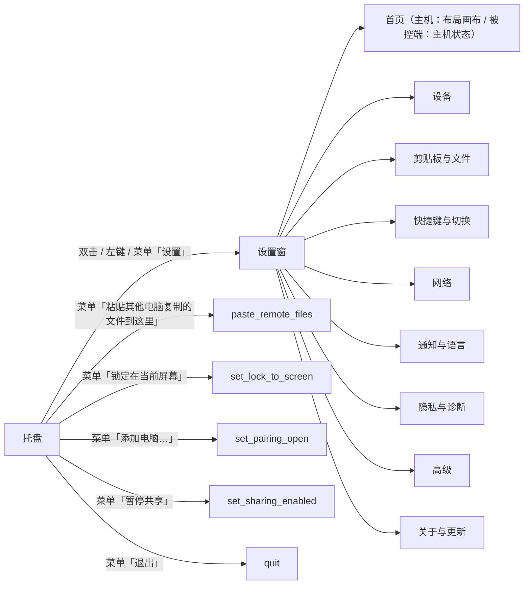
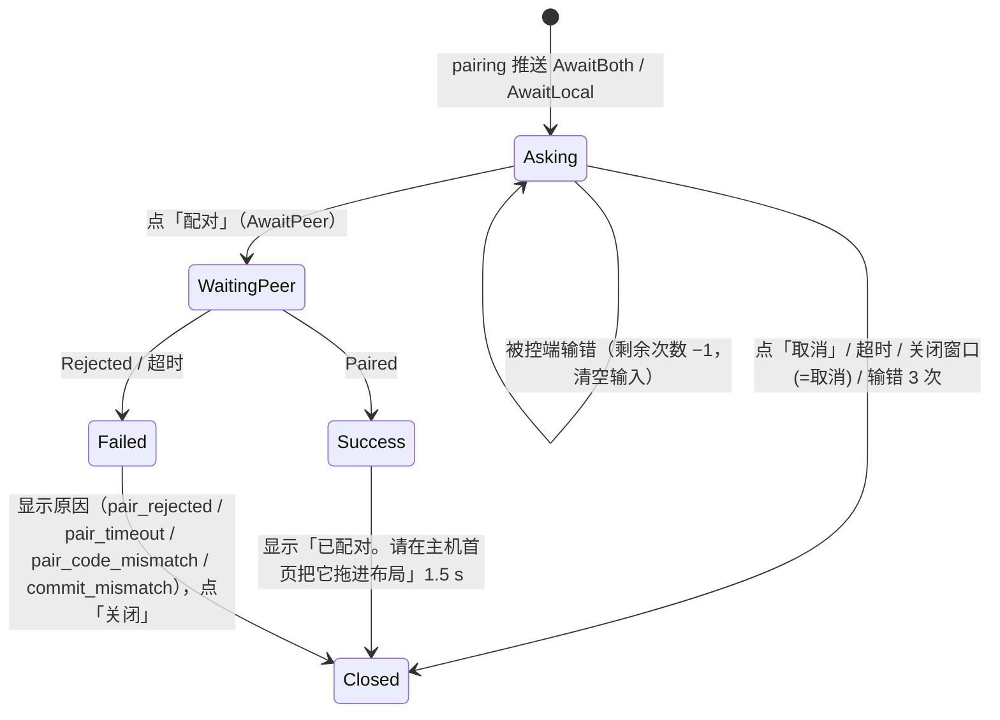
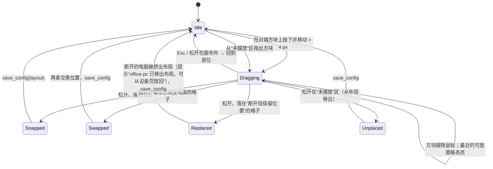
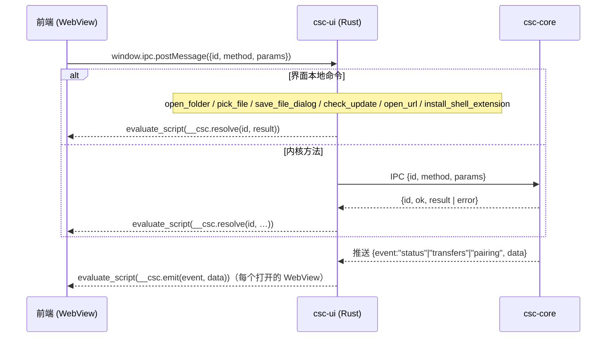

# Cross-SystemConnect 界面设计

> 文档版本：v2.0 · 对应软件 v2.0.0（未发布）
> 相关文档：[PRD](PRD.md)（F1–F34）· [架构设计](架构设计.md)（配置 §7、IPC §8、错误码 §10.7）· [用户手册](用户手册.md) · [测试用例](测试用例.md)（T-UI-01～40）
> 未确定的数值和素材标为 TBD；本文的界面文字以简体中文为准，英文见 §6。

---

## 1. 设计原则与信息架构

### 1.1 技术前提（来自架构设计）

- 界面进程 `Cross-SystemConnect`（crate `csc-ui`）= tao（窗口）+ wry（Windows 用 WebView2、Linux 用 WebKitGTK）+ tray-icon（托盘）。Linux 支持 X11 与 GNOME Wayland 会话；Wayland 下窗口不能自行定位或置顶，需要定位的元素（被控提示）改由 GNOME Shell 扩展或 portal 提供（架构设计 §13）。
- Clash 风格的 HTML/CSS/JS 静态资源编译时内嵌，不监听本机 HTTP 端口，不打开系统浏览器。
- 界面不碰钩子和网络：所有业务操作经本机 IPC 调用内核 `Cross-SystemConnect-core`；状态由 IPC `subscribe` 推送（`status`、`transfers`、`pairing`）。
- 只有托盘「退出」会结束内核（IPC `quit`）；关闭任何窗口都只是隐藏或销毁该窗口。

### 1.2 设计原则

1. **平时看不见**：正常工作时只有托盘图标；只有需要用户决定的事（配对、重名、错误）才弹窗。
2. **状态一眼可见**：托盘图标 + 提示文字 + 首页横幅三处一致地表达同一状态（§3），不只靠颜色区分。
3. **改了立即生效**：除网络端口和角色外，设置项修改后自动保存（防抖 500 ms），不需要「应用」按钮；端口和角色有明确的「保存」与确认，因为会断开连接。
4. **校验前置**：能在输入时发现的错误（端口冲突、热键冲突）就在输入框下提示，并禁用保存。
5. **危险操作二次确认**：移除设备、清除数据、改角色、改端口（中断传输时）。
6. **主机与被控端各看各的**：只显示对本机角色有意义的设置（§1.4）。
7. **远端内容只当文字**：对端名字、文件名、地址、更新说明一律纯文本渲染，任何窗口只能调用自己需要的内核方法（§7.2，架构设计 §14.1）。
8. **被控必须看得见、停得下**：被控端始终有提示，本地一个热键即可暂停（§2.16）。

### 1.3 设置窗导航



| 页 | 内容 | 相关功能 |
|---|---|---|
| 首页 | 主机：屏幕布局画布与连接状态；被控端：主机状态卡片 | F1、F2、F8、F17、F18 |
| 设备 | 「添加电脑…」（允许新配对）、已配对设备与指针速度、手动添加的电脑、版本不兼容提示 | F10、F15、F21、F27、F34 |
| 剪贴板与文件 | 文字上限、图片、格式、发送时机、文件粘贴、断点续传、元数据、来源标记、兜底保存目录（只读） | F3、F4、F5、F9、F23、F24 |
| 快捷键与切换 | 热键（录制器）、到边距离、按住键不切换、全屏不切换、角落死区、锁定键同步、指针与光标、防熄屏 | F1、F7、F20、F22、F33、F34 |
| 网络 | 网卡与网卡模式、信任的 Wi-Fi、三个端口、IPv6、监听范围、刷新 | F8、F16、F27 |
| 通知与语言 | 通知开关、界面语言 | F25、F26 |
| 隐私与诊断 | 隐私说明、私钥保护方式、导出诊断信息、测量模式、清除所有数据 | F28、F29、F30、F31 |
| 高级 | 角色、计算机名、开机自启、管理员权限（Windows）、系统集成（Wayland 授权与 Shell 扩展）、日志 | F13、F14、F32 |
| 关于与更新 | 版本、协议版本、检查更新、许可证（Apache-2.0）、文档链接 | F21 |

### 1.4 主机与被控端的差异

| 区域 | 主机（`role=server`） | 被控端（`role=client`） |
|---|---|---|
| 首页 | 布局画布（可拖动） | 主机状态卡片（`host_state`），无画布 |
| 设备 → 手动添加的电脑 | 显示（主机按这些地址拨号） | 隐藏（被控端不主动拨号） |
| 快捷键 | 回到主机、锁屏、锁定在当前屏幕 | 锁屏（本地键盘也能触发，F7）、紧急暂停（F33）；其他不显示 |
| 被控提示 | — | 被控时显示提示标签（§2.16），可在「快捷键与切换」关闭 |
| 设备 → 指针速度 | 每台被控端一个滑块 | 不显示（由主机设置） |
| 切换（到边距离、按住键、全屏、角落） | 可编辑 | 不显示，提示“切换规则由主机设置” |
| 锁定键同步 | 可编辑 | 不显示（以主机为准，F20） |
| 托盘「锁定在当前屏幕」 | 显示 | 不显示 |
| 托盘「暂停共享」「添加电脑…」 | 显示 | 显示 |
| 隐私与诊断 → 测量 | 可开启测量模式并运行测量 | 只能开启测量模式（测量由主机发起） |
| 其他页 | 相同 | 相同 |

---

## 2. 窗口与页面

控件表中的列：**控件** / **功能编号** / **配置字段** / **IPC 方法或数据来源**。`save_config` 表示读取 `get_config` 后修改对应字段再保存。

### 2.1 首次运行向导（F14、F32）

触发：UI 启动时 `get_status.first_run=true`（core 本次新建了配置、角色尚未经用户确认；新增状态字段，见 §7.4）。尺寸 560×420（TBD），不可调整大小，模态。共 3 步；Wayland 会话多一步“系统授权”。

```
┌───────────────────────────────────────────────┐
│  欢迎使用 Cross-SystemConnect           1 / 3 │
│   这台电脑接着键盘鼠标吗？                       │
│   ┌─────────────────┐  ┌─────────────────┐    │
│   │  是，这是主机    │  │  否，这是被控端   │    │
│   │  用这台的键鼠    │  │  被其他电脑控制   │    │
│   └─────────────────┘  └─────────────────┘    │
│   只能有一台主机。                  [ 下一步 ]  │
└───────────────────────────────────────────────┘
┌───────────────────────────────────────────────┐
│  网络                                    2 / 3 │
│  直连网卡：[ 以太网 2  192.168.100.1/24   ▾ ]  │
│  ☐ 自动（所有可信网卡都可用）                   │
│  ☑ 登录后自动启动                              │
│  防火墙需放行 TCP 24900、24901 和 UDP 24900     │
│  （只对直连网卡所在网络）。                     │
│                       [ 上一步 ]  [ 下一步 ]    │
└───────────────────────────────────────────────┘
┌───────────────────────────────────────────────┐
│  系统授权（仅 Wayland）                  3a / 3 │
│  ● 远程交互授权   [ 授权… ]   ✓ 已授权          │
│  ● 输入捕获授权（主机） [ 授权… ]               │
│  ● GNOME Shell 扩展   ⚠ 需要注销后重新登录      │
│                                  [ 下一步 ]    │
└───────────────────────────────────────────────┘
┌───────────────────────────────────────────────┐
│  添加电脑                                3 / 3 │
│  已开启「允许新配对」，还剩 1:52。               │
│  在另一台电脑上也完成向导，配对窗会自动弹出。     │
│  主机会显示 6 位配对码，在被控端输入它。          │
│                         [ 稍后 ]  [ 完成 ]      │
└───────────────────────────────────────────────┘
```

| 控件 | 功能 | 配置字段 | IPC |
|---|---|---|---|
| 角色卡片（单选） | F14 | `role` | `save_config` |
| 直连网卡下拉 | F8 | `network.interface` | `list_interfaces`（显示名字、类型、地址；地址非私有的网卡标“公共地址”并置灰） |
| 自动网卡模式 | F27 | `network.interface_mode` | `save_config` |
| 登录后自动启动 | F28 | `autostart.enabled`（向导默认勾选） | `save_config` |
| 系统授权（Wayland） | F32 | — | `wayland_setup {step}`；状态来自 `status.platform.portals`、`shell_extension` |
| 添加电脑倒计时 | F10 | `pairing.open_window_s` | 进入第 3 步时 `set_pairing_open {enabled:true}`；`status.pairing_open_until` |
| 完成 | — | — | 打开设置窗首页（「允许新配对」继续到时间结束） |

关闭向导（×）= 按被控端保存（与“无界面首次运行默认 client”一致），不开启「允许新配对」，并在首页提示可在「高级」改角色。

### 2.2 配对窗（F10）

触发：`pairing` 推送中出现 `state` 为 `AwaitBoth`/`AwaitLocal` 的项（只有本机开启了「允许新配对」才会出现）。尺寸 420×360（TBD），置顶，不吞键盘。同时有多个请求时排队（最多 3 个，架构设计 §14.5），标题显示“1/2”。按本机角色分两种：

**主机（`mode=display`，显示配对码）**

```
┌──────────────────────────────────────────┐
│  配对新电脑                          1/1 │
│  「linux-pc」请求与本机配对                │
│  （192.168.100.2，被控端）                 │
│        ┌──────────────────────┐          │
│        │     482   913        │          │
│        └──────────────────────┘          │
│  请在 linux-pc 上输入这 6 位数。            │
│  不认识这台电脑，请点「取消」。              │
│  ⏱ 52 秒后自动取消                         │
│                  [ 取消 ]  [ 配对 ]       │
└──────────────────────────────────────────┘
```

**被控端（`mode=enter`，输入配对码）**

```
┌──────────────────────────────────────────┐
│  配对新电脑                          1/1 │
│  「win-pc」请求成为本机的键鼠主机           │
│  （192.168.100.1）                         │
│  ⚠ 配对后，win-pc 可以控制本机的键盘和鼠标。 │
│  请输入 win-pc 屏幕上显示的 6 位数：         │
│        [ _ _ _   _ _ _ ]                  │
│  （还可尝试 3 次）                          │
│  ⏱ 52 秒后自动取消                         │
│                  [ 取消 ]  [ 配对 ]       │
└──────────────────────────────────────────┘
```

**指纹变化**（`fingerprint_changed=true`）时两种窗口顶部都加红色横幅：“这台电脑以前配对过，但身份已改变。如果对方没有重装系统或 CSC，可能有人在冒充，请取消。”

| 控件 / 区域 | 功能 | 字段 / 数据 | IPC |
|---|---|---|---|
| 对端名字、地址、角色 | F10 | `pairing.items[].peer_name`（已清洗，纯文本）、`address`、`peer_role` | `pairing` 推送 |
| 配对码（仅主机） | F10 | `pairing.items[].sas`（显示为 `123 456`，等宽数字） | `pairing` 推送 |
| 配对码输入（仅被控端） | F10 | 6 个数字格，只接受数字，粘贴会被拆分；`attempts_left` | — |
| 倒计时 | F10 | `expires_at`（以 core 为准） | — |
| 配对 / 取消 | F10 | — | 主机 `pair_confirm {device_id, accepted}`；被控端 `pair_confirm {device_id, accepted, code}`（未输满 6 位时「配对」禁用） |

状态流转：



- 「等待对方确认…」时「配对」按钮变为加载状态，「取消」仍可用。
- 角色冲突（`role_conflict`）不弹配对窗，改为首页横幅与通知（§3）。
- 默认焦点：主机在「取消」上（防止回车误确认）；被控端在第一个数字格上。
- 配对成功后对端出现在主机首页的“未摆放”区（§2.3），不会自动进入布局。

### 2.3 主机首页：布局画布（F1、F2）

```
┌ 设置 ───────────────────────────────────────────────────────────────┐
│ ▸首页      │ ⚠ 横幅区（仅异常时显示，见 §3）                          │
│  设备      │ ┌────────────────────────────────────────────────────┐ │
│  剪贴板与文件│ │            ┌──────┐┌──────┐┌──────┐               │ │
│  快捷键与切换│ │            │ 空位 ││ 空位 ││ 空位 │               │ │
│  网络      │ │            └──────┘└──────┘└──────┘               │ │
│  通知与语言 │ │            ┌──────┐┌══════┐┌──────┐               │ │
│  隐私与诊断 │ │            │linux-││ 本机 ││ 空位 │               │ │
│  高级      │ │            │pc  ● ││(主机)││      │               │ │
│  关于与更新 │ │            └──────┘└══════┘└──────┘               │ │
│            │ │            ┌──────┐┌──────┐┌──────┐               │ │
│            │ │            │ 空位 ││ 空位 ││ 空位 │               │ │
│            │ │            └──────┘└──────┘└──────┘               │ │
│            │ └────────────────────────────────────────────────────┘ │
│            │ 未摆放（拖到上方格子后才能切换、共享剪贴板）：           │
│            │ ┌──────────┐                                           │
│            │ │ office-pc│                                           │
│            │ └──────────┘                                           │
│            │ ● 已连接  ◐ 重连中  ○ 断开（保留位置）  🔒 安全桌面  ⏸ 已暂停 │
│            │ 当前：键鼠在本机    [🔒 锁定在当前屏幕]  [⏸ 暂停共享]      │
└────────────┴────────────────────────────────────────────────────────┘
```

- 画布大小固定；主机方块固定在中间，不可拖动；周围 8 个位置（上下左右与四角），方块间距 5 像素。
- 只显示已配对的电脑（未配对的不出现，F10）；暂时断开的电脑保留位置，以空心标记显示。
- **未摆放区**：新配对的电脑（`peers[].in_layout=false`）显示在画布下方，必须由用户拖进格子；未摆放的电脑不能切换、不收剪贴板（架构设计 §7.2 `layout`）。从布局移出的电脑也回到这里。
- 方块内容：计算机名（超长省略，悬停显示全名、IP、版本、状态）、状态点、活动屏幕高亮边框（键鼠当前所在）。

| 控件 | 功能 | 配置字段 | IPC |
|---|---|---|---|
| 对端方块（拖动） | F2 | `layout`（按 `device_id` 引用） | `save_config`（松手后保存） |
| 状态点 / 安全桌面标记 | F8、F17、F18 | — | `status` 推送 `peers[].state`、会话状态 |
| 活动屏幕高亮 | F1 | — | `status` 推送 |
| 锁定在当前屏幕按钮 | F22 | `hotkeys.lock_to_screen`（热键）；状态不持久化 | `set_lock_to_screen {enabled}`，状态来自 `get_status.lock_to_screen` |
| 暂停共享按钮 | F33 | 不持久化 | `set_sharing_enabled {enabled}`，状态来自 `sharing_paused` |
| 未摆放区方块（拖入格子） | F2、F10 | `layout` | `save_config` |
| 已暂停标记 | F33 | — | `peers[].paused_by_peer` |
| 方块右键菜单：在设备页查看、从布局移出 | F2、F15 | `layout` | `save_config` |

空状态：没有已配对电脑时，画布只显示主机方块，中间提示“还没有配对的电脑。点「添加电脑…」，并在另一台电脑上也打开「添加电脑…」，配对窗会自动弹出。” 以及「添加电脑…」按钮和「网络设置」「手动添加电脑」两个链接。

### 2.4 被控端首页（F17、F18）

```
┌ 设置 ─────────────────────────────────────────────────┐
│ ▸首页      │  ┌───────────────────────────────────────┐ │
│  …         │  │  主机：win-pc   ● 已连接               │ │
│            │  │  192.168.100.1 · v2.0.0 · 协议 2      │ │
│            │  │  键鼠：在本机（被控中时显示“正在被控制”）│ │
│            │  └───────────────────────────────────────┘ │
│            │  本机：linux-pc（被控端）                    │
│            │  本地键盘鼠标始终可用。                       │
│            │  按 Ctrl+Alt+Shift+P 可随时暂停被控。          │
│            │  [⏸ 暂停共享]                                 │
└────────────┴───────────────────────────────────────────┘
```

| 区域 | 功能 | 数据 |
|---|---|---|
| 主机状态 | F17 | `get_status.host_state` ∈ `no_host`/`connected`/`host_sleeping`/`host_lost`/`reconnecting` |
| 被控中提示 | F1 | 会话状态（Controlled） |
| 本机状态 | F18 | 本机 `PEER_STATE`（`normal`/`locked`/`secure_desktop`…） |
| 正在被控制 | F33 | `controlled_by` |
| 暂停共享 | F33 | `set_sharing_enabled`；`sharing_paused` |
| Wayland 授权状态 | F32 | `platform.portals.remote_desktop`；`needs_consent`/`denied` 时显示「授权…」（`wayland_setup`） |

### 2.5 设备页（F10、F15、F21、F27）

```
[ 添加电脑… ]   已允许新配对，还剩 1:52  [停止]
已配对设备
┌──────────────────────────────────────────────────────────────────────────────┐
│ linux-pc   ● 已连接  192.168.100.2  v2.0.0  指纹 3F9A…C21B  指针速度 [──●──] 1.0× [移除] │
│ office-pc  ○ 未连接  上次 10.8.0.5  v2.0.0  指纹 77D0…9E04  指针速度 [──●──] 1.0× [移除] │
└──────────────────────────────────────────────────────────────────────────────┘
⚠ dev-box（v1.1）版本不兼容，请升级到同一版本。          （仅有不兼容时）

手动添加的电脑（仅主机）
┌──────────────────────────────┬──────────┬──────┐
│ 地址（IP / IPv6 / 主机名）    │ 控制端口  │      │
│ [ 10.8.0.5               ]   │ [24900 ] │[添加]│
├──────────────────────────────┼──────────┼──────┤
│ 10.8.0.5                     │ 24900    │ [删除]│
└──────────────────────────────┴──────────┴──────┘
```

| 控件 | 功能 | 配置字段 | IPC |
|---|---|---|---|
| 添加电脑… / 停止 | F10 | `pairing.open_window_s` | `set_pairing_open {enabled}`；倒计时来自 `pairing_open_until` |
| 已配对列表 | F15 | `trusted_peers[]`（名字、指纹前 8 位+后 4 位、`last_endpoint`） | `list_peers` |
| 指针速度滑块（仅主机，0.25×–4×，步进 0.05） | F34 | `trusted_peers[].pointer_speed` | `set_peer_pointer_speed {device_id, factor}`（松手后调用） |
| 移除（二次确认） | F15 | `trusted_peers[]` | `forget_peer {device_id}` |
| 版本不兼容提示 | F21 | — | `get_status.version_mismatch[]` |
| 地址 + 控制端口 + 添加 | F27 | `network.manual_peers[]` | `add_manual_peer {address, control_port?}` |
| 删除手动地址 | F27 | 同上 | `remove_manual_peer {address}` |

- 移除确认框：“移除「office-pc」后，下次连接需要重新配对。对方电脑上的配对记录不会被删除。” [取消] [移除]（危险色）。
- 地址输入校验：IPv4、IPv6（可带 `%网卡`）、主机名（RFC 1123 字符）；端口 1024–65535，空表示 24900。重复地址提示“已存在”。

### 2.6 剪贴板与文件页（F3–F5、F9、F23、F24）

```
剪贴板
  文字上限            [ 15 ] MB   (1–15)
  ☑ 同步图片
  ☑ 同步格式（HTML / RTF）
  ☑ 复制文件后可在另一台电脑粘贴
  发送时机   (•) 复制后立即发送  ( ) 只在切到该电脑时发送
文件传输
  断点续传保留时间     [ 30 ] 分钟  (0 = 不续传)
  ☑ 保留修改时间
  ☑ 保留权限（Linux 之间）
  ☑ 收到的文件标记为“来自其他电脑”（Windows）
  ☑ 存到桌面的文件去掉可执行权限（Linux）
  粘贴的文件存到文件管理器当前打开的文件夹（托盘粘贴存到兜底目录）。
  兜底保存目录：C:\Users\xx\Desktop   [打开]
  （拿不到当前文件夹或托盘粘贴时使用；可在配置文件 file_transfer.receive_dir 修改）
```

| 控件 | 功能 | 配置字段 | IPC |
|---|---|---|---|
| 文字上限 | F3 | `clipboard.max_inline_mb` | `save_config` |
| 同步图片 | F4 | `clipboard.image` | `save_config` |
| 同步格式 | F23 | `clipboard.rich` | `save_config` |
| 文件粘贴 | F5 | `clipboard.files` | `save_config` |
| 续传保留时间 | F24 | `file_transfer.resume_window_min` | `save_config` |
| 保留修改时间 / 权限 | F24 | `file_transfer.preserve_mtime` / `preserve_mode` | `save_config` |
| 发送时机 | F3 | `clipboard.push_mode` | `save_config` |
| 来源标记 / 去掉可执行权限 | F24 | `file_transfer.mark_of_web` / `strip_exec_on_desktop`（按平台只显示一项） | `save_config` |
| 兜底保存目录（只读）+ 打开 | F9 | `file_transfer.receive_dir`（不可编辑） | `get_save_dir`；「打开」由 UI 进程调用系统文件管理器 |

### 2.7 快捷键与切换页（F1、F7、F20、F22）

```
快捷键
  回到主机           [ Ctrl + Alt + /          ] [恢复默认]
  所有电脑一起锁屏    [ Ctrl + Alt + Shift + L  ] [恢复默认]
  锁定在当前屏幕      [ Ctrl + Alt + Shift + K  ] [恢复默认]
  紧急暂停被控（本机键盘）[ Ctrl + Alt + Shift + P ] [恢复默认]
                      ⚠ 与「所有电脑一起锁屏」相同        （冲突时）
切换（仅主机）
  到边继续推的距离    [ 8 ] 像素  (0–200)
  按住此键时不切换    ( ) 无  ( ) Ctrl  ( ) Shift  ( ) Alt
  ☑ 前台全屏时不切换
  角落死区           [ 10 ] 像素  (0–100)
键盘（仅主机）
  ☑ 同步锁定键（CapsLock / NumLock / ScrollLock）
指针（仅主机）
  ☑ 各电脑指针移动速度一致（按显示器缩放换算）
  ☑ 控制其他电脑时隐藏本机光标
  （每台电脑的速度微调在「设备」页）
光标与提示（被控端）
  ☑ 不在使用时隐藏本机光标
  ☑ 被控制时显示提示标签
电源
  ☑ 使用任一电脑时，其他电脑不熄屏、不自动锁屏
```

| 控件 | 功能 | 配置字段 | IPC |
|---|---|---|---|
| 回到主机录制器 | F7 | `hotkeys.return_to_server` | `validate_hotkey`、`save_config` |
| 锁屏录制器 | F7 | `hotkeys.lock_screen` | 同上 |
| 锁定在当前屏幕录制器 | F22 | `hotkeys.lock_to_screen` | 同上 |
| 紧急暂停录制器（被控端显示；主机也显示以便统一设置，主机不转发该组合） | F33 | `hotkeys.emergency_pause` | 同上 |
| 指针速度一致 | F34 | `pointer.match_physical_speed` | `save_config` |
| 隐藏本机光标（主机） | F34 | `pointer.hide_host_cursor` | `save_config` |
| 不在使用时隐藏光标（被控端） | F34 | `pointer.hide_inactive_cursor` | `save_config` |
| 被控提示 | F33 | `ui.controlled_indicator`（`badge`/`off`） | `save_config` |
| 防熄屏 | F7 | `power.keep_peers_awake` | `save_config` |
| 录制期间暂停内核热键 | — | — | `set_hotkey_recording {enabled}` |
| 到边距离 | F1 | `switch.edge_push_px` | `save_config` |
| 按住键不切换 | F22 | `switch.block_modifier` | `save_config` |
| 全屏不切换 | F22 | `switch.block_when_fullscreen` | `save_config` |
| 角落死区 | F22 | `switch.corner_dead_px` | `save_config` |
| 同步锁定键 | F20 | `keyboard.sync_locks` | `save_config` |

`keyboard.remap` 不在界面提供（只在配置文件中，F19）。

**热键录制器**（§5.2 详述）：点击输入框进入录制态（虚线框 + “请按下组合键，Esc 取消，Backspace 清除”），松开全部键时确定组合；随后调用 `validate_hotkey`：

| 冲突类型 | 表现 | 能否保存 |
|---|---|---|
| 与 CSC 其他热键相同（`internal`） | 红字“与「…」相同” | 否 |
| 已知系统组合（`system`，如 `Ctrl+Alt+Del`、`Alt+Tab`、`Alt+F4`） | 红字“系统保留，无法使用” | 否 |
| `Win+L`（Windows 主机） | 黄字“Windows 会先锁本机，再通知其他电脑” | 是 |
| 被其他程序注册（`registered`，Windows 用 `RegisterHotKey` 试探） | 黄字“可能与其他程序冲突” | 是 |
| 已知 IDE 快捷键（`ide`，如 JetBrains 的 `Ctrl+Alt+L`/`Ctrl+Alt+K`） | 黄字“与常用开发工具的快捷键相同” | 是 |
| 包含右 Alt 且本机布局带 AltGr | 黄字“右 Alt 在此布局下是 AltGr，请用左 Alt” | 否（录制器自动按左 Alt 记录） |
| 只有修饰键 / 没有修饰键 | 红字“需要“修饰键 + 一个键”” | 否（与 §7 配置说明一致：修饰键 + 一个键才能在本机态被观察到） |

### 2.8 网络页（F8、F16、F27）

```
网卡
  模式   (•) 固定  ( ) 自动（可信网卡都可用，有线断开时改用其他网卡）
  直连网卡 [ 以太网 2  192.168.100.1/24        ▾ ]  [刷新]
  自动模式可用的 Wi-Fi：[ HomeWiFi ×  ] [+ 添加当前 Wi-Fi]
  ☑ IPv6
  监听地址：192.168.100.1、fe80::1%eth1（只在私有和链路本地地址上监听）
端口                                      状态：● 正在监听
  控制端口（TCP） [ 24900 ]
  数据端口（TCP） [ 24900 ]  ✖ 控制端口和数据端口不能相同
  发现端口（UDP） [ 24900 ]  ⓘ 所有电脑必须相同；可与控制端口相同
  改端口后请在防火墙放行新端口。
                                  [ 还原 ]  [ 保存 ]（有错误时禁用）
```

| 控件 | 功能 | 配置字段 | IPC |
|---|---|---|---|
| 网卡模式 | F27 | `network.interface_mode` | `save_config` |
| 直连网卡 | F8 | `network.interface` | `list_interfaces`；`save_config` |
| 刷新 | F8 | — | `refresh_network` |
| 可信 Wi-Fi 列表（仅自动模式显示） | F27 | `network.trusted_wifi` | `save_config`；「添加当前 Wi-Fi」取 `list_interfaces` 中的 `ssid` |
| 监听地址（只读） | F16 | — | `status.network.listen_addrs` |
| IPv6 | F27 | `network.ipv6` | `save_config` |
| 监听状态 | F16 | — | `get_status.network.state`（`listening`/`rebinding`/`config_invalid`）与 `errors[]` |
| 三个端口输入 | F16 | `network.control_port`、`network.data_port`、`network.discovery_port` | 输入停顿 300 ms 后 `validate_network_ports` |
| 保存 | F16 | 同上 | `set_network_ports`（有进行中的传输时先确认“将中断正在进行的传输”） |
| 还原 | — | — | 恢复为 `get_config` 中的值 |

错误码 → 输入框下的文字：`port_conflict` “控制端口和数据端口不能相同”；`port_out_of_range` “端口必须在 1024–65535 之间”；`port_in_use` “端口已被其他程序占用（TCP 24901）”。保存成功后显示“正在切换端口…”（`rebinding`），变为 `listening` 后提示“已切换到新端口”。

网络页的端口与角色不自动保存，离开页面时若有未保存修改，提示 [放弃修改] [留在此页]。

### 2.9 通知与语言页（F25、F26）

| 控件 | 功能 | 配置字段 | IPC |
|---|---|---|---|
| 对端连接 | F25 | `notify.connect`（默认关） | `save_config` |
| 断开 / 主机休眠或失联 | F25 | `notify.disconnect`（默认开） | `save_config` |
| 传输完成 / 失败 | F25 | `notify.transfer`（默认开） | `save_config` |
| 错误 | F25 | `notify.errors`（默认开） | `save_config` |
| 配对请求（只读说明“总会通知”） | F25 | — | — |
| 界面语言：跟随系统 / 简体中文 / English | F26 | `ui.language` | `save_config`；UI 立即重载字符串并重建托盘菜单 |

### 2.10 隐私与诊断页（F28–F31）

```
隐私
  CSC 只在已配对的电脑之间传输数据，不收集任何统计。
  日志不记录按键、剪贴板和文件内容。        [查看隐私声明]
安全
  私钥保存方式  (•) 配置目录中的文件（仅本用户可读）  ( ) 系统密钥库（Windows DPAPI / GNOME 密钥环）
诊断
  [ 导出诊断信息… ]   最近一次崩溃：无
  ☐ 测量模式（仅测试时打开）
     （主机）对端 [linux-pc ▾]  类型 [延迟 ▾]  [ 开始测量 ]
数据
  [ 清除所有数据并退出… ]
```

| 控件 | 功能 | 配置字段 | IPC |
|---|---|---|---|
| 隐私声明 | F29 | — | 打开内嵌页面（内容同用户手册 §12） |
| 私钥保存方式 | F29 | `identity.key_store` | `save_config`（切换时 core 迁移私钥，失败回退并提示） |
| 导出诊断信息 | F28 | — | 先显示将包含的文件清单与“☐ 包含崩溃转储（可能含敏感数据）”，再弹系统“另存为” → `export_diagnostics {path, include_crash_dumps}` |
| 最近一次崩溃 | F28 | — | 崩溃目录信息（来源 TBD） |
| 测量模式 | F31 | `diagnostics.bench_enabled` | `save_config` |
| 开始测量（主机） | F31 | — | `bench_run {kind, peer, samples?, size?, files?}`；结果表格 + 「打开 CSV」 |
| 清除所有数据并退出 | F30 | — | `reset_data {keep_pairing}`（二次确认，§5.4） |

### 2.11 高级页（F13、F14、F29、F32）

| 控件 | 功能 | 配置字段 | IPC |
|---|---|---|---|
| 角色（主机 / 被控端，需点「保存」并确认“将断开所有连接”） | F14 | `role` | `save_config` |
| 计算机名（只用于显示） | F2 | `name` | `save_config` |
| 开机自启 | F28 | `autostart.enabled`（向导写入时默认 true；无界面首次运行的 core 不写自启，为 false） | `save_config` |
| 以管理员权限运行（仅 Windows） | F29 | `autostart.elevated` | `save_config`；说明“开启后设置窗也以管理员身份运行，普通程序无法连接内核” |
| 系统集成（仅 Wayland）：远程交互授权、输入捕获授权、剪贴板授权、Shell 扩展状态 | F32 | — | 状态来自 `status.platform`；按钮「重新授权」→ `wayland_setup {step}`；扩展缺失时「安装/启用扩展」（UI 本地命令 `install_shell_extension`，复制到用户扩展目录并启用）与“需要注销重新登录”提示 |
| 写入日志文件 / 级别 / 路径（「浏览…」系统对话框） | F13 | `log.to_file`、`log.level`、`log.file` | `save_config` |
| 打开日志目录 | F13 | — | UI 进程调用系统文件管理器 |

### 2.12 关于与更新页（F21）

```
Cross-SystemConnect 2.0.0（协议 2，配置 5）
内核：运行中（PID 1234）
[ 检查更新 ]  ☐ 启动时检查更新
  ✓ 已是最新版本 / ⬆ 有新版本 2.1.0 [打开下载页] 更新说明…
文档：用户手册 · 隐私声明 · 许可证（Apache-2.0）
```

| 控件 | 功能 | 配置字段 | 实现 |
|---|---|---|---|
| 检查更新 | F21 | `update.url`（TBD） | `check_update`：由 UI 进程发 HTTPS GET 清单与 minisign 签名并验签（core 不联网，见架构设计 §12.5）；签名无效显示“更新信息签名无效”；只显示结果，不下载 |
| 启动时检查 | F21 | `update.check_on_start`（默认关） | `save_config` |
| 打开下载页 | F21 | — | `open_url`：只有主机名在内置白名单内才显示按钮；用户点击才打开 |
| 更新说明 | F21 | — | 纯文本显示（不解析 HTML/链接），最长 4 KiB |

### 2.13 接收进度窗（F9、F12、F24）

只在接收端弹出；多个传输在同一窗口中按批次列出。尺寸 480×400（TBD），可调整大小，不抢焦点。

```
┌ 接收文件 ───────────────────────────────────────────┐
│ 来自 win-pc · 粘贴 · 3 项 · 1.2 GB                  │
│ ████████████░░░░░░░░  58%  112 MB/s  剩余 5 秒      │
│ 保存到：~/文档/项目（当前文件夹）      [取消] [打开位置] │
│ ⓘ 已重命名 2 项  ▸ 展开                              │
│    report:v2.docx → report_v2.docx                  │
│    CON.txt        → CON_.txt                        │
├────────────────────────────────────────────────────┤
│ 来自 linux-pc · 粘贴 · 1 项                          │
│ ⚠ 有 1 项同名：                                      │
│   photo.jpg   ( ) 跳过 (•) 保留两者 ( ) 替换          │
│   [全部：保留两者 ▾]                       [继续]     │
├────────────────────────────────────────────────────┤
│ 来自 win-pc · 1 项 · ⏸ 等待重连（断点续传，剩余 27 分钟）│
├────────────────────────────────────────────────────┤
│ ✖ 来自 win-pc · 磁盘空间不足：需要 2.1 GB，可用 1.0 GB  │
│                                           [关闭]     │
├────────────────────────────────────────────────────┤
│ ⓘ 来自 win-pc · 粘贴 · 当前位置不是普通文件夹，        │
│   已存到兜底目录：桌面                               │
├────────────────────────────────────────────────────┤
│ ✓ 来自 linux-pc · 完成 · 12 个文件       （30 秒后移除）│
└────────────────────────────────────────────────────┘
```

| 区域 / 控件 | 功能 | 数据 | IPC |
|---|---|---|---|
| 批次标题（来源、用途、项数、大小） | F9 | `Transfer.from`、`purpose`、`files_total`、`bytes_total`（架构设计 §8.2） | `transfers` 推送（≤ 10 Hz） |
| 保存到 | F5、F9 | `Transfer.dest`（`current_folder`/`located`/`fallback`） | 同上 |
| 提示行（兜底目录、长路径、已标记来源） | F9、F24 | `Transfer.notes[]` | 同上 |
| 进度、速度、剩余时间；小文件时显示“文件 120/1000” | F9、F24 | 同上 | 同上 |
| 取消 | F9 | — | `cancel_transfer {transfer_id}` |
| 打开位置 | F9 | — | `get_save_dir` 或实际存放目录 → 系统文件管理器 |
| 重名选择（逐项 + 「全部」）+ 继续 | F12 | `Transfer.conflicts[]` | `resolve_conflict {transfer_id, decisions:[{index, choice}]}`，`choice` ∈ `skip`/`keep_both`/`replace` |
| 已重命名列表 | F24 | `Transfer.renamed[]`（文件名已清洗，纯文本） | `transfers` 推送 |
| 等待重连 | F24 | `state=paused_link_lost`、`resume_deadline` | 同上 |
| 错误行（`no_space`、`file_too_large_for_fs`、`hash_mismatch`、`peer_lost`、`no_target_dir`、`io_error`、`sharing_paused`…） | F9、F24 | `Transfer.error` | 同上；关闭 = `dismiss_transfer {transfer_id}` |
| 完成项保留 30 s 后移除 | F9 | — | 自动 `dismiss_transfer` |

- 所有批次都结束且被移除后，窗口自动隐藏。
- 批次用途仅为粘贴 / 托盘粘贴（跨屏拖拽已取消，不再出现「拖拽」批次）。

### 2.14 边缘窗（已移除）

跨屏拖拽已取消，**不再提供**虚拟拖拽细窗与边缘投放窗。`status.drag_edge` 字段保留但恒为不可见；IPC `drag_enter` 保留未用（架构设计 §4.6）。设置页布局画布上的电脑方块拖动（§5.1）与此无关，仍保留。

### 2.15 托盘

**菜单**

| 菜单项 | 显示条件 | 动作 |
|---|---|---|
| 状态行（灰色不可点，如“已连接 2 台 · 键鼠在本机”） | 总是 | — |
| 设置 | 总是 | 打开设置窗 |
| 粘贴其他电脑复制的文件到这里 | 存在其他电脑的文件复制记录时可用，否则灰色 | `paste_remote_files` |
| 锁定在当前屏幕（勾选项） | 仅主机 | `set_lock_to_screen {enabled}` |
| 暂停共享（勾选项） | 总是 | `set_sharing_enabled {enabled}`（勾选 = 暂停） |
| 添加电脑… | 总是 | `set_pairing_open {enabled:true}`，并打开设置窗设备页显示倒计时 |
| 退出 | 总是 | `quit`，然后 UI 退出 |

打开方式：Windows 双击或右键「设置」；Linux（StatusNotifierItem）左键打开，双击不打开。

**图标状态**（素材 16/20/24/32/48 px，深浅两套，设计 TBD）

| 图标 | 含义 |
|---|---|
| 常规（实心） | 正常：主机有已连接对端且键鼠在本机；被控端已连接主机 |
| 常规 + 箭头角标 | 主机正在控制某台被控端 / 被控端正在被控制 |
| 灰色 | 无连接（主机没有已连接对端；被控端 `no_host`/`host_lost`） |
| 灰色 + 旋转角标（静态帧） | 重连中 / 端口切换中（`reconnecting`、`rebinding`） |
| 常规 + 月亮角标 | 被控端：主机休眠（`host_sleeping`） |
| 黄色叹号角标 | 需要注意：配对等待、版本不兼容、安全桌面 |
| 红色叉角标 | 错误：`config_invalid`、`role_conflict`、`unsupported_session`、内核连续崩溃 |
| 常规 + 锁角标 | 锁定在当前屏幕 |
| 常规 + 下载角标 | 正在接收文件 |
| 常规 + 暂停角标 | 暂停共享（本机或被控端紧急暂停） |
| 常规 + 加号角标 | 正在允许新配对（倒计时中） |

角标优先级：红 > 黄 > 暂停 > 锁 > 加号 > 下载 > 箭头。提示文字（tooltip）始终写出完整状态（§3），不依赖颜色。

### 2.16 被控提示层（F33）

- 被控端被控制（`controlled_by` 非空）且 `ui.controlled_indicator=badge` 时显示：当前显示器右上角、距边 16 px、不抢焦点、鼠标可穿透的小标签。
- 内容：“正在被 win-pc 控制 · Ctrl+Alt+Shift+P 暂停”（名字已清洗）；3 s 后缩成直径 10 px 的强调色圆点，`SWITCH_LEAVE` 后消失。
- Windows：原生分层窗口（`WS_EX_TOPMOST|WS_EX_NOACTIVATE|WS_EX_TRANSPARENT|WS_EX_LAYERED`），不用 WebView；X11：override-redirect 窗口；Wayland：GNOME Shell 扩展顶栏指示器（GNOME 自带的远程桌面指示同时可见）。
- 读屏：出现时发一次 `status` 播报“正在被 win-pc 控制”。

---

## 3. 状态设计

| 状态（来源） | 托盘图标 | 提示文字（tooltip） | 首页横幅 | 通知（F25，配置项） |
|---|---|---|---|---|
| IPC 连不上内核（UI 正在拉起/重启 core） | 灰色 + 旋转 | CSC：正在启动内核… | 全窗口加载遮罩“正在连接内核…” | — |
| 内核连续崩溃，停止重启（F28） | 红叉 | CSC：内核异常退出 | 红色：“内核多次异常退出。[导出诊断信息] [重新启动]” | 错误（`notify.errors`） |
| `network.state=listening`，无对端 | 灰色 | CSC：等待其他电脑连接 | 无（首页空状态） | — |
| `network.state=rebinding` | 灰色 + 旋转 | CSC：正在切换端口… | 蓝色：“正在切换到新端口…” | — |
| `network.state=config_invalid` | 红叉 | CSC：网络配置无效 | 红色：错误列表（`port_conflict` / `port_out_of_range` / `port_in_use`）+ [去网络页修改] | 错误 |
| `platform.supported=false`（`unsupported_session`：wlroots 等无所需 portal 的合成器） | 红叉 | CSC：当前桌面环境不受支持 | 红色：“当前桌面（Sway 等）缺少所需的系统接口。支持的环境：GNOME（Wayland/X11）、X11 桌面；KDE 尽力支持。” | 错误 |
| `platform.portals.*=needs_consent`（Wayland） | 黄叹号 | CSC：需要系统授权 | 黄色：“需要允许 CSC 远程交互/捕获输入。[授权…]”（`wayland_setup`） | 总是 |
| `platform.portals.*=denied`（`portal_denied`） | 红叉 | CSC：系统授权被拒绝 | 红色：“你拒绝了授权，CSC 无法控制/被控。[重新授权]” | 错误 |
| `platform.shell_extension=missing`/`disabled`/`outdated`（`extension_missing`） | 黄叹号 | CSC：Shell 扩展未启用 | 黄色：“未启用 CSC 的 GNOME Shell 扩展：文件管理器识别、全屏判断和快捷键不可用。[安装/启用]”；装好后提示“请注销并重新登录” | 错误 |
| `sharing_paused=true` | 暂停角标 | CSC：已暂停共享（键鼠、剪贴板、文件） | 蓝色：“已暂停共享 [恢复]” | — |
| `peers[].paused_by_peer=true` | 不变 | CSC：linux-pc 已暂停被控 | 方块显示 ⏸，提示“对方按了紧急暂停” | 总是 |
| `pairing_open_until` 非空 | 加号角标 | CSC：允许新配对，剩 1:52 | 设备页倒计时 | — |
| `role_conflict` | 红叉 | CSC：两台都设为主机 | 红色：“「x」也设为了键鼠主机。[改为被控端] ” | 错误 |
| 配对等待（`pairing.items` 非空；只在允许新配对期间出现） | 黄叹号 | CSC：有电脑请求配对 | 黄色：“「x」请求配对 [查看]” | 总是 |
| `version_mismatch[]` 非空 | 黄叹号 | CSC：对端版本不兼容 | 黄色：“「x」版本 1.1 不兼容…” | 错误 |
| 主机：已连接，键鼠在本机 | 常规 | CSC：已连接 N 台 · 键鼠在本机 | 无 | 连接时（`notify.connect`） |
| 主机：控制某台 | 常规 + 箭头 | CSC：正在控制 linux-pc | 无 | — |
| 主机：某对端断开 | 常规或灰色 | CSC：linux-pc 已断开 | 方块显示空心 | 断开（`notify.disconnect`） |
| `peers[].state=secure_desktop` | 黄叹号 | CSC：linux-pc 处于安全桌面 | 方块显示锁标记，提示“到边不会切换” | 错误 |
| `peers[].state=locked` / `suspending` / `shutting_down` | 不变 | CSC：linux-pc 已锁屏 / 正在休眠 / 正在关机 | 方块副标题 | — / 断开 |
| 被控端 `host_state=connected` | 常规 | CSC：已连接主机 win-pc | 无 | 连接时 |
| 被控端 被控中（`controlled_by`） | 常规 + 箭头 | CSC：正在被 win-pc 控制 | 卡片“正在被控制”；屏幕提示层（§2.16） | — |
| 被控端 `host_state=host_sleeping` | 常规 + 月亮 | CSC：主机休眠中 | 卡片“主机休眠，唤醒后自动重连” | 断开 |
| 被控端 `host_state=host_lost` | 灰色 | CSC：与主机失去联系 | 卡片“与主机失去联系，正在等待…” | 断开 |
| 被控端 `host_state=reconnecting` | 灰色 + 旋转 | CSC：正在重连主机 | 卡片“正在重连…” | — |
| 被控端 `host_state=no_host` | 灰色 | CSC：未连接主机 | 卡片“未找到主机” + 网络排查链接 | — |
| `lock_to_screen=true` | 加锁角标 | CSC：已锁定在当前屏幕（Ctrl+Alt+Shift+K 解除） | 首页按钮高亮 | — |
| 接收中（`transfers` 有进行项） | 加下载角标 | CSC：正在接收 2 项 · 58% | — | 完成/失败（`notify.transfer`） |
| 传输 `paused_link_lost` | 不变 | CSC：传输等待重连 | 进度窗行 | — |
| 传输错误（`no_space` 等） | 不变 | — | 进度窗错误行 | 错误 |
| 有新版本（手动检查结果） | 不变 | — | 关于页 | 总是（仅手动检查时） |
| 更新信息签名无效（`update_signature_invalid`，UI 本地） | 不变 | — | 关于页红字“更新信息签名无效，已忽略” | — |

同一时刻多个状态并存时：托盘角标按 §2.15 优先级；首页横幅最多同时显示 3 条，按 红 > 黄 > 蓝 排序。

---

## 4. 视觉规范

### 4.1 颜色

跟随系统深浅色（CSS `prefers-color-scheme`；Windows 读系统应用模式，Linux 依赖 WebKitGTK/GTK 主题传递，效果 TBD）。以下为初始值，最终由视觉设计确认（TBD）。

| Token | 浅色 | 深色 | 用途 |
|---|---|---|---|
| `--bg` | `#F5F6F8` | `#1E1F22` | 窗口背景 |
| `--surface` | `#FFFFFF` | `#2B2D31` | 卡片、侧栏 |
| `--text` | `#1F2329` | `#E6E7EA` | 正文 |
| `--text-2` | `#5C6370` | `#A3A8B3` | 次要文字 |
| `--border` | `#DDE1E6` | `#3A3D44` | 分隔线、输入框 |
| `--accent` | `#2F6FEB` | `#5B8FF9` | 主按钮、选中、活动屏幕边框 |
| `--ok` | `#1F9D55` | `#3CC27A` | 已连接 |
| `--warn` | `#B7791F` | `#E0A23B` | 需要注意 |
| `--danger` | `#D23F31` | `#F06A5D` | 错误、危险按钮 |
| `--info` | `#2F6FEB` | `#5B8FF9` | 进行中横幅 |

文字与背景对比度 ≥ 4.5:1（WCAG AA），大字与图标 ≥ 3:1；CI 用自动对比度检查（T-UI-27）。

### 4.2 字体

- 字族：`"Segoe UI", "Microsoft YaHei UI", "Noto Sans CJK SC", "Source Han Sans SC", system-ui, sans-serif`。
- 配对码、端口、指纹：等宽数字（`font-variant-numeric: tabular-nums`，配对码 32 px 字重 600）。
- 字号：12（辅助）/ 14（正文）/ 16（小标题）/ 20（页标题）；行高 1.5。

### 4.3 间距与布局

- 4 px 基础网格；常用间距 4 / 8 / 12 / 16 / 24。
- 设置窗：左侧导航宽 180 px（英文时自适应，最大 220 px），内容区最大宽度 720 px，左对齐。
- 圆角：卡片 8 px、按钮与输入框 6 px；布局方块 6 px。
- 布局画布：方块间距 5 px（与 v1.1 一致）；方块尺寸 TBD（建议 96×64）。

### 4.4 图标

- 界面内：线性 SVG 图标，内嵌在 HTML 资源中；来源 TBD（候选 Lucide，ISC 许可）。
- 托盘：PNG 多尺寸（16/20/24/32/48）+ 深浅两套；Linux SNI 同时提供 pixmap，主题图标名 TBD。

### 4.5 组件

按钮（主要 / 次要 / 危险 / 文字）、开关、单选组、数字输入（带范围提示和步进）、下拉、热键录制器、横幅（红/黄/蓝）、卡片、列表行、确认对话框、进度条（确定 / 不确定）、标记点、空状态插画（TBD）、Toast（窗口内短提示，2 s）。

### 4.6 高 DPI

- Windows：两个 exe 的清单声明 PerMonitorV2；tao 窗口以逻辑像素设定尺寸；WebView2 自动按缩放渲染；在不同缩放的显示器之间移动时随 `WM_DPICHANGED` 调整。
- Linux：遵循 `GDK_SCALE` / 桌面整数缩放；分数缩放下 WebKitGTK 的清晰度 TBD。
- 托盘图标按系统要求的尺寸选择最接近的素材，不缩放模糊图。
- 布局画布使用 core 下发的物理像素矩形，UI 换算为窗口逻辑坐标。

### 4.7 窗口尺寸（初始值，TBD）

| 窗口 | 默认 | 最小 | 可调 | 备注 |
|---|---|---|---|---|
| 设置窗 | 960×640 | 800×560 | 是 | 记住位置与大小（存储位置 TBD） |
| 首次运行向导 | 560×420 | — | 否 | 模态、居中 |
| 配对窗 | 420×320 | — | 否 | 置顶、居中 |
| 接收进度窗 | 480×400 | 400×240 | 是 | 屏幕右下角 |
| 确认对话框 | 400×自适应 | — | 否 | 设置窗内模态 |
| 被控提示层 | 自适应文字宽 × 28 px，3 s 后缩成 10 px 圆点 | — | 否 | 原生窗口 / Shell 扩展（§2.16） |

---

## 5. 交互细节

### 5.1 布局拖动



- 吸附：松开时吸到距离最近的空格（8 个位置之一）；中心格（主机）不可放。
- 已连接电脑之间互换位置（不挤掉已连接的）；挤掉的只能是暂时断开的电脑（与 v1.1 规则一致）。
- 新配对的电脑**不自动放入布局**，出现在“未摆放”区，由用户拖进格子后才参与切换和剪贴板（防止配错的电脑立即收到键鼠与剪贴板，架构设计 §10.4）。
- 键盘操作：Tab 选中方块，方向键移动到相邻格，Enter 确认，Esc 取消。
- 保存失败时方块回到原位并显示 Toast。

### 5.2 热键录制器

1. 获得焦点 → 调用 `set_hotkey_recording {enabled:true}`（内核暂停热键匹配与 Ctrl+V 拦截；Wayland 下扩展暂停其快捷键绑定），显示录制态。
2. 记录按下的修饰键与一个主键（用 `KeyboardEvent.code`，与 HID 键位对应，不用字符），实时显示“Ctrl + Alt + …”。
3. 全部键松开时确定；Esc 取消（恢复原值）；Backspace 清空（显示“未设置”，该热键禁用）。
4. 失去焦点或确定后 → `set_hotkey_recording {enabled:false}`，调用 `validate_hotkey {combo}` 显示冲突（§2.7 表），无阻断性冲突时自动保存。
5. WebView 收不到的组合（如 Windows 的 `Win+L`、`Ctrl+Alt+Del`）：提供下拉“从列表选择”作为补充，列表含 `Win+L`。
6. AltGr：`KeyboardEvent.code=AltRight` 且当前布局有 AltGr 时，按左 Alt 记录并提示（§2.7）；匹配时内核也把 AltGr 视为不同于 Ctrl+Alt 的键（架构设计 §12.16）。

### 5.3 输入校验

| 输入 | 规则 | 时机 | 失败表现 |
|---|---|---|---|
| 端口 | 整数 1024–65535；控制 ≠ 数据；未被占用 | 停顿 300 ms → `validate_network_ports` | 输入框红框 + 文字，禁用保存 |
| 数字项（上限、距离、死区、续传时间） | 范围见配置表 | 失焦 | 自动夹到范围内并 Toast 说明 |
| 手动地址 | IPv4 / IPv6（可带 `%if`）/ 主机名 | 输入时 | 红框，禁用添加 |
| 计算机名 | 1–63 字符，非空白，去掉控制字符和双向控制符（与架构设计 §14.2 一致） | 失焦 | 红框 |
| 配对码（被控端输入） | 6 位数字；粘贴时去掉空格和连字符；满 6 位自动启用「确认」，不自动提交 | 输入时 | 非数字不接受；错误时显示“配对码不对，还可以试 N 次”（`attempts_left`） |
| 指针速度 | 0.25–4，步进 0.05 | 松手 | 夹到范围 |
| 热键 | §2.7 | 录制完成 | 红/黄字 |

### 5.4 确认对话框

| 操作 | 文案要点 | 按钮（默认焦点） |
|---|---|---|
| 移除已配对设备 | 下次需重新配对；对方的记录不会删除 | 取消（默认）/ 移除（危险） |
| 关闭私钥保护方式切换失败 | 已保留原方式 | 确定 |
| 导出诊断时勾选崩溃转储 | 转储可能含剪贴板内容、文件名等敏感数据，只发给你信任的人 | 取消（默认）/ 包含并导出 |
| 改角色 | 将断开所有连接 | 取消（默认）/ 确定 |
| 改端口且有进行中的传输 | 将中断 N 个传输 | 取消（默认）/ 继续保存 |
| 清除所有数据并退出（第一次） | 将删除配置、证书、日志；☐ 保留配对记录 | 取消（默认）/ 下一步（危险） |
| 清除所有数据并退出（第二次） | 输入“清除”或英文 `DELETE` 以确认 | 取消（默认）/ 清除并退出（危险，输入正确后可用）→ `reset_data {keep_pairing}` |
| 退出（有进行中的传输） | 退出会中断传输 | 取消（默认）/ 退出 |

### 5.5 空、加载、错误状态

| 场景 | 表现 |
|---|---|
| 首次打开、等待 `get_config` | 骨架屏（灰块），超过 3 s 显示“正在连接内核…” |
| IPC 断开（core 重启中） | 全窗口遮罩 + 旋转，可操作项禁用；恢复后自动刷新 |
| 首页无对端 | 空状态说明 + 链接（§2.3） |
| 设备页无已配对设备 | “还没有配对的电脑” |
| 进度窗无任务 | 窗口隐藏 |
| IPC 返回 `ok:false` | 对应控件旁错误文字；未知错误用 Toast 显示错误码 |
| 测量运行中 | 按钮变为“测量中…（可取消，TBD）”，完成后表格 |

---

## 6. 多语言与无障碍

### 6.1 多语言（F26）

- 资源文件：`resources/i18n/zh-CN.json`、`resources/i18n/en-US.json`（与内核共用，编译时内嵌）；缺键回退 `en-US`；CI 检查键一致（T-I18N-1）。
- 键命名：`<区域>.<元素>[.<变体>]`，例如 `nav.home`、`home.empty.title`、`pair.sas.hint`、`net.port.control`、`tray.menu.quit`、`tooltip.host_sleeping`、`banner.config_invalid`。
- 错误码统一映射：`error.<code>`，例如 `error.port_conflict`、`error.no_space`（参数 `{need}`、`{free}` 由 UI 格式化为 GB/MB）。
- 布局：英文通常比中文长 30%–60%，所有按钮和标签不写死宽度；导航宽度自适应（最大 220 px，超出省略并悬停显示）；表单使用“标签在上”布局以便长文本换行。
- 数字与单位：按语言格式化（`Intl.NumberFormat`）；时间用相对表述（“剩余 5 秒” / “5 s left”）。
- 切换语言后：WebView 内立即重渲染，托盘菜单与 tooltip 重建，已打开的配对/进度窗同步更新。

### 6.2 无障碍

- 键盘：所有功能可只用键盘完成；Tab 顺序与视觉顺序一致；焦点环清晰可见（2 px `--accent`）；对话框打开时焦点进入、关闭后回到触发控件；Esc 关闭非强制对话框。
- 角色（ARIA）：导航 `navigation` + `aria-current`；页面标题 `h1`；配对窗 `alertdialog`（显示的配对码 `aria-label` 逐位朗读，如“4 8 2 9 1 3”；输入框 `inputmode=numeric`、`autocomplete=one-time-code`、`aria-describedby` 指向剩余次数）；进度 `progressbar`（`aria-valuenow`）；横幅 `alert`（红）/ `status`（其他）；布局画布 `grid`，方块 `gridcell` 带“linux-pc，左侧，已连接”标签；热键录制器 `textbox` + `aria-describedby` 提示。
- 读屏：Windows 讲述人经 WebView2 UIA 支持；Linux Orca 经 WebKitGTK 的支持程度 TBD（需实测）。
- 被控提示层出现时以 `status` 播报一次（§2.16）。
- 不只用颜色：状态点同时有形状（实心/空心/锁）和文字；托盘状态在 tooltip 中有完整文字。
- 对比度：WCAG AA（§4.1）；支持系统高对比度模式（Windows `forced-colors` 媒体查询）。
- 动画：遵守 `prefers-reduced-motion`，关闭旋转和过渡动画。

---

## 7. 前端架构

### 7.1 结构

```
crates/csc-ui/
├── src/                     # Rust：tao 窗口、wry WebView、tray-icon、IPC 客户端、系统对话框
│   ├── main.rs              # 启动参数 --background / --open-settings；监护 core（架构设计 §12.12）
│   ├── tray.rs              # 托盘菜单与图标状态
│   ├── windows.rs           # 设置窗 / 向导 / 配对窗 / 进度窗
│   ├── bridge.rs            # WebView ⇄ Rust 消息桥
│   └── ipc_client.rs        # 本机 IPC（Named Pipe / UDS），请求-响应 + subscribe
└── ui/                      # 前端静态资源（内嵌）
    ├── index.html           # 单一入口，按 ?view= 渲染不同窗口
    ├── app/                 # store、bridge、router、i18n
    ├── pages/               # home-host, home-client, devices, clip-files, hotkeys, network,
    │                        # notify-lang, privacy-diag, advanced, about
    ├── windows/             # wizard, pairing, progress
    └── components/          # button, switch, port-input, hotkey-recorder, layout-canvas, banner…
```

前端框架与构建工具：TBD（建议原生 TypeScript + 轻量响应式 store，构建产物为单个 JS/CSS 文件内嵌；若需要 Node 构建链，须加入 Docker 打包镜像，见[构建发布流程](构建发布流程.md)）。

### 7.2 消息桥



- 前端 API：`csc.call(method, params): Promise`，超时 10 s（`export_diagnostics`、`bench_run` 等长操作 TBD，按方法单独设置）。
- **安全加固（架构设计 §14.1）**：
  - 所有来自对端的字符串（计算机名、文件名、更新说明、错误参数）只用 `textContent` / 属性绑定渲染；禁止 `innerHTML`、`insertAdjacentHTML`、`document.write`，CI 用 lint 检查。
  - CSP：`default-src 'none'; script-src 'self'; style-src 'self'; img-src 'self' data:; connect-src 'none'; frame-ancestors 'none'; base-uri 'none'; form-action 'none'`；无内联脚本、无 `eval`。
  - 禁止导航：wry `with_navigation_handler` 只放行内嵌资源协议；新窗口请求一律拒绝；外部链接只能经 `open_url`（主机名白名单）。
  - 每个窗口的桥白名单（表见架构设计 §14.1）：Rust 侧按来源窗口只放行所需方法（如配对窗只允许当前 `device_id` 的 `pair_confirm`；进度窗只允许传输相关方法与 `open_folder`），其他方法返回 `forbidden` 并记警告。
  - 关闭开发者工具（发布版）。
- UI 进程启动后对内核 `subscribe {topics:["status","transfers","pairing"]}`，并负责把推送分发给所有窗口；托盘与配对窗/进度窗的弹出由 Rust 侧根据推送决定（即使设置窗未打开）。
- IPC 断开：Rust 侧通知前端 `__csc.emit("ipc", {connected:false})`，同时按监护策略重启 core；重连后重新 `subscribe` 并 `get_config`。

### 7.3 状态存储

```ts
interface Store {
  ipc: { connected: boolean };
  status: Status;             // get_status / status 推送，结构见架构设计 §8.2（platform, network, sharing_paused, pairing_open_until, controlled_by, peers[]…）
  transfers: Transfer[];      // transfers 推送的 items
  pairing: PairingItem[];     // pairing 推送的 items
  config: Config;             // get_config 的最新值
  draft: Partial<Config>;     // 网络页 / 角色等需要显式保存的草稿
  ui: { page: string; lang: "zh-CN" | "en-US"; theme: "light" | "dark" };
}
```

- 单向数据流：推送 → store → 页面渲染；用户操作 → `csc.call` → 成功后以返回值或下一次推送更新 store（不做乐观更新，避免与 core 不一致）。
- 自动保存项：修改后防抖 500 ms 调 `save_config`（基于最新 `config` 合并单个字段，避免覆盖其他窗口的修改）。
- 多窗口：每个 WebView 有自己的 store，数据都来自同一推送源。

### 7.4 本文新增或明确的接口

| 接口 | 类型 | 说明 |
|---|---|---|
| `validate_hotkey {combo}` | core IPC（新增） | 返回 `{conflicts:[{kind:"internal"\|"system"\|"registered"\|"ide", detail}]}` |
| `set_hotkey_recording {enabled}` | core IPC（新增） | 录制期间暂停热键匹配与 Ctrl+V 拦截；UI 断开时 core 自动恢复 |
| `get_status.drag_edge` | 状态字段（保留未用） | 跨屏拖拽已移除；`visible` 恒为 `false`（架构设计 §4.6） |
| `get_status.first_run` | 状态字段（新增） | core 本次新建配置且角色未经确认时为 true；向导完成（`save_config` 写入 `role`）后为 false |
| `get_status.host_state` 取值 | 状态字段（明确） | `no_host` / `connected` / `host_sleeping` / `host_lost` / `reconnecting` |
| `set_pairing_open {enabled}` → `{open_until}` | core IPC（新增） | 允许新配对窗口（默认 120 s） |
| `pair_confirm {device_id, accepted, code?}` | core IPC（修改） | 被控端输入模式带 `code` |
| `set_sharing_enabled {enabled}` | core IPC（新增） | 暂停/恢复共享，不持久化 |
| `set_peer_pointer_speed {device_id, factor}` | core IPC（新增） | 每台电脑速度系数 |
| `list_interfaces` / `refresh_network` | core IPC（新增） | 网卡列表（含 `ssid`、是否私有）/ 重建监听 |
| `export_diagnostics {path, include_crash_dumps}` | core IPC（修改） | 默认不含崩溃转储 |
| `wayland_setup {step}` | core IPC（新增） | `step` ∈ `remote_desktop`/`input_capture`/`clipboard`，返回 `{granted}` |
| `cancel_transfer` / `resolve_conflict` / `dismiss_transfer` 的 `transfer_id` | core IPC（改名） | 原 `transferId` |
| `status` / `transfers` / `pairing` 推送 | 推送结构 | 完整 JSON 结构见架构设计 §8.2 |
| `open_folder`、`pick_file`、`save_file_dialog`、`open_url`、`check_update`、`install_shell_extension` | 界面本地命令 | 由 UI 进程处理，不经过 core（`check_update` 的网络请求与验签在 UI 进程，见架构设计 §12.5） |

---

## 8. 界面测试用例

已同步追加到 [测试用例.md](测试用例.md) §2.14。

| 编号 | 前置条件 | 步骤 | 预期 | 类型 | 优先级 |
|---|---|---|---|---|---|
| T-UI-01 | 无配置 | 启动 UI，选择「是，这是主机」并完成 | `role=server` 保存；打开首页画布 | 集成 | P1 |
| T-UI-02 | 无配置 | 在向导第 1 步点 × | 按被控端保存，首页提示可在「高级」修改 | 集成 | P2 |
| T-UI-03 | 两台未配对，两端都点「添加电脑…」 | 连接 | 主机配对窗显示 6 位码、对方名字与倒计时，默认焦点在「取消」；被控端显示输入框，焦点在输入框 | 真机 | P0 |
| T-UI-04 | 配对窗打开 | 被控端输入正确配对码，主机不操作至超时 | 被控端显示“等待对方确认”，超时后两端显示 `pair_timeout` 原因并关闭 | 集成 | P1 |
| T-UI-05 | 同时两台请求配对 | 观察 | 配对窗排队显示“1/2”“2/2”，逐个处理 | 集成 | P2 |
| T-UI-06 | 主机有 2 台已连接、1 台断开 | 拖动方块到空位 / 已连接电脑格 / 断开电脑格 / 画布外 | 分别吸附、互换、挤出（提示）、回原位；每次成功都 `save_config` | 真机 | P0 |
| T-UI-07 | 主机首页 | 只用键盘选中方块并用方向键移动、Enter 确认 | 与鼠标拖动结果一致 | 集成 | P1 |
| T-UI-08 | 被控端 | 依次让主机连接、休眠、拔线、重连 | 首页卡片与托盘依次显示 `connected`/`host_sleeping`/`host_lost`/`reconnecting`（§3） | 真机 | P0 |
| T-UI-09 | 设备页 | 移除已配对设备，确认框先点取消再点移除 | 取消不变；移除调用 `forget_peer`，列表更新 | 集成 | P1 |
| T-UI-10 | 主机设备页 | 添加 `10.8.0.5`、`fe80::1%eth0`、`bad host!`、重复地址 | 前两者成功；第三个红框禁用添加；重复提示“已存在” | 单元 | P1 |
| T-UI-11 | 被控端设备页 | 查看 | 不显示「手动添加的电脑」 | 集成 | P2 |
| T-UI-12 | 网络页 | 数据端口改成与控制端口相同 | 300 ms 内输入框下显示“控制端口和数据端口不能相同”，保存禁用 | 集成 | P0 |
| T-UI-13 | 网络页，另一程序占用 26000 | 控制端口填 26000 | 显示“端口已被其他程序占用（TCP 26000）” | 集成 | P0 |
| T-UI-14 | 网络页，有进行中的传输 | 改端口并保存 | 先弹确认；确认后横幅“正在切换端口…”，完成后“已切换到新端口” | 真机 | P1 |
| T-UI-15 | 网络页有未保存修改 | 切到其他页 | 提示放弃修改 / 留在此页 | 单元 | P2 |
| T-UI-16 | 配置文件端口相同 | 启动 UI | 托盘红叉，tooltip“网络配置无效”，首页红横幅带“去网络页修改” | 集成 | P0 |
| T-UI-17 | 快捷键页（默认值） | 录制 `Ctrl+Alt+Shift+L` 到「锁定在当前屏幕」；再录制 `Ctrl+Alt+L` | 前者红字“与「所有电脑一起锁屏」相同”，不保存；后者黄字 `ide` 冲突“与常用开发工具的快捷键相同”，允许保存 | 集成 | P0 |
| T-UI-18 | 快捷键页 | 录制 `Alt+Tab`、只按 `Ctrl`、Esc、Backspace | 系统保留红字；需要修饰键+一个键；Esc 恢复原值；Backspace 显示“未设置” | 集成 | P1 |
| T-UI-19 | 快捷键录制中 | 按 `Ctrl+Alt+/` 与 `Ctrl+V`（存在文件记录） | 内核不执行回主机、不拦截粘贴（`set_hotkey_recording` 生效）；失焦后恢复 | 集成 | P1 |
| T-UI-20 | Windows 主机 | 从列表选择 `Win+L`；再在德语布局下按右 Alt 录制 | 前者黄字提示“Windows 会先锁本机…”，允许保存；后者提示 AltGr 并按左 Alt 记录 | 集成 | P2 |
| T-UI-21 | 被控端 | 打开快捷键与切换页 | 只显示锁屏热键；切换项显示“切换规则由主机设置” | 集成 | P1 |
| T-UI-22 | 接收端 | 同时进行两次粘贴（含 2 个改名项与 1 项重名）、一个断线续传、一个 `no_space` | 进度窗分批显示：改名列表、重名选择 + 「全部」、等待重连、错误行；完成项 30 s 后移除；无「拖拽」批次 | 真机 | P0 |
| T-UI-23 | 重名选择 | 选「全部：替换」后继续 | `resolve_conflict` 的 decisions 全为 `replace` | 单元 | P1 |
| T-UI-24 | — | （原 Windows 拖拽目标进度窗） | **功能已取消 / 不再测试** | — | — |
| T-UI-25 | — | （原边缘窗 / 投放窗） | **功能已取消 / 不再测试** | — | — |
| T-UI-26 | 各状态 | 依次制造 §3 表中各状态 | 托盘图标、tooltip、横幅、通知与 §3 一致；多状态时角标按优先级 | 真机 | P0 |
| T-UI-27 | 浅色与深色 | 自动对比度检查全部页面 | 文字 ≥ 4.5:1，图标与大字 ≥ 3:1 | 单元 | P1 |
| T-UI-28 | 语言 en-US，最小窗口 800×560 | 浏览全部页面与窗口 | 无文字截断（导航超长项省略并悬停显示）、无重叠；所有字符串来自资源文件 | 集成 | P1 |
| T-UI-29 | — | 只用键盘完成：配对确认、改端口、录制热键、导出诊断 | 全部可完成，焦点可见，对话框焦点正确回收 | 集成 | P1 |
| T-UI-30 | Windows 讲述人 | 打开配对窗与进度窗 | 朗读对端名字、逐位朗读配对码、朗读进度百分比 | 真机 | P2 |
| T-UI-31 | 隐私与诊断页 | 清除所有数据：第一次确认后在第二次输入错误文字，再输入正确 | 输入错误时按钮禁用；正确后调用 `reset_data {keep_pairing}` 并退出 | 集成 | P1 |
| T-UI-32 | 设置窗打开 | 结束 core 进程 | 窗口显示“正在连接内核…”遮罩，core 被重启后自动恢复并刷新数据 | 集成 | P1 |
| T-UI-33 | 设备页 | 点「添加电脑…」，等待；再点一次后点「停止」 | 显示 2:00 倒计时与托盘加号角标，到 0 自动关闭；「停止」立即关闭；关闭后对端的配对请求不弹窗（`pairing_closed`） | 集成 | P0 |
| T-UI-34 | 两端允许新配对 | 被控端输入错误码 3 次；重来一次输入正确码 | 每次显示剩余次数，3 次后关闭并显示 `pair_code_mismatch`；正确码后两端成功，主机显示“已配对，请把它拖进布局” | 真机 | P0 |
| T-UI-35 | 新配对成功 | 查看首页；把方块拖入格子；再拖回“未摆放”区 | 新电脑在“未摆放”区，到边不切换；拖入后可切换；拖回后又不可切换，每次 `save_config` | 集成 | P0 |
| T-UI-36 | 主机设备页 | 把 linux-pc 速度滑块拖到 2.0× | 松手才调用一次 `set_peer_pointer_speed`；`trusted_peers[].pointer_speed=2.0` | 集成 | P1 |
| T-UI-37 | Ubuntu Wayland | 依次制造：未授权、拒绝授权、扩展未启用、wlroots 会话 | 分别显示黄“需要系统授权”、红“授权被拒绝”、黄“Shell 扩展未启用”、红“当前桌面不受支持”；高级页系统集成状态一致 | 真机 | P0 |
| T-UI-38 | 托盘 | 勾选「暂停共享」，再取消 | 托盘暂停角标、首页蓝横幅“已暂停共享”；对端方块显示 ⏸；取消后恢复 | 集成 | P0 |
| T-UI-39 | 隐私与诊断页 | 导出诊断：先不勾选再勾选崩溃转储 | 显示文件清单；不勾选时 zip 无 `.dmp`；勾选时先弹敏感数据确认 | 集成 | P1 |
| T-UI-40 | 关于页，伪造更新清单（签名错误 / 下载页域名不在白名单 / 说明含 `<script>`） | 检查更新 | 签名错误显示“更新信息签名无效”；域名不在白名单时不显示「打开下载页」；说明按纯文本显示 | 单元 | P1 |
