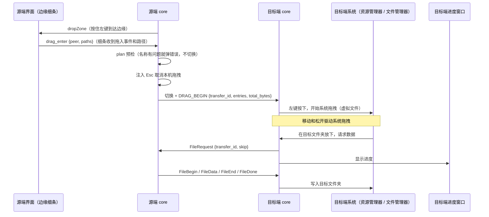

# Cross-SystemConnect 软件架构

> 版本：v1.3（[问题描述.md](问题描述.md) 第 42–50 条已写入代码）
> 日期：2026-09-30
> 基线：问题描述 1–41 已完成时的代码（提交 `b573612`），加上本轮 42–50 的实现
> 相关文档：需求与协议细节见 [设计方案.md](设计方案.md)，构建环境见 [开发环境.md](开发环境.md)

本文分三部分：

- **第 1–7 章**：当前代码的实际架构，包括进程、crate、模块、线程、通信、数据流（已包含 42–50 的改动）。
- **第 8 章**：第 42–50 条的改动设计。实现时和原设计不同的地方，已在各节里改成实际做法，并标注「实现」。需求中有歧义的地方已经确认，结论汇总在第 10 章。
- **第 11 章**：42–50 的完成情况，以及还需要在真机上验证的项目。

---

## 1. 总体视图

```
┌──────────────────────────────── 一台电脑 ────────────────────────────────┐
│                                                                           │
│  Cross-SystemConnect（csc-ui）          Cross-SystemConnect-core（csc-core）│
│  ┌───────────────────────┐   本机 IPC   ┌──────────────────────────────┐   │
│  │ 托盘（tray-icon/ksni）│  长度前缀     │ IPC 服务                      │   │
│  │ 设置窗（tao + wry）   │◄────JSON────►│ 主循环（8 ms tick，切换/注入）│   │
│  │ 边缘窗 DropWindow     │  Named Pipe  │ 网络（发现 UDP + TLS 会话）   │   │
│  │ 接收进度窗            │  / UDS       │ 剪贴板线程 / 传输引擎 / 中转  │   │
│  │ 自启动 autostart      │              │ 拖拽任务 / 链路监督           │   │
│  └───────────────────────┘              └──────────────┬───────────────┘   │
│                                                        │ csc-platform      │
│                      Win32（钩子、Raw Input、OLE 拖拽） / X11（XTest、XI2、XDND）│
└────────────────────────────────────────────────────────┼──────────────────┘
                                                         │ UDP 发现 + TCP/TLS 1.3
                                                         ▼ 端口 24900
                                                  另一台电脑的 core
```

- **core** 是唯一接触键鼠、剪贴板、网络和文件的进程。它没有界面，可以单独运行。
- **ui** 只负责展示和收集用户操作，所有动作都经 IPC 交给 core。UI 启动时如果连不上 core，会先拉起 core。
- 两台电脑之间只有 core 与 core 通信。UI 不跨机。

---

## 2. Crate 与依赖

```
csc-proto  ◄── csc-config ◄── csc-platform
    ▲              ▲               ▲
    ├──────────────┼───────────────┤
 csc-core ─────────┴───────────────┘        csc-ui ──► csc-proto, csc-config
```

| Crate | 产物 | 职责 | 主要依赖 |
|-------|------|------|----------|
| `csc-proto` | lib | 跨机帧格式、消息类型与编解码；本机 IPC 类型（`IpcRequest` / `IpcResponse` / `AppStatus`）；socket 路径 | serde、bytes |
| `csc-config` | lib | `Config` 结构、默认值、读写与旧目录迁移；计算机名；信任与证书指纹；不超过 100 KB 的日志文件（`logfile.rs`） | serde_json、dirs、hostname |
| `csc-platform` | lib | 平台抽象：输入捕获与注入、原始鼠标位移、Ctrl+V 观察、光标、屏幕与显示器、网卡、剪贴板、系统通知、虚拟文件拖拽源 | windows（含 OLE/COM/Shell 与 `implement`）、libc、arboard、x11rb（Linux） |
| `csc-core` | `Cross-SystemConnect-core` | 业务：发现、会话、链路监督、切换状态机、剪贴板同步、共享剪贴板（Ctrl+V 粘贴文件）、文件传输与中转、跨屏拖拽、传输进度、IPC 服务 | tokio、rustls、rcgen、xxhash |
| `csc-ui` | `Cross-SystemConnect` | 托盘、设置 WebView、边缘窗、接收进度窗、开机自启、选择日志文件的系统对话框 | tao、wry、tray-icon / ksni、gtk（Linux）、windows（Windows） |

### 2.1 csc-core 模块

| 文件 | 职责 |
|------|------|
| `main.rs` | 启动顺序；`Core` 结构体持有全部主循环状态。**主循环**（8 ms tick）：本机光标与原始位移、切换决策、抓取和转发输入、接收端注入与真实指针判边（`EDGE_HIT`）、边缘窗、快捷键（回本机、一起锁屏）、Ctrl+V 粘贴、跨屏拖拽的发起与路由、链路监督 |
| `switch.rs` | `SwitchController`：Local/Remote 状态、外侧边与对角区判定、`EdgePush`（到边后继续推动的累计）、远端相对坐标、离开判定；对端报告边缘时改用 `on_remote_edge` |
| `layout.rs` | `ScreenLayout`：由 `config.layout` 构建邻接关系 |
| `net.rs` | `PeerTable`（每个对端一条 `Link`，记录对端 `PeerInfo`：计算机名、能力位）、服务端/客户端角色循环、TLS 会话、心跳、帧分发。`Wires` 把入站帧分给主循环（`InboundEvent`）或直接交给传输引擎（文件帧）；`last_peers` 与 `kick` 用于断线后立即重连 |
| `supervisor.rs` | 链路监督：网卡地址恢复或变化、被控端长时间无会话时，决定是否重建网络 |
| `discover.rs` | UDP 发现报文（魔数 `CSCD`）、/24 扫描目标、取消后的抑制 |
| `tls.rs` | 本机自签名身份 `identity.crt/key`，记录对方证书的校验器 |
| `prompt.rs` | 被控端「信任 / 取消」提示的排队与结果 |
| `clipboard.rs` | 独立线程轮询系统剪贴板（400 ms），发出 `ClipEvent`，只接受 `set_text`（文件不再放进剪贴板） |
| `paste.rs` | `SharedClip`：键鼠主机上的共享剪贴板状态（谁最后复制、是不是文件），决定某台电脑上的 Ctrl+V 要做什么 |
| `transfer.rs` | 文件传输引擎：`plan` 预检 → `FileOffer` → 重名询问 → `FileRequest{skip}` → 按条目流式传输（`FILE_ACK` 窗口） → `FileDone`；写入目标 `Sink`（目录 / 原地 / 暂存）；限速与校验；拖拽批次的预登记与绑定 |
| `relay.rs` | 主机中转：路由表、`transfer_id` 改写、每条路由一个有界转发队列、逐跳确认 |
| `progress.rs` | `TransferBoard`：接收方向的批次进度与速度，给 UI 的进度窗 |
| `drag.rs` | 目标端的跨屏拖拽任务：登记批次、启动平台拖拽源、把放下的结果交给传输引擎 |
| `path_safe.rs` | 相对路径规范化，检查 Windows 非法名称与保留名 |
| `ipc.rs` | IPC 服务与方法分发；`AppState` |
| `logging.rs` | `LogControl`：tracing 订阅器，级别可在运行中重载，日志文件可在运行中打开、换路径或关闭 |

### 2.2 csc-platform 模块

| 文件 | 职责 |
|------|------|
| `lib.rs` / `traits.rs` | 工厂函数与 trait（`InputInjector`、`ScreenInfo`、`Captured` 等）；`take_raw_motion`、`paste_watch`、`paste_hits` |
| `vdrag.rs` | 虚拟文件拖拽的平台无关部分：`DragItem`、`DragDesc`、`DragEvent`、`StagedFeed`（暂存文件边收边读），`supported` / `start` / `cancel` / `cleanup_stale` 分发到各平台 |
| `win/hook.rs` | `WH_MOUSE_LL` / `WH_KEYBOARD_LL` 钩子线程；抓取时吞掉本机输入并放入队列。同一线程还有一个只收消息的窗口读 Raw Input（原始位移），以及未抓取时吞掉 Ctrl+V |
| `win/dragsrc.rs` | OLE 拖拽源：`IDataObject`（`FileGroupDescriptorW` + `FileContents`）、`IDataObjectAsyncCapability`、`IDropSource`，`IStream` 读暂存文件 |
| `win/injector.rs`、`win/screen.rs`、`win/host_net.rs` | `SendInput` 注入、显示器枚举、网卡（以太网优先） |
| `linux/grab.rs` | X11 抓取线程；同一连接上读 XInput2 `XI_RawMotion`（原始位移），需要时对根窗口被动抓取 Ctrl+V |
| `linux/xdnd.rs` | XDND 拖拽源（x11rb）：XDS 与 `text/uri-list`；同名虚拟文件的生成、查找和改名 |
| `linux/xdo.rs` | 运行时加载 `libX11` / `libXtst`：指针、按键、Xinerama |
| `clip.rs` | arboard 读写文本与文件列表；Windows 用剪贴板序号判断变化。Linux 上 arboard 只按 `\n` 拆分 `text/uri-list`，而 uri-list 用 CRLF 换行，每个路径尾部会多一个 `\r`，导致「文件名包含控制字符」。`tidy_path` 去掉路径尾部的 `\r`/`\n`/`\0`（原路径确实存在时不动），复制文件和拖拽发送前都经过它 |
| `keymap.rs` | HID Usage 与平台键码互转，快捷键名称解析（含标点键） |
| `lock.rs` | 锁屏（Windows `LockWorkStation`，Linux 依次尝试 Deepin / GNOME / freedesktop / `loginctl`）；本机按下锁屏组合键的计数 |
| `notify.rs` | 系统通知（传输结果、错误） |

### 2.3 csc-ui 模块

| 文件 | 职责 |
|------|------|
| `main.rs` | 事件循环，托盘菜单（设置 / 退出），设置窗，`csc://` 自定义协议路由，`UserEvent` 分发 |
| `ipc_client.rs` | 同步 IPC 客户端；`ensure_core_running` |
| `status_poller.rs` | 每 80 ms 调一次 `get_status`，发出 `UserEvent::DropZone`、`UserEvent::Transfers` |
| `drop_zone.rs` | 屏幕边缘的置顶窗。对端支持虚拟拖拽时是 12 px 细条，文件拖入即调用 `drag_enter`；否则是旧的投放窗，松手调用 `send_files` |
| `transfer_window.rs` | 接收进度窗（只在接收端出现）：进度、速度、剩余时间、取消、打开、关闭、重名选择 |
| `linux_tray.rs` | Linux StatusNotifierItem 托盘 |
| `log_picker.rs` | 设置页「浏览…」打开的保存对话框：Linux GTK `FileChooserDialog`，Windows `IFileSaveDialog` |
| `autostart.rs`、`icon.rs` | 开机自启、图标 |
| `ui/index.html` | 单页前端：首页、设置、日志、帮助 |

---

## 3. 运行时模型

### 3.1 core 的任务与线程

| 执行体 | 类型 | 作用 |
|--------|------|------|
| 主循环 | Tokio 任务（`main` 内 `select!`，状态在 `Core` 里） | 8 ms tick、剪贴板事件、网络入站事件（键鼠、切换、`EDGE_HIT`、`PASTE_REQUEST`、`DRAG_BEGIN`、剪贴板清单）、拖拽准备结果、退出信号。**切换状态只在这里修改** |
| IPC 服务 | Tokio 任务 | 每个连接一个任务，读写 `AppState` |
| 网络角色循环 | Tokio 任务 | 按 `role` 运行 `run_server` / `run_client`；`net_reload` 变化时重建；主机按退避重拨 `last_peers` |
| 会话 | 每个对端一个 Tokio 任务 | TLS 读写、心跳、`biased` 优先发送输入帧，其次文件帧。**文件帧直接交给传输引擎**，不经过主循环 |
| 传输引擎 | Tokio 任务 + 每批发送一个子任务 | 管理 `outgoing` / `sending` / `incoming` / `parked`（待放下的拖拽）四张表，以及中转路由 |
| 中转转发 | 每条路由一个 Tokio 任务 | 按顺序把帧交给目标链路，交出 1 MiB 就向源端确认一次 |
| 拖拽任务 | Tokio 任务 + 事件转接线程 | 目标端启动平台拖拽源，把放下结果变成 `bind_drop` / `cancel_drag` |
| 剪贴板 | OS 线程 | 系统剪贴板调用可能阻塞，所以不放在 Tokio 上 |
| 输入钩子 | OS 线程（Windows 消息循环 / X11） | 抓取期间吞掉本机输入，由主循环 `capture_drain` 取走；同时累计原始位移、统计被吞掉的 Ctrl+V |
| 拖拽源 | 每次拖拽一个 OS 线程 | Windows `csc-dragsrc`（STA，`DoDragDrop`，放下后继续处理资源管理器的回调）；Linux `csc-xdnd`（x11rb 连接，XDND 协议与查找虚拟文件） |

**共享状态**

- `Arc<RwLock<Config>>`：配置。IPC 写入后落盘，并通过 `net_reload` / `layout_reload` 通知。
- `Arc<RwLock<AppStatus>>`：给 UI 的状态快照，包括连接、网卡、发现列表、`pendingPeer`、`dropZone`。`transfers` 在 `get_status` 时从 `TransferBoard` 读取。
- `NetHub`：发送入口（`send_to` / `send_control` / `send_bulk`）、`NetStatus`，以及对端能力位 `peer_caps` 和显示名 `peer_label`。
- `TransferBoard`：接收进度，传输引擎写、IPC 读。

### 3.2 ui 的线程

| 执行体 | 作用 |
|--------|------|
| UI 主线程 | tao 事件循环：窗口、WebView、托盘，处理 `UserEvent` |
| 状态轮询线程（`status_poller.rs`） | 每 80 ms `get_status`：边缘窗变化时发 `UserEvent::DropZone`；传输列表变化时（或非空时每 1 s）发 `UserEvent::Transfers` |
| 信任提示轮询线程 | 每 800 ms `get_status`，有 `pendingPeer` 时弹出设置窗 |
| 前端 JS | 每 1 s `fetch('/status')` |

---

## 4. 通信

### 4.1 本机 IPC

帧格式为 `u32 LE 长度 + JSON`。端点：Windows 用 `\\.\pipe\Cross-SystemConnect-core`，Linux 用 `$XDG_RUNTIME_DIR/cross-systemconnect-core.sock`；运行目录不可用时退到 `/tmp/cross-systemconnect-core-<user>.sock`。

| 方法 | 说明 |
|------|------|
| `get_status` | 返回 `AppStatus` |
| `get_config` / `save_config` | 读取配置 / 合并补丁并落盘；按改动的字段决定是否重启网络 |
| `resolve_peer` | 信任提示的结果：`trust` 或 `reject` |
| `send_files` | 旧式投放窗收到文件后，按 `Drag` 用途发给对端 |
| `drag_enter` | 文件拖进边缘细条：`{peer, paths}`，开始跨屏拖拽 |
| `cancel_transfer` | 取消一批接收：`{id}` |
| `resolve_conflict` | 重名选择：`{transferId, decisions: [{index, choice}]}`，`choice` 为 `skip` / `keep_both` / `replace` |
| `dismiss_transfer` | 从进度窗移除已结束的一批：`{id}` |
| `receive_dir` | 返回实际使用的接收目录（未设置时为桌面） |
| `rescan` | 清空发现列表并重启网络（即界面上的「刷新」） |
| `set_sharing_enabled` | 开关键鼠共享 |
| `get_logs` | 读取日志末尾 48 KB，并返回实际写入的路径；没有开「写入文件」时返回空 |
| `quit` | 延迟 80 ms 后退出 core |

UI 内部的设置页通过 `csc://`（Windows 为 `http://csc.localhost/`）访问这些路由：`/status`、`/config`、`/logs`、`/rescan`、`/peer-decision`，再由 UI 转成 IPC。进度窗不走路由，它用 wry 的 `window.ipc.postMessage` 把「取消 / 重名选择 / 打开 / 关闭」交给 UI 进程，再调用对应的 IPC。

### 4.2 跨机通信

| 层 | 内容 |
|----|------|
| 发现 | UDP 24900。键鼠主机向选中网卡所在的 /24 发 `Search`；被控端回 `Announce`（计算机名、TCP 端口）。主机收到被控端的 Announce 后，如果还没有会话，会回一个 `SearchUnlinked` |
| 建链 | 双向拨号：主机收到 Announce 就去拨被控端；被控端听到 Search 且没有会话时也回拨主机。**TLS 服务端始终是被控端** |
| 准入 | 被控端检查证书指纹，不认识的就弹「信任 / 取消」；主机记住被控端的第一张证书（`pin_peer`） |
| 会话 | 主机先发 `HELLO`（带能力位），被控端通过准入后再回 `HELLO`；然后双方心跳。被控端在信任提示期间每 2 s 发一个心跳；主机 10 s 收不到任何字节才放弃等待 `HELLO`。连续 4 个心跳周期收不到数据就断开 |
| 重连 | 会话结束时立即触发一轮 Search / Announce；主机按 2 s 起、最长 10 s 的退避直接重拨对端上次的地址 |
| 队列 | 每条 `Link` 有 `tx`（输入和控制，容量 64）与 `bulk`（文件和超过 64 KB 的文字，容量 4）。写出时 `biased` 优先 `tx`，文件传输不会拖慢鼠标 |
| 帧 | 12 字节头（`CS`、版本、类型、flags、长度），单帧最大 **16 MiB**（`MAX_PAYLOAD`） |
| 能力位 | `CAP_VIRTUAL_DRAG`（1，本机能生成虚拟文件拖拽时才置位）、`CAP_EDGE_REPORT`（2）、`CAP_FILE_ACK`（4） |

消息类型见 [设计方案.md §6.3](设计方案.md)。

---

## 5. 关键流程（现状）

### 5.1 穿屏切换

```
Local ──光标到达有邻居的边或角，并继续推过 edge_push_px──► 发 SWITCH_ENTER，抓取本机输入 ──► Remote
  ▲                                                                                    │
  │  被控端 EDGE_HIT（旧版对端：主机推算的坐标越过边）/ 快捷键回本机 / 会话断开             │
  └──────────────────── 发 SWITCH_LEAVE，松开抓取，光标回到进入点附近 ◄──────────────────┘
```

- 在本机时，光标到边后还要按原始位移继续往外推 `switch.edge_push_px`（默认 8）才切换；沿边滑动或往回移动会清零。
- 被控端收到 `SWITCH_ENTER` 后按进入边定位，之后注入相对位移、按键和滚轮。每次注入移动后读取**真实**指针位置判断是否压在外侧边上，满足推动量后发 `EDGE_HIT`（同一条边 250 ms 内只发一次）。主机收到后才离开或跳到下一台。对端没有 `CAP_EDGE_REPORT` 时，主机仍按推算坐标判断。
- 会话断开时，被控端松开所有注入过的键和鼠标按键。
- 按住左键到达边缘、且文件传输已开启时，不切换，而是生成 `dropZone`（边缘窗）。对端支持虚拟拖拽时是细条，见 5.4。

### 5.2 剪贴板

- 文字：剪贴板线程发现变化后，主循环把文字放进 `ClipOffer` 发给所有对端。上限是 `clipboard.max_inline_mb`（默认也是最大 15 MB），超出时发系统通知。超过 64 KB 的走 `bulk` 队列。主机收到被控端的文字后，也转给其他被控端。
- 文件：复制文件时**不传数据、不改任何剪贴板**。被控端只把条目清单（`ClipOffer`，不带数据）告诉主机；主机的 `SharedClip` 记下「最后一次复制是哪台电脑上的文件」。
- 粘贴：键鼠主机判断 Ctrl+V 按在哪台电脑上。按在另一台电脑上时吞掉这次按键，改为把文件传到那台电脑的接收目录（`Paste` 用途）：主机自己的文件直接发；被控端的文件发 `PASTE_REQUEST` 让它发，目标是另一台被控端时经主机中转。同一批文件、同一目标 3 s 内重复按只算一次。

### 5.3 文件传输

```
发送端                                   接收端
plan（名称和路径检查、统计大小）
FileOffer {id, purpose, entries} ──►     检查开关、大小；顶层名称已存在时进入「有重名」，等用户在进度窗选择
                                  ◄──    FileRequest {id, skip}     或 FileError / FileCancel（全部跳过）
FileBegin / FileData… / FileEnd(xxh64) ──► 逐条写入并校验；替换的文件先写 .<名>.csc-part，校验后改名覆盖
                                  ◄──    FileAck {id, bytes}（每 1 MiB）
FileDone ──►                             进度窗显示完成；通知保存位置
```

- 发送端在对端有 `CAP_FILE_ACK` 时启用窗口：已发未确认超过 8 MiB 就暂停，60 s 收不到确认按失败处理。
- 接收端可以取消（发 `FileCancel`），并删除本批已写的内容。
- 限速在发送端做，按累计字节和已用时间计算需要等待多久。
- 断线时双方丢弃未完成的传输，中转路由一并清除。
- 中转：主机在 `relay.rs` 里改写 `transfer_id` 后转发，不落盘。主机把数据交给目标链路时就向源端确认，目标端的确认由主机吸收，所以主机上最多积压一个窗口（约 8 MiB）。

### 5.4 跨屏拖拽

- 源端：边缘细条收到拖入事件 → `drag_enter` → `plan` 预检并预登记批次 → 注入 Esc 取消本机拖拽 → 切换（或被控端发 `EDGE_HIT{dragging}`）→ `DRAG_BEGIN`。
- 主机：`DRAG_BEGIN` 来自被控端时，按刚才的 `EDGE_HIT` 记录的路由处理：目标是主机就在本机开始拖拽；目标是另一台被控端就建立中转并转发。
- 目标端：`drag.rs` 登记批次，调用 `vdrag::start` 开始系统拖拽（虚拟文件）。放下的结果决定写入目标：Windows 为暂存文件（`Sink::Staged`，资源管理器边收边读）；Linux XDS 为目标目录（`Sink::Dir`）；Linux 同名虚拟文件为原地写入（`Sink::InPlace`）；找不到放下位置时存到接收目录并通知。之后流程同 5.3。

---

## 6. 配置与数据

| 数据 | Windows | Linux |
|------|---------|-------|
| 配置 | `%APPDATA%\Cross-SystemConnect\config.json` | `~/.config/cross-systemconnect/config.json` |
| 身份证书 | 配置目录 `identity.crt` / `identity.key` | 同左 |
| core 日志 | 程序目录 `log.txt`；不能写时 `%APPDATA%\Cross-SystemConnect\Cross-SystemConnect.log` | 程序目录 `log.txt`；不能写时 `~/.local/state/cross-systemconnect/Cross-SystemConnect.log` |
| ui 日志 | 配置目录 `ui.log` | 同左 |

两个日志都不超过 100 KB，满了清空重写（8.10）。

与本轮相关的配置节：

| 节 | 字段 |
|----|------|
| 顶层 | `config_version`（当前 4；旧文件没有，按 1 处理并迁移一次） |
| `log` | `to_file`（默认开）、`level`（默认 `info`，旧字段 `log_level` 同步）、`file`（空表示程序目录下的 `log.txt`） |
| `clipboard` | `enabled`、`text`、`image`、`files`（复制文件后可在另一台电脑按 Ctrl+V 传输，默认开）、`max_inline_mb`（默认 15，范围 1–15） |
| `file_transfer` | `enabled`、`receive_dir`（界面不再提供，总是空，表示桌面；取不到时依次退到下载、配置目录下的 `received`）、`max_size_mb`、`limit_speed`、`max_speed_mibs` |
| `switch` | `edge_delay_ms`、`edge_push_px`（默认 8，范围 0–200）、`corner_dead_zone_px`、`diagonal_zone_px`（默认 80）、`double_tap_*` |
| `network` | `heartbeat_enabled`、`heartbeat_ms`（默认 5000） |

`clipboard.max_total_mb` 已删除。

---

## 7. 质量保障

- 本地 CI：`scripts/local-ci.sh`（Linux）和 `scripts/local-ci.ps1`（Windows）依次运行格式检查、clippy、单元测试、依赖安全检查、构建和打包，可选上传 Release。
- 单元测试集中在帧编解码、IPC、切换判定、路径检查、TLS 握手、配置合并、文件预检。
- 本轮新增的逻辑都要能在没有显示器和网络的环境下单测（见第 8 章各节的「测试」）。

---

## 8. 本轮改动设计（第 42–52 条）

### 8.0 实施顺序

| 顺序 | 条目 | 原因 |
|------|------|------|
| 1 | 44 文字剪贴板上限 | 改动小，独立 |
| 2 | 43 进度窗口与存储位置 | 45、47 都依赖进度展示和默认目录 |
| 3 | 50 重名处理 | 在进度窗口里询问，45、47 都要用 |
| 4 | 42 自动重连 | 独立，但涉及 net.rs，放在 45 之前以减少冲突 |
| 5 | 45 复制文件、在对方粘贴时传输 | 依赖 43、50；需要新增「观察按键」能力 |
| 6 | 46 到达边缘才切换 | 把离开判定交给被控端，47 从被控端拖出时要用到 |
| 7 | 47、49 跨屏拖拽虚拟文件 | 最大，依赖 43、46、50 |
| 8 | 48 被控端之间经主机中转 | 在 45、47 的直连流程稳定后再加中转 |

---

### 8.1 第 42 条：断线后自动重连，不需要被控端刷新

#### 8.1.1 现状分析

「刷新」即 `rescan`，它做的事是增加 `net_reload`，于是 `run_role` 整个重建：重新绑定 UDP/TCP 套接字，清空 `seen`、`inflight`、`rejected`。刷新能解决，说明问题出在「不重建就恢复不了」的状态上。从代码看有三个可能原因，需要用日志确认：

1. **套接字绑在具体 IP 上。** `effective_bind` 返回 `search_address`（例如 10.10.10.10）。拔网线、休眠唤醒、网卡重置后，这个地址会短暂消失，绑在上面的 UDP 和 TCP 监听套接字就失效了。发送失败只在 debug 级别记录，`run_role` 也不会因此退出，所以一直恢复不了，直到手动刷新。这和「被控端刷新才能连上」的现象最吻合。
2. **半开连接占着位置。** 主机拨号成功后，先把链路放进 `peers`，然后最多等 **120 s** 被控端的 `HELLO`（留给信任提示的时间）。这段时间里 `peers.contains` 为真，主机既不重拨，也不发 `SearchUnlinked`。
3. **网卡变化没有触发重启。** 主循环每 3 s 刷新网卡列表，但只更新界面，不会通知网络层。

#### 8.1.2 设计：链路监督

在 `csc-core` 新增 `supervisor.rs`，把「什么时候需要重建网络」集中在一处判断。它和 `rescan` 走同一个 `net_reload` 通道，效果与手动刷新相同。

| 触发条件 | 动作 |
|----------|------|
| 选中的 `search_address` 从网卡列表中消失后又出现，或者地址变了 | 重建网络（等同刷新） |
| UDP 连续 3 个周期发送全部失败，或 `recv` 返回的错误不是连接重置 | `run_role` 返回错误，外层 2 s 后重建 |
| 被控端连续 10 s 没有会话，而且曾经连上过 | 重建一次；之后退避 10 s、20 s，最长 30 s |
| 主机：已知的被控端断开 | 立即发一次 Search，不等 2 s 周期；之后每 2 s 直接拨它上次的地址（不必等 Announce），退避到最长 10 s |

**辅助改动**

- **记住对端地址**：主机在内存里保存 `last_peers: 名称 → (IP, 端口)`。有 Announce 就更新，重连时直接拨。`accept` 时除了 `seen` 列表，也放行 `last_peers` 里的 IP。
- **等待 HELLO 改为按空闲超时**：被控端弹出信任提示期间，每 2 s 发一个心跳帧（HELLO 之前的帧本来就会被收进 `early`，协议不用改）。主机改为「10 s 没收到任何字节就放弃」，不再固定等 120 s。两边都要升级到新版本。
- **断线立即广播**：会话结束时发送 `Disconnected` 的同时，让角色循环立刻发一轮 Search 或 Announce。
- **「刷新」按钮保留**，作为手动兜底。

#### 8.1.3 涉及文件

`net.rs`（套接字错误上报、`last_peers`、HELLO 空闲超时、断线立即广播）、`main.rs`（网卡快照交给监督器）、新增 `supervisor.rs`。

**实现**：

- `Supervisor::on_adapters`：选中的地址从网卡列表里消失后又出现时重建；没有选中地址时，网卡地址集合有变化就重建（空列表忽略，避免网卡短暂全部消失时反复重建）。
- `Supervisor::on_link`：只对被控端生效，曾经连上过、之后没有会话满 10 s 才重建，之后间隔 20 s、30 s（封顶）。
- `count_udp_failure`：一轮里所有目标都发送失败记一次，连续 3 轮就让 `run_role` 出错返回，由外层重建。
- `Wires.kick`（`Notify`）：会话结束时唤醒角色循环，主机立即 Search，被控端立即 Announce。
- 主机的 `Redial`：对 `last_peers` 里断开的电脑按 2 s、4 s、8 s、10 s（封顶）直接拨号；`accept` 也放行 `last_peers` 里的 IP。
- HELLO：被控端等待信任结果时每 2 s（`HELLO_KEEPALIVE`）写一个心跳；主机 `read_until_hello_idle` 跳过心跳，10 s（`HELLO_IDLE`）没有任何字节才放弃。

#### 8.1.4 验收与测试

| 场景 | 期望 |
|------|------|
| 拔掉直连网线 30 s 后插回 | 10 s 内自动连上，两端都不用操作 |
| 被控端退出 core 再启动 | 5 s 内连上 |
| 主机退出 core 再启动 | 5 s 内连上 |
| 任一端休眠后唤醒 | 15 s 内连上 |
| 被控端弹出信任提示，1 分钟后才点「信任」 | 连接成功，主机不会中途放弃 |

单测：退避序列、网卡快照比较（地址消失和出现）、HELLO 空闲超时的计时。

---

### 8.2 第 43 条：传输进度条，存储位置可改，默认存到桌面

#### 8.2.1 默认目录

- `file_transfer.receive_dir` 为空时，默认改为**桌面**：`dirs::desktop_dir()`。它会遵循 XDG 用户目录，中文 Linux 下是 `~/桌面`。取不到时退到「下载」，再退到配置目录下的 `received`。
- 目录不存在就创建。
- 以前留空的用户升级后也会改存到桌面；已经填写过路径的保持不变。

#### 8.2.2 进度数据（core）

在 `transfer.rs` 旁边新增 `progress.rs`，其中的 `TransferBoard` 登记每一批传输的进度：

```rust
// csc-proto/src/ipc.rs（实现），JSON 字段为 camelCase
pub struct TransferProgress {
    pub id: u64,
    pub peer: String,             // 文件来自哪台电脑
    pub via: String,              // 经主机中转时为主机名，直连为空
    pub title: String,            // 第一个顶层名称，多项时显示为“a.txt 等 5 项”
    pub files_done: u32,
    pub files_total: u32,
    pub bytes_done: u64,
    pub bytes_total: u64,
    pub bytes_per_sec: u64,       // 最近 1 s 的滑动平均
    pub state: TransferState,     // Waiting | Conflict | Running | Done | Failed | Cancelled
    pub message: String,          // 失败原因，或者保存位置
    pub dest: String,             // 接收端的保存目录
    pub open_path: String,        // 只收到一项时，完成后可直接打开它
    pub conflicts: Vec<TransferConflict>, // 有重名时的列表（8.8）
}
```

- **只登记接收方向**，没有 `direction` 字段。接收端每写一块数据就更新一次（加锁时间很短），速度按最近 1 s 的样本计算。发送端不登记进度，只在失败时发系统通知（与现在相同）。
- `AppStatus` 新增 `transfers: Vec<TransferProgress>`。结束的条目保留到用户关闭，或者 30 s 后移除。
- 新增 IPC 方法 `cancel_transfer {id}`：接收端发送 `FileCancel` 帧，删除已写的部分；发送端收到后停止发送，不弹提示。另有 `dismiss_transfer {id}`，用于从进度窗移除已结束的一批。

#### 8.2.3 传输进度窗口（ui，只在接收端）

- 新增 `transfer_window.rs`：一个**单独的窗口**，与设置窗互不影响。设置窗关着的时候也能显示。
- 窗口内容：每批传输一行，显示名称、来源电脑（中转时显示「来自 B（经 H）」）、进度条、已传 / 总大小、速度、剩余时间和「取消」按钮。完成后这一行变成「打开文件夹」「打开文件」，失败时显示原因。目标位置有同名文件时，这一行展开重名选择（8.8）。
- 窗口有标题栏，可以移动和关闭（**实现**：位置由系统决定，不置顶）。关闭只是隐藏，并把已结束的条目移除；之后有新的一批开始接收时会再出现。
- 何时显示（**实现**）：出现本窗口还没显示过的、未结束的一批时自动弹出；某一批进入「有重名」时弹出并获得焦点。列表清空（已结束的条目 30 s 后移除，或被关闭）时自动隐藏。
- **发送端不显示这个窗口**，设置窗首页也不加传输列表。

#### 8.2.4 UI 状态轮询合并

**实现**：新增 `status_poller.rs`，一个线程每 80 ms 调一次 `get_status`，分发 `UserEvent::DropZone` 和 `UserEvent::Transfers`。原来的投放区轮询线程已删除；信任提示的 800 ms 轮询线程保留不变。传输列表有变化时立即发送，列表非空时每 1 s 重发一次，保证进度窗页面加载完成后也能拿到当前状态。

#### 8.2.5 选择目录（已取消）

最初的设计是在设置页「接收目录」旁放「浏览…」和「打开」两个按钮，由 UI 弹出原生选目录对话框。拖拽已经能直接写到放下的位置，用户要求去掉这个设置，所以设置页不再有「接收目录」，UI 里的选目录对话框、`/pick-folder`、`/open-folder` 路由也一并删除。`file_transfer.receive_dir` 字段还在，但界面保存时不再写它，所以总是空，也就是桌面：Ctrl+V 粘贴的文件、旧版对端投放窗发来的文件、拖拽找不到放下位置时的文件都存到桌面。进度窗里的「打开」照常打开每批文件实际保存的位置。

#### 8.2.6 测试

`TransferBoard` 的过期清理、速度计算、关闭已结束条目（已有单测）；接收端取消后双方的状态、发送端不产生进度条目（待真机验证）。

---

### 8.3 第 44 条：文字剪贴板默认上限拉到最大

- 上限取决于单帧大小：单帧最大 16 MiB，文字放在 JSON 里转义后会变长，所以**上限定为 15 MB**。默认值也是 15。
- `csc-config` 加载配置时把 `max_inline_mb` 限制在 1–15；界面的输入框也设为 `min=1 max=15`。
- 标签从「内联 MB」改为「文字上限 MB」，提示写明「超过上限的文字不会同步」。超出时发系统通知，不再静默丢弃。
- 超过 64 KB 的文字改走 `bulk` 队列（接收端不用改），避免一次复制大段文字卡住鼠标。
- 旧配置的处理：**所有旧配置一律改成 15**。为了只改这一次、以后用户手动调小不会被再次覆盖，`Config` 新增 `config_version` 字段（旧文件没有这个字段，按 1 处理）。加载时如果版本小于 2，就把 `max_inline_mb` 设为 15，版本写成 2 并保存。

测试：配置限制范围、版本迁移只执行一次、64 KB 分流阈值、超出上限时不发送。

---

### 8.4 第 45 条：复制文件不进剪贴板，在另一台电脑按 Ctrl+V 时才传到接收目录

#### 8.4.1 行为

1. 在电脑 X 上复制（Ctrl+C）文件或文件夹时，**不传数据**，也不改动任何一台电脑的剪贴板，只登记「最近一次复制的是 X 上的这些文件」。
2. 指针移到另一台电脑 Y，按 Ctrl+V。这次按键**不交给 Y 的系统**（否则会粘贴 Y 剪贴板里的旧内容），而是开始把文件从 X 传到 Y 的接收目录（默认桌面）。Y 上弹出进度窗口（8.2）。
3. 在 X 本机按 Ctrl+V，照常交给系统，就是普通的本地粘贴。
4. 之后在任何一台电脑上复制了别的东西（文字或文件），前面登记的文件就失效，和普通剪贴板一样「最后一次复制为准」。
5. 同一批文件可以在 Y 上多次粘贴，每次都传一份，重名时按 8.8 询问。**实现**：同一批文件、同一目标在 3 s 内再按 Ctrl+V 视为重复（例如按住不放的自动重复），吞掉但不再发起。

#### 8.4.2 由键鼠主机统一判断

所有按键都会经过键鼠主机：指针在主机上时是本机按键，在被控端上时是主机抓取后转发的按键。所以「谁复制了什么」和「在哪台电脑上按了 Ctrl+V」都由**主机的 core** 判断。

- 主机维护一个共享剪贴板状态：`owner`（哪台电脑复制的）、`seq`、`kind`（文字 / 文件）、文件条目摘要。
- 被控端复制了文件，就发送 `ClipOffer {seq, formats: ["files"], files: [...]}`（字段已存在），**只带条目信息，不带数据**。路径只保存在被控端自己的内存里。被控端复制文字的流程不变。
- 主机收到任何一台电脑的新复制，就更新 `owner` / `seq`。

| 复制在 | Ctrl+V 在 | 主机的动作 |
|--------|-----------|------------|
| 主机 A | 被控端 B | 不转发这次 V 键，直接按 `Paste` 用途把文件从 A 传到 B |
| 被控端 B | 主机 A | 吞掉本机这次 V 键，给 B 发 `PASTE_REQUEST {seq}`，B 把文件传给 A |
| 被控端 B | 被控端 C | 不转发这次 V 键，给 B 发 `PASTE_REQUEST {seq, to: "C"}`，数据经主机中转传到 C（8.7） |
| 任意 X | 同一台 X | 照常处理，本地粘贴 |

#### 8.4.3 平台能力：观察按键

主机在**没有抓取**时也要能看到本机的 Ctrl+V，并且能吞掉它。

- **实现**：接口是 `csc_platform::paste_watch(enable)` 和 `paste_hits() -> u32`（取走上次以来吞掉的 Ctrl+V 次数），只针对 Ctrl+V。
- Windows：`WH_KEYBOARD_LL` 钩子本来就常驻。未抓取且开启观察时，非注入的 V 键、Ctrl 按住、Shift / Alt / Win 都没按时，按下和抬起都吞掉（返回 1），按下计一次。
- Linux X11：抓取线程对根窗口做 `XGrabKey`（核心协议的被动抓取），只抓 Ctrl+V，并覆盖 CapsLock、NumLock 的四种组合；抓取失败不会让进程退出（装了忽略错误的 X 错误处理函数）。关闭观察时解除抓取。
- 只有在「最近一次复制是别的电脑上的文件」时才启用吞键，其他时候 Ctrl+V 完全不受影响。
- 指针在被控端时，按键本来就被主机抓取，主机在 `grab_input` 里认出 Ctrl+V，不再转发。

#### 8.4.4 其他改动

| | 现在 | 改后 |
|---|------|------|
| 复制文件时 | 立即以 `Clipboard` 用途传给所有对端 | 只登记，不传 |
| 接收端 | 存到 `.clipboard/<id>`，再放进剪贴板 | 存到接收目录，**不碰剪贴板** |
| 大小上限 | `clipboard.max_total_mb`（64 MB） | 与拖拽相同，只按 `file_transfer.max_size_mb` 限制单个文件；`max_total_mb` 删除 |
| 设置项 | 「剪贴板」卡片里的「文件」 | 移到「文件传输」卡片，改名为「复制文件后，在另一台电脑按 Ctrl+V 传输」，默认开启 |

- `TransferPurpose` 新增 `Paste`。收到旧版本发来的 `Clipboard` 用途时，按 `Paste` 处理，存到接收目录。
- 新消息 `PASTE_REQUEST`（0x33，主机 → 复制文件的被控端）。
- `clipboard.rs` 不再调用 `set_files`，`.clipboard` 暂存目录和清理逻辑删除。

#### 8.4.5 测试

共享剪贴板状态的转换（新复制使旧文件失效、文字复制覆盖文件复制）、上表四种组合的动作、3 s 内重复 Ctrl+V 不重复发起、旧用途的兼容映射（已有单测）；左右 Ctrl 都能触发（待真机验证）。

---

### 8.5 第 46 条：鼠标还没到边缘就已经切到另一个屏幕

#### 8.5.1 现状分析

- **在本机时**：`hit_outer_edge` 要求光标正好在边上的那 1 个像素，本机这一侧不会提前切换。
- **在被控端上时**：是否离开由**主机推算**。主机按 `HELLO` 里的屏幕尺寸，自己累计 `remote_x/remote_y`，算出来越过边界就切走。被控端注入的是另一份独立累计的坐标。只要两边算出来的位置不一致，主机就会在被控端的指针还没到边时切走，正好是「接近边缘就过去了」的现象。可能的不一致来源：
  1. 被控端有多台显示器，而且大小或位置不对齐。`HELLO` 只报了整个虚拟桌面的外接矩形，主机把它当成一整块。被控端真实的指针会被系统限制在显示器范围内，主机不知道。
  2. Linux 在 XWayland 下做缩放时，X11 报的尺寸和实际移动的像素比例不一致。
  3. 被控端本地也有人动了鼠标，主机不知道。

#### 8.5.2 设计

**1. 离开判定交给被控端**

- 被控端每次注入移动后，读取自己**真实的**指针位置（`cursor_pos`）和显示器列表，用同一套 `SwitchController` 判定，只有真正压在外侧边上才算到达。
- 到达后，被控端发送新消息 `EDGE_HIT {edge, position_pct, dragging, corner}`（0x12，被控端 → 主机）。`dragging` 表示左键按着（可能随后有 `DRAG_BEGIN`），`corner` 表示指针在角落区。同一条边 250 ms 内只发一次。主机收到后才执行离开或跳转（`SWITCH_LEAVE`、回到本机、跳到下一台）。
- 主机不再用推算的坐标决定离开，推算只用来算进入位置。对方是旧版本（`HELLO.capabilities` 没有 `CAP_EDGE_REPORT` 位）时，保留原来的推算方式。
- 这样被控端的多显示器、缩放和本地移动都不会再造成提前切换。第 47 条反方向的拖拽也依赖这一点，因为被控端需要知道自己何时到了边缘。

**2. 到边后还要继续推一下才切换**

- 新增 `switch.edge_push_px`，默认 **8**：指针到达边缘后，还要继续朝外移动累计 8 个像素才切换。只是碰到边缘、或者沿着边滑动，不会切过去。设为 0 就是现在「一碰就切」的行为。
- 朝外的位移取原始相对位移，因为到了边缘后系统会把指针卡住，从坐标上看不出还在往外推：
  - 主机本机：Windows 用 Raw Input（`WM_INPUT`，`RIDEV_INPUTSINK`，只收消息的窗口；没有设备句柄的注入事件不算）；Linux 用 XInput2 `XI_RawMotion`（`libXi.so.6` 运行时加载）。接口是 `csc_platform::take_raw_motion()`，取不到原始位移时返回 `None`，这时退回「碰到边缘就切换」。**实现补充**：原始位移源注册成功不等于有数据（精确式触摸板、手写板、远程桌面可能没有或只有绝对坐标），所以 `SwitchController` 只在原始位移「跟得上光标」时使用它：光标连续 3 次移动而原始位移都是 0，就当作没有原始位移，退回碰边即切换；之后原始位移重新有值时恢复。Windows 不再丢弃没有设备句柄的 Raw Input（触摸板就是这样上报的）。光标不在本机时（控制远端、被控）主循环每个 tick 清空累积的原始位移，避免回到本机后被当成一次推动。
  - 被控端：直接用主机转发过来的 `dx/dy`。
- 离开边缘或者往回移动，累计值清零。

**3. 诊断日志**

每次切换在 `info` 级别记录：真实指针位置、所在显示器矩形、判定出的边、累计推动量；兼容模式下再加主机推算的位置。以后遇到类似问题可以直接从日志判断是哪一侧提前了。

#### 8.5.3 设置与测试

- 设置页「边缘切换」卡片新增「推过边缘 px」（`edge_push_px`，0–200）。
- 单测（已有）：推动量的累计、清零和阈值；被控端多显示器不对齐时只有真实的外侧边才报告；主机跟随对端的边缘报告，不再按推算坐标离开。旧版本对端的回退、XWayland 缩放下的实际效果待真机验证。

---

### 8.6 第 47、49 条：拖到边缘生成虚拟文件，在另一台电脑松开后直接传输

#### 8.6.1 目标行为

下面把开始拖拽的电脑叫**源端 S**，松手的电脑叫**目标端 T**，键鼠主机叫 **H**。

1. 在 S 上按住左键拖着文件或文件夹，碰到通向 T 的边。
2. 指针切到 T，**依然处于拖拽状态**：T 上显示一个带文件图标的拖拽（这就是「虚拟文件」）。
3. 在 T 的某个文件夹或桌面上松开左键，**不再询问，直接开始传输**，T 上弹出进度窗口（8.2）。
4. 拖拽途中按 Esc，或者放到不接收文件的地方，就什么都不发生。
5. 目标文件夹里有同名文件时，按 8.8 选择「跳过 / 保留两者 / 替换」。

支持三种路径：

| 路径 | 说明 |
|------|------|
| 主机 H → 被控端 B | 直接传输 |
| 被控端 B → 主机 H | 直接传输 |
| 被控端 B → 被控端 C | 数据经主机中转（8.7） |

#### 8.6.2 三种路径的差别

数据流程相同，区别只在于物理鼠标在主机上，所以由谁判定边缘、由谁注入按键：

| 步骤 | H → B | B → H | B → C（经 H） |
|------|-------|-------|---------------|
| 发现到了边缘 | H 本机判定（8.5 的推动量） | B 用真实指针判定，发 `EDGE_HIT` | 同左 |
| 边缘细条窗口 | 显示在 H 上 | 显示在 B 上 | 显示在 B 上 |
| 取消源端本机的拖拽 | H 给自己注入 Esc | B 给自己注入 Esc | 同左 |
| 切换 | H 开始抓取，发 `SWITCH_ENTER` | H 收到 `EDGE_HIT` 后松开抓取 | H 收到 `EDGE_HIT` 后跳到 C（`SWITCH_LEAVE` 给 B，`SWITCH_ENTER` 给 C） |
| 在目标端按下左键 | H 让 B 注入 | H 给自己注入 | H 让 C 注入 |
| 驱动拖拽 | H 转发移动和松开 | 物理鼠标直接作用在 H 上 | H 转发移动和松开给 C |
| 数据 | H → B | B → H | B → H → C |

源端是被控端时有一个顺序要求：B 必须先取消自己的本机拖拽，再发 `EDGE_HIT` 和 `DRAG_BEGIN`。H 切走时会照常给 B 发送「松开所有按键」（`release_all`），这时 B 的拖拽已经取消，松开左键不会被当成一次放下。

#### 8.6.3 时序（以 H → B 为例）



#### 8.6.4 各环节设计

**源端：识别拖的是什么**

- 边缘的投放窗改为贴边的细条（12 px 宽）。wry 的 `DragDropEvent::Enter` 会带上被拖文件的路径，UI 收到后立即调用新 IPC `drag_enter`，**不需要等用户松手**。
- core 收到后先用 `plan` 检查名称和大小。不通过就弹出错误提示，不切换（沿用第 39 条的安全检查）。
- 然后取消本机的系统拖拽：用 `SendInput` / XTest 注入一个 Esc，防止源程序把文件「移走」。Windows 钩子要忽略带注入标志（`LLKHF_INJECTED`）的事件，避免这次 Esc 被主机自己抓到、转发给对方。
- 源端预先登记这批文件（生成 `transfer_id`），先不发送数据。

**目标端：生成虚拟文件的拖拽**

**实现**：没有做成 trait，而是 `csc-platform/src/vdrag.rs` 里的一组函数，按平台分发：

```rust
pub fn supported() -> bool;                                   // 本机能否生成虚拟文件拖拽（决定 CAP_VIRTUAL_DRAG）
pub fn start(desc: DragDesc, events: std::sync::mpsc::Sender<DragEvent>) -> bool;
pub fn cancel(id: u64);                                       // 指针离开本屏时结束拖拽
pub fn cleanup_stale();                                       // core 启动时清理 1 小时以前的暂存和虚拟文件

pub struct DragDesc { pub id: u64, pub items: Vec<DragItem>, pub staged: Option<Arc<StagedFeed>> }
pub enum DragEvent {
    Staged { id },               // Windows：资源管理器要数据了
    Folder { id, dir },          // Linux XDS：放到了这个目录
    InPlace { id, tops },        // Linux：文件管理器复制的虚拟文件，按顶层条目顺序
    Lost { id },                 // 放下了，但找不到放在哪里
    Cancelled { id, reason },    // 没有放下
}
```

`StagedFeed`：Windows 的暂存目录。传输引擎写文件时报告进度，资源管理器的读取按需等待，读取顺序可以和发送顺序不同。

| 平台 | 实现 |
|------|------|
| Windows（`win/dragsrc.rs`） | 独立的 STA 线程调用 `DoDragDrop`。自己实现 `IDataObject`，只提供 `FileGroupDescriptorW`（名称、大小、修改时间、目录结构）和延迟提供的 `FileContents`，并实现 `IDataObjectAsyncCapability`，让资源管理器在后台复制。资源管理器第一次请求 `FileContents`（或开始异步操作）时发出 `Staged`，core 随即发 `FileRequest`。返回的 `IStream` 读暂存文件，数据还没到时最多等 120 s。放下后线程继续处理消息，直到资源管理器调用 `EndOperation` 且数据全部到齐，再清理暂存目录。重名由资源管理器自己的对话框处理（8.8） |
| Linux X11（`linux/xdnd.rs`） | 用 x11rb 自己做 XDND 拖拽源（协议版本 5），同时提供 `XdndDirectSave0`（XDS）和 `text/uri-list`。目标支持 XDS 时会把目标目录告诉我们，回复 `S`，直接接收到那里，重名按 8.8 由我们的进度窗口询问。只支持 uri-list 时，用**同名虚拟文件**找出目标目录（第 49 条，见下方） |

- **实现**：Windows 由 core 先注入左键按下再调用 `start`。Linux 不能这样做：注入的按下会让指针下的窗口拿到隐式抓取，拖拽源就抓不到指针。所以 Linux 由 `xdnd.rs` 先在根窗口上抓取指针，再用 XTest 按下左键（如果左键已经按着，先松开）。之后的移动和松开驱动系统拖拽（见 8.6.2 的表），不需要额外处理输入。
- 放到不接收文件的地方（例如普通应用窗口），系统拖拽会以「未放下」结束，目标端发 `DRAG_CANCEL`。
- 拖拽期间指针又回到源端：目标端调用 `cancel` 结束系统拖拽并发 `DRAG_CANCEL`。源端本机的拖拽已经被取消，无法恢复，需要重新拖。这是已知限制。

**Linux：不支持 XDS 时，用同名虚拟文件找到放下的位置（第 49 条）**

有的文件管理器不支持 XDS，只接受 `text/uri-list`：它会把我们提供的文件复制到放下的文件夹，但不会告诉我们是哪个文件夹。做法是让它复制一组虚拟文件，再去找这些文件落在了哪里。

虚拟文件的**名字和被拖的文件完全一致**，用户看到的效果和在本机拖动文件一样：松手后，目标文件夹里立刻出现同名、同图标的文件，接收过程中文件逐渐变大，传完就是真实的文件。

1. **生成**：开始拖拽前，在暂存目录 `<系统临时目录>/cross-systemconnect-drag/<transfer_id>/`（**实现**：与 Windows 暂存共用 `vdrag::staging_root()`）下，为每个顶层条目各生成一个，名字和源端的名字一样。拖拽时提供的 `text/uri-list` 就指向它们。

   | 被拖的条目 | 虚拟文件 | 用来认出它的内容 |
   |------------|----------|------------------|
   | 文件 `报告.docx` | 同名文件 `报告.docx` | 文件内容是一行 JSON：`{"csc_drag":<transfer_id>,"index":<序号>}`，只有几十字节 |
   | 文件夹 `照片` | 同名空文件夹 `照片/` | 里面放一个隐藏文件 `.csc-drag`，内容同上。文件管理器复制文件夹时会把它一起复制过去 |

   扩展名保持原样，文件管理器显示的就是这类文件的图标。（**实现**：没有把修改时间设成源文件的时间，传完后是接收时的时间。）

2. **放下后查找**（**实现**，比原设计简单）：收到 `XdndFinished`（或放下后 30 s 仍没有回应）时开始找。不读窗口标题，也不用 inotify，而是每 0.5 s 扫一遍，最多 20 s：
   - 范围：家目录（6 层以内，跳过隐藏目录）、`/media/<用户>`、`/run/media/<用户>`、`/mnt`、系统临时目录（暂存目录本身除外），最多 40000 个目录。
   - 只看「最近 60 s 内内容有变化」的目录（目录的修改时间），在里面找「最近 60 s 内新建」的条目。

3. **按内容确认**：不看名字，只看内容。小于 256 字节的新文件读出 `csc_drag` 和 `index`，文件夹读里面的 `.csc-drag`，与本次的 `transfer_id` 和条目序号一致才算数。所以文件管理器给副本起了别的名字也能找到。

4. **重名**：由文件管理器自己的对话框先处理，然后按 8.8 统一结果：

   | 用户在文件管理器里选 | 结果 |
   |----------------------|------|
   | 跳过 | 虚拟文件没有被复制，找不到，按 `Lost` 存到默认接收目录并通知 |
   | 保留两者 | 文件管理器起的名字各不相同（例如「报告 (副本).docx」）。找到后改名为我们统一的「报告 (1).docx」「报告 (2).docx」（取第一个空闲的序号），再接收。已经是「原名 (数字)」格式的保持不变 |
   | 替换 | 原来的文件已被虚拟文件覆盖，直接接收，结果是新文件 |

5. **接收**：**直接写入虚拟文件所在的位置**。文件截断后逐步写入，文件夹删除 `.csc-drag` 后往里写。文件管理器里看到的就是这个文件在逐渐变大，和本机复制一样。先写到临时文件再改名会让文件「闪一下」，所以这里不采用。
   - 传输失败或取消：删除虚拟文件，包括写了一半的内容。如果之前在文件管理器里选了「替换」，原文件已经被覆盖，无法恢复，这与本机复制中途失败的结果一致。
   - 20 s 内没找到：改存到默认接收目录，并在通知里写明保存位置。**实现限制**：之后才出现的虚拟文件不会被自动删除，会留下一个几十字节的同名文件。
   - 暂存目录里的虚拟文件在找到后删除；没找到时保留，core 下次启动时清理 1 小时以前的残留。

**目标端：接收数据**

传输引擎的接收端抽象出写入目标：

```rust
pub enum Sink {
    Dir(PathBuf),              // 写到目录：粘贴、XDS、默认接收目录。重名按 8.8 处理
    InPlace(Vec<PathBuf>),     // Linux 同名虚拟文件：直接写入已找到的位置
    Staged(Arc<StagedFeed>),   // Windows：先写到暂存目录，资源管理器的 IStream 边收边读
}
```

拖拽批次在目标端先「停放」（`TransferCmd::ParkDrag`），放下后 `BindDrop{id, sink}` 绑定写入目标并发 `FileRequest`；没有放下则 `CancelDrag` 发 `DRAG_CANCEL`。

Windows 用「先暂存、再流式读」，这样网络接收和资源管理器读取互不阻塞，即使资源管理器请求条目的顺序和发送顺序不一致也能处理。完成后删除暂存目录。

#### 8.6.5 协议补充

| 类型 | 名称 | 方向 | 内容（JSON） |
|------|------|------|--------------|
| 0x40 | `DRAG_BEGIN` | 源端 → 目标端（B → C 时经 H 转发） | `transfer_id`、`entries`、`total_bytes`、`to`（目标电脑名，源端是被控端时由主机按路由决定）、`origin`（中转时由主机填源端名）。**实现**：不单独设 `drag_id`，用 `transfer_id` 标识 |
| 0x41 | `DRAG_CANCEL` | 双向 | `transfer_id`、`reason`（实现中的取值：`unsupported`、`left screen`、`no target`、`cancelled`、`refused`、`error`） |
| 0x12 | `EDGE_HIT` | 被控端 → 主机 | 见 8.5 |
| 0x50、0x55–0x57 | `FILE_*` | 复用 | 目标端放下后发送 `FileRequest {transfer_id, skip}`，后续与现有流程相同 |

- `TransferPurpose` 新增 `DragDrop`。
- `HELLO.capabilities` 的第 0 位 `CAP_VIRTUAL_DRAG` 表示对端支持虚拟拖拽（Linux 需要有 `DISPLAY` 且 XTest 可用才置位）。对端不支持时，退回现在的做法：在边缘窗口上松手，发送到对方的接收目录。

#### 8.6.6 涉及文件

| 模块 | 改动 |
|------|------|
| `csc-core/drag.rs`（新） | 目标端的拖拽任务：停放批次、启动平台拖拽源、把 `DragEvent` 变成 `bind_drop` / `cancel_drag` |
| `csc-core/main.rs` | 边缘细条触发切换（`on_drag_enter` → `on_drag_ready`）；取消本机拖拽（注入 Esc，等 60 ms）；在目标端开始拖拽（`start_drag_here`）；主机按 `drag_route` 路由 `DRAG_BEGIN` |
| `csc-core/transfer.rs` | `Sink` 抽象；`DragDrop` 用途；`PrepareDrag` 预先登记待发送的批次 |
| `csc-platform/vdrag.rs`（新） | 平台无关的类型与分发、`StagedFeed` |
| `csc-platform/win/dragsrc.rs`（新） | OLE 拖拽源。windows crate 增加 `Win32_System_Ole`、`Win32_System_Com`、`Win32_System_Com_StructuredStorage`、`Win32_UI_Shell`、`Win32_System_Memory`、`Win32_System_SystemServices`、`implement` 等 feature |
| `csc-platform/linux/xdnd.rs`（新） | XDND 拖拽源与 XDS；**实现**：原计划的 `drop_marker.rs` 合并在这里（虚拟文件的生成、按内容查找、改名为统一格式） |
| `csc-platform/win/hook.rs` | 忽略自己注入的事件（原本已如此） |
| `csc-ui/drop_zone.rs` | 对端支持时改为贴边细条；处理 `Enter` 事件，调用 `drag_enter`；被控端也显示 |

#### 8.6.7 验收与测试

| 场景 | 期望 |
|------|------|
| Windows 主机把一个文件拖到 Linux 被控端的桌面（Nautilus） | 松手后直接开始传输，Linux 上显示进度，文件出现在桌面 |
| Linux 被控端把一个文件夹拖回 Windows 主机的资源管理器 | 目录结构完整，校验通过，Windows 上显示进度 |
| Linux 主机把文件拖到 Windows 被控端，反过来再拖回 | 两个方向都能完成 |
| 被控端 B 拖到被控端 C | 经主机中转完成，C 上显示进度，来源显示为 B |
| 拖到目标端后按 Esc | 拖拽取消，没有产生文件，指针留在目标端，可以正常使用 |
| 放到普通应用窗口上 | 没有产生文件 |
| 文件名含 `:` 等 Windows 不允许的字符 | 在源端就提示错误，不会切换 |
| 拖到不支持 XDS 的 Linux 文件管理器 | 松手后立刻出现同名、同图标的文件，接收时逐渐变大，最终内容与源文件一致 |
| 同上，已有同名文件，选「保留两者」 | 新文件名为「原名 (1)」，原文件不变 |
| 同上，选「替换」 | 覆盖为新文件 |
| 同上，选「跳过」 | 不传输，原文件不变 |
| 对端是旧版本 | 退回边缘窗口松手的方式，可以正常发送 |

单测（已有）：`StagedFeed` 的乱序读取与失败；虚拟文件的生成、按内容识别、改名为「原名 (1)」；`Sink::InPlace` 写入已找到的位置；文件 URI 编解码；边缘细条尺寸。上表的场景都要在真机上验证（见第 11 章）。

---

### 8.7 第 48 条：被控端之间的复制粘贴和拖拽，经主机中转

#### 8.7.1 拓扑

现在的连接是星形：每台被控端只和主机有一条 TLS 会话，被控端之间没有连接。**不新增被控端之间的连接**（那样要重新做发现、信任和证书），而是由主机转发。被控端仍然只信任主机。

```
被控端 B ──TLS──► 主机 H ◄──TLS── 被控端 C
         FILE_* 帧            FILE_* 帧
      (B 的 transfer_id)   (H 分配的 transfer_id)
```

#### 8.7.2 中转

在主机的传输引擎里新增 `relay.rs`：

- **路由表**：`(源电脑, 源 transfer_id) ↔ (目标电脑, 中转 transfer_id)`。中转 id 由主机分配，避免两台被控端的 id 撞在一起。
- **转发**：主机只转发，不落盘。JSON 帧改写 `transfer_id` 字段后转发；`FileData` 帧的 id 在前 8 个字节，原地改写即可。反方向的 `FileRequest`、`FileError`、`FileCancel`、`FILE_ACK` 同样按路由表转回。
- **只转发已登记的路由**：主机只为自己发起的粘贴请求或拖拽建立路由，收到没有登记的中转帧直接丢弃。
- **来源显示**：转发给 C 的 `FileOffer` 带上 `origin: "B"`，C 的进度窗口显示「来自 B（经 H）」。C 照常做路径和名称检查。
- 限速在最初的发送端 B 生效。实际速度受主机两条链路中较慢的一条限制。

#### 8.7.3 流量控制

中转会带来一个新问题：C 那条链路慢时，主机收到 B 的数据来不及发出去。

- 如果让主机等待，B 那条会话的读取就会停下，连带 B 的心跳和 `EDGE_HIT` 也收不到。
- 如果不等待，主机内存会一直涨。

解决方法是**确认窗口**：

- 新消息 `FILE_ACK {transfer_id, bytes}`（0x58）：接收端每写入 1 MiB 回一次。
- 发送端在「已发未确认」超过 8 MiB 时暂停发送；60 s 收不到新的确认，这批按失败结束。
- 直连传输也使用这个窗口，行为一致。对方是旧版本（没有 `CAP_FILE_ACK`）时，发送端不启用窗口。
- **实现：中转时逐跳确认**，不是端到端。主机每条路由有一个转发任务和有界队列（512 帧），它把帧交给目标链路（`bulk` 队列）后，每交出 1 MiB 就以主机的身份向源端发一次 `FILE_ACK`；目标端回给主机的 `FILE_ACK` 由主机吸收，不再转回。源端的窗口只有 8 MiB，所以主机队列里最多积压约 8 MiB，不会阻塞任何会话的读取。目标链路慢时，转发任务在 `bulk` 队列上等待，确认随之变慢，源端自然降速。

同时调整一处现有结构：**文件帧不再经过主循环**。会话把 `FILE_*` 帧直接交给传输引擎（或中转）的通道；主循环只处理键鼠和切换。这样文件传输再忙也不会拖慢指针。

#### 8.7.4 复制粘贴 B → C

接 8.4.2 的表，「复制在被控端 B、Ctrl+V 在被控端 C」一行改为：

1. H 不转发这次 V 键，给 B 发 `PASTE_REQUEST {seq, to: "C"}`。
2. B 向 H 发起 `FileOffer`（带 `relay_to: "C"`）。
3. H 建立路由，把 offer 转给 C。C 放到接收目录，重名按 8.8 处理，显示进度。

#### 8.7.5 拖拽 B → C

见 8.6.2 表的最后一列。B 发出的 `DRAG_BEGIN` 带 `to: "C"`；H 建立路由后转给 C，同时完成指针跳转。C 放下时发出的 `FileRequest` 经 H 转回 B。

#### 8.7.6 验收与测试

| 场景 | 期望 |
|------|------|
| 在 B 上复制文件，在 C 上 Ctrl+V | 文件传到 C 的接收目录，C 显示「来自 B」 |
| B 拖文件到 C 的文件夹 | 文件出现在松手的文件夹 |
| 中转传输 2 GB 期间，在 B、C 之间来回移动鼠标 | 指针不卡顿，传输不中断 |
| C 的链路明显比 B 慢 | 主机内存稳定，不持续上涨 |
| 中转过程中 B 或 C 断开 | 另一端收到失败提示，路由清除 |

单测（已有）：路由表的 id 改写（JSON 帧和 `FileData` 帧）、中转许可只能用一次（未登记的路由不转发）。窗口的暂停与恢复、断开时清理路由、上表场景待真机验证。

**实现补充**：主机发出 `PASTE_REQUEST {to}` 时调用 `allow_relay(from, to)` 登记许可，许可 120 s 内有效、只能用一次；被控端发来带 `relay_to` 的 `FileOffer` 时，主机先取许可，没有（或目标不在线）就回 `FileError`。被控端发来的 `DRAG_BEGIN` 不带目标，主机按自己在处理 `EDGE_HIT{dragging}` 时记下的 `drag_route`（5 s 内有效）决定交给本机还是转给哪台被控端。

---

### 8.8 第 50 条：重名处理：跳过 / 保留两者 / 替换

#### 8.8.1 适用范围

| 接收方式 | 谁来询问 |
|----------|----------|
| 粘贴到接收目录（8.4、8.7） | 我们的进度窗口 |
| 拖到支持 XDS 的 Linux 文件管理器 | 我们的进度窗口 |
| 拖拽退回默认接收目录（旧版本对端、没找到虚拟文件） | 我们的进度窗口 |
| 拖到 Windows 资源管理器 | 资源管理器自己的对话框。「保留两者」时文件名由资源管理器决定，格式为「原名 (2)」 |
| 拖到不支持 XDS 的 Linux 文件管理器 | 文件管理器自己的对话框，结果按 8.6.4 统一改名为「原名 (1)」 |

#### 8.8.2 我们的询问

- **什么时候问**：接收端收到 `FileOffer` 后，在 `prepare_incoming` 里检查顶层名称在目标目录中是否已存在。有冲突就先不发 `FileRequest`，这批传输显示为「等待选择」。
- **在哪里问**：就在接收端的进度窗口里，这批传输那一行展开冲突列表：名称、新文件大小、已有文件的大小和修改时间（文件夹显示「替换会合并内容」）。每项三个按钮：**跳过**、**保留两者**、**替换**，默认选中「保留两者」。**实现**：冲突多于一项时，下方是一行「全部：跳过 / 保留两者 / 替换」按钮（代替原设计的勾选框），最后点「继续」提交。
- `AppStatus.transfers` 中这批的状态为 `Conflict`，并带上冲突列表；新增 IPC `resolve_conflict {transfer_id, decisions: [{index, choice}]}`。
- 等待期间不超时，用户可以在进度窗口里取消整批。

#### 8.8.3 三种选择

| 选择 | 文件 | 文件夹 |
|------|------|--------|
| 跳过 | 不传这一项 | 整个文件夹都不传 |
| 保留两者 | 新文件依次命名为「原名 (1).扩展名」「原名 (2).扩展名」，沿用现有的 `unique_name` | 新文件夹命名为「原名 (1)」 |
| 替换 | 先写到同目录的隐藏临时文件 `.<原名>.csc-part`，**整个文件校验通过后再改名覆盖**。传输失败时原文件不受影响 | **合并**，和 Windows 复制文件夹时一样：同名的文件在传完后覆盖，其他已有文件保留 |

- 「跳过」的条目不需要传：`FileRequest` 新增 `skip: [index…]` 字段，发送端跳过这些条目。旧版本发送端不认识这个字段，仍会发送，接收端直接丢弃这些条目的数据。
- 所有条目都被跳过时，接收端发 `FileCancel`，这批按取消结束。
- 冲突只在顶层判断：「保留两者」和「跳过」对整个顶层条目生效；「替换」一个文件夹时，里面的文件按合并规则处理，不再逐个询问。

#### 8.8.4 测试

单测（已有）：顶层重名的识别；三种选择在文件和文件夹上的路径与跳过；替换中途失败时原文件完好。`skip` 字段新旧版本兼容、全部跳过时按取消结束、「全部」按钮待真机验证。

### 8.9 快捷键：回到主机 `Ctrl+Alt+/`、一起锁屏 `Win+L`（第 51 条）

需求：回到主机改为 `Ctrl+Alt+/`；去掉「切换共享」；按 `Win+L` 时两台电脑都锁屏。

#### 8.9.1 配置与界面

- `HotkeyConfig` 只剩 `return_to_server`（默认 `Ctrl+Alt+/`）和 `lock_screen`（默认 `Win+L`）。`toggle_enable` 从结构体删除，旧文件里的这个字段读取时忽略、保存时消失。它原本就没有实现。
- `CONFIG_VERSION` 升到 3。
- 旧快捷键不再保留：`Config::retire_old_hotkeys` 在每次加载（有改动就写回文件）和每次界面保存（`merge_from_value` → `clamp_limits`）时，把回到主机的 `Ctrl+Alt+Home` 或空值换成 `Ctrl+Alt+/`，把锁定屏幕的 `ScrollLock` 或空值换成 `Win+L`，与配置版本无关（比较时忽略大小写和空格）。设置页的 `hkClean` 做同样的替换，旧核心还在运行时页面也只显示新键，并自动保存一次。
- `keymap::hid_from_name` 支持主键盘区的标点键（斜杠、减号、等号、方括号、反斜杠、分号、引号、反引号、逗号、句号），所以 `Ctrl+Alt+/` 能解析。
- 设置页的「切换共享」一行和帮助里的对应条目删除，另外两项的默认值和提示同步更新。
- 快捷键输入框改为按键录入：点一下进入录制，按下组合键即写入并自动保存，只按修饰键时显示「Ctrl+Alt+…」，Esc 取消。用 `KeyboardEvent.code` 取键名，与键盘布局无关，写出的名字就是 `hid_from_name` 认识的写法。`Win+L` 会被系统先锁屏，录不进来，所以每项旁边有「默认」按钮。

#### 8.9.2 锁屏的触发

| 状态 | 谁发现 | 做法 |
|------|--------|------|
| 键鼠在远端（主机抓取中） | 主机 `grab_input`，和回到主机的快捷键同一处 | 这次按键不转发，先 `return_home` 把键鼠收回（对端收到已按下键的松开），再锁屏 |
| 键鼠在本机 | 平台层只观察、不吞键：Windows 键盘钩子在未抓取时查修饰键状态；Linux 抓取线程从 XInput2 `XI_RawKeyPress` / `XI_RawKeyRelease` 跟踪修饰键 | 主循环每个 tick 读 `lock_hits()`，大于 0 就锁屏。系统自己也会处理 `Win+L` |

- 平台接口：`lock_watch(mods, key)` 设置要观察的组合（HID，修饰键按左右手合并为 `modifier_bit`），`lock_hits()` 取次数，`lock_screen()` 在单独线程里锁屏。组合里有非修饰键时本机状态下不观察，只在抓取时生效，并写一条警告日志。
- Linux 的 XInput2 版本请求从 2.0 改为 2.2。2.0 的客户端在别的程序持有抓取时收不到原始事件，而 Deepin 为了单按 Win 打开启动器会抓 Win 键，`L` 就漏掉了。2.1 起原始事件不受抓取影响，原始位移测边也因此更可靠。
- 被控端注入的按键不计：Windows 钩子跳过 `LLKHF_INJECTED`；主机抓取时本来就不转发锁屏组合，所以 Linux 被控端不会收到注入的 `Super+L`。

#### 8.9.3 传播

- 新消息 `LOCK_SCREEN`（0x60，无负载），进入主循环的 `InboundEvent::From`。
- `Core::lock_all(from)`：3 s 内只执行一次（`LOCK_REPEAT`，挡住按住不放的重复和来回转发）；抓取中先收回键鼠，被控时释放注入过的按键；本机按下（`from` 为空）或自己是键鼠主机时，发给除 `from` 以外的所有会话；最后本机锁屏。被控端只连着主机，所以它按下时只通知主机，由主机转给其他被控端。
- 旧版本不认识 0x60，解帧时跳过，不需要能力位。

#### 8.9.4 锁屏方式

- Windows：`LockWorkStation`（windows crate 增加 `Win32_System_Shutdown`）。
- Linux：依次执行，第一个成功的为准：Deepin `org.deepin.dde.LockFront1.Show`（Deepin 25 / V23）、`com.deepin.dde.lockFront.Show`（V20）、`org.gnome.ScreenSaver.Lock`、`org.freedesktop.ScreenSaver.Lock`（都用 `dbus-send --session`）、`loginctl lock-session`、`xdg-screensaver lock`。`loginctl` 放在后面，是因为没有桌面组件响应时它也返回成功。

#### 8.9.5 测试

单测：`Ctrl+Alt+/`、`Win+L` 的解析和左右手匹配；标点键名；旧快捷键 `Ctrl+Alt+Home`、`ScrollLock` 和空值在加载与界面保存时都被替换（其他自定义值保留，`toggle_enable` 被丢弃）。真机待验证：Windows 上 `Win+L` 钩子能否看到（系统锁屏不受影响，只影响是否通知对端）；Deepin 本机按 `Super+L` 时对端是否跟着锁；控制远端时按 `Win+L` 两边都锁、解锁后键鼠在主机上。

### 8.10 日志：默认写入程序目录 `log.txt`，满 100 KB 清空（第 52 条）

需求：「写入文件」保持打开；默认写到程序目录下的 `log.txt`，超过 100 KB 自动清空；默认级别 info；日志路径可以用对话框选择。

#### 8.10.1 配置

- `LogConfig.to_file` 默认改为开（字段缺失时也按开处理）；`level` 默认 `info`。
- `log.file` 为空表示 `default_log_path()`，即 `current_exe` 所在目录下的 `log.txt`；取不到程序目录时用 `fallback_log_path()`（原来的配置目录 / state 目录路径）。`LogConfig::path()` 统一给出要写的路径。
- `CONFIG_VERSION` 升到 4：低于 4 的配置一次性把 `to_file` 改为开、`level` 和旧字段 `log_level` 改为 `info`。之后用户关掉或改级别都保留。

#### 8.10.2 写入与 100 KB 上限

- `csc_config::logfile::CappedLog`：打开时建目录，定位到文件末尾；已经不小于 100 KB 的文件先清空。每次写之前，如果写完会超过 100 KB，就 `set_len(0)` 清空，先写一行「log reached 100 KB and was cleared」再写本条。文件用普通写模式打开而不是追加模式，因为 Windows 上追加模式的句柄不能截断。
- `SharedLog` 是 `Arc<Mutex<Option<CappedLog>>>`，实现 `Write`，给 tracing 的 `fmt` 层当 writer；为 `None` 时什么都不写。磁盘写满等错误被忽略，不让每条日志都报错。
- core 和 UI 共用这套：core 写 `log.txt`，UI 写配置目录下的 `ui.log`。

#### 8.10.3 运行中生效（core）

- `logging::LogControl`：订阅器是 `registry` + `reload::Layer<EnvFilter>` + `fmt` 层（writer 取 `SharedLog` 的克隆）。
- `save_config` 发现 `log` 节变了就调用 `LogControl::apply`：重载级别；要写的路径（关闭时为空）和上次不同，就先在旧文件里记一行「log file now …」，再打开新文件或关闭。指定的路径打不开时退到 `fallback_log_path()`。比较的是设置要求的路径而不是实际打开的文件，所以退回备用路径后，保存其他设置不会反复重开。
- `get_logs` 返回实际写入的路径和 `to_file`；关闭时返回空文本。

#### 8.10.4 设置页

- 「写入文件」默认勾选（配置里不是明确的 `false` 就勾选）。
- 路径框为空时提示「默认：程序目录下的 log.txt」；旁边「浏览…」打开系统保存对话框，「默认」清空路径。下方显示当前实际写入的文件，页面加载和每次保存后刷新。
- 「浏览…」走 wry IPC：页面 `window.ipc.postMessage('pick-log-file:' + 当前路径)` → UI 进程 `UserEvent::PickLogFile` → 在事件循环线程调用 `log_picker::pick`（以设置窗为父窗口，起始位置为当前路径，空则为默认路径）→ 选中后 `evaluate_script("window.onLogFilePicked(路径)")`，页面填入并自动保存。
- 对话框：Linux 用 GTK `FileChooserDialog`（tao 本身就在 GTK 上运行，同一线程直接用）；Windows 用 `IFileSaveDialog`，默认扩展名 `txt`。所以 ui 重新依赖 `gtk` 0.18 和 `windows` 0.58（`Win32_System_Com`、`Win32_UI_Shell`、`Win32_UI_Shell_Common`）。

#### 8.10.5 测试

单测：日志写到 102 000 字节后再写一条会清空；打开时已超 100 KB 的文件被清空；版本 3 的配置（debug、不写文件）升级后是 info、写文件、默认路径，改回后再次加载保持用户的值。真机待验证：程序目录不可写（如安装到系统目录）时退到备用路径并在日志页显示；两个平台的「浏览…」对话框。

---

## 9. 改动汇总

| 类别 | 新增或变更 |
|------|------------|
| 配置 | 新增 `config_version`（当前为 4）；`log.to_file` 默认开、`log.level` 默认 `info`（旧配置一次性改过来），`log.file` 为空表示程序目录下的 `log.txt`，日志满 100 KB 清空；快捷键默认改为 `Ctrl+Alt+/`、`Win+L`，删除 `hotkeys.toggle_enable`；`clipboard.max_inline_mb` 默认 15、范围 1–15，旧配置一次性改为 15；删除 `clipboard.max_total_mb`；`clipboard.files` 的含义改为「复制文件后可在另一台电脑粘贴」；`file_transfer.receive_dir` 为空时表示桌面；新增 `switch.edge_push_px`（默认 8） |
| `AppStatus` | 新增 `transfers`（只有接收方向，状态含 `Conflict` 和冲突列表） |
| IPC | 新增 `cancel_transfer`、`dismiss_transfer`、`drag_enter`、`resolve_conflict`、`receive_dir` |
| UI 路由 | 无新增；进度窗口的取消、冲突选择、打开位置、关闭，以及设置页选择日志文件（`pick-log-file:`），走 `window.ipc.postMessage`，不经过 HTTP 路由。设置页的「接收目录」已删除 |
| 跨机协议 | 新增 `EDGE_HIT`（0x12）、`PASTE_REQUEST`（0x33）、`FILE_ACK`（0x58）、`LOCK_SCREEN`（0x60）；启用 `DRAG_BEGIN` / `DRAG_CANCEL`；接收端开始处理 `FILE_CANCEL`；`FileRequest` 新增 `skip`；`FileOffer` 新增 `origin` / `relay_to`；`ClipOffer` 可以只带文件条目；`TransferPurpose` 新增 `Paste`、`DragDrop`；能力位 `CAP_VIRTUAL_DRAG`（第 0 位，本机能做拖拽源时才置位）、`CAP_EDGE_REPORT`（第 1 位）、`CAP_FILE_ACK`（第 2 位）；`EDGE_HIT` 带 `corner`；被控端在信任提示期间发心跳 |
| 平台能力 | 未抓取时观察并吞掉指定组合键（Ctrl+V）；未抓取时只观察锁屏组合键；锁屏；原始相对位移（Windows Raw Input、Linux `XI_RawMotion`，XInput2 请求 2.2）；虚拟文件拖拽源；钩子忽略自己注入的事件 |
| 结构调整 | 文件帧由会话直接交给传输引擎，不再经过主循环 |
| 新模块 | core：`supervisor.rs`、`progress.rs`、`paste.rs`、`drag.rs`、`relay.rs`、`logging.rs`；config：`logfile.rs`；platform：`vdrag.rs`、`lock.rs`、`win/dragsrc.rs`、`linux/xdnd.rs`（同名虚拟文件也在这里）；ui：`status_poller.rs`、`transfer_window.rs`、`log_picker.rs` |
| 删除 | UI 中投放区的单独轮询线程（信任提示的 800 ms 轮询线程保留）；`.clipboard` 暂存目录及清理逻辑 |
| 新依赖 | platform：`x11rb`（Linux 拖拽源）、运行时加载 `libXi`（原始位移）、`windows-core`，windows crate 增加 Raw Input、OLE、COM、Shell、`Win32_System_Shutdown`（锁屏）相关 feature。ui：`gtk`（Linux）、`windows`（Windows），只用于选择日志文件的对话框 |
| 兼容性 | 协议版本仍为 1。对端是旧版本时：拖拽退回边缘窗口松手的方式，离开判定退回主机推算，不启用 `FILE_ACK` 窗口，`Clipboard` 用途按 `Paste` 处理。**信任提示期间的心跳要求两端同时升级**，否则主机可能在用户点「信任」之前就放弃等待。中转需要主机和两台被控端都是新版本 |

---

## 10. 已确认的需求细节

| 条目 | 问题 | 结论 | 对应章节 |
|------|------|------|----------|
| 43 | 进度条显示在哪里 | 单独的进度窗口，**只在接收端显示**，发送端不显示 | 8.2.3 |
| 44 | 旧配置里的 1 MB 怎么处理 | 所有旧配置一次性改为 15 MB | 8.3 |
| 45 | 复制文件后什么时候传 | 复制时不传；在另一台电脑按 Ctrl+V 时才传到它的接收目录 | 8.4 |
| 46 | 「收窄」指什么 | 指针还没到边缘就已经切到另一个屏幕；改成真正到边、再继续推一下才切换 | 8.5 |
| 47 | 拖拽松手后是否询问 | 不询问，直接传输，接收端显示进度 | 8.6 |
| 47 | 支持哪些方向 | 主机与被控端之间双向；被控端之间经主机中转 | 8.6、8.7 |
| 48 | 被控端之间怎么传 | 经主机中转，不新增被控端之间的连接 | 8.7 |
| 49 | 不支持 XDS 的 Linux 文件管理器 | 用和被拖文件同名的虚拟文件找到放下的位置 | 8.6.4 |
| 50 | 重名怎么处理 | 跳过 / 保留两者（「原名 (1)」「(2)」）/ 替换 | 8.8 |
| 51 | 快捷键 | 回到主机 `Ctrl+Alt+/`；去掉切换共享；`Win+L` 让所有已连接的电脑一起锁屏（任一台按下都算） | 8.9 |
| 52 | 日志 | 默认写文件、级别 info、程序目录 `log.txt`，满 100 KB 清空；路径用系统对话框选择；修改立即生效 | 8.10 |

仍有两处无法完全由我们控制：

- 拖到 Windows 资源管理器时，重名对话框和「保留两者」的命名由资源管理器决定，格式是「原名 (2)」，不是「(1)」。
- 拖到不支持 XDS 的 Linux 文件管理器时，放到搜索范围以外（家目录 6 层以下、其他分区）、或者 20 s 内没找到，会改存到默认接收目录并通知位置；在文件管理器里选了「替换」之后如果传输失败，原文件无法恢复。

---

## 11. 完成情况（第 42–52 条）

代码已全部写完。Linux 上 `cargo build`、`cargo test --workspace`（72 个单测）、`cargo clippy` 通过；Windows 目标对 `csc-platform`、`csc-ui`、`csc-proto`、`csc-config` 做了 `cargo check`（`csc-core` 依赖的 `ring` 需要 MinGW gcc，这台机器上没有，所以 core 还没有在 Windows 上编译过）。**所有条目都还没有在真机上验证。**

| 条目 | 状态 | 真机上要重点确认的 |
|------|------|--------------------|
| 42 自动重连 | 已实现，有单测 | 拔插网线、休眠唤醒、任一端重启 core 后是否自动连上（8.1.4） |
| 43 接收进度窗、默认桌面 | 已实现（设置页的接收目录按要求删除） | 进度窗只在接收端出现；取消后双方状态；进度窗「打开」 |
| 44 文字上限 15 MB | 已实现，有单测 | 旧配置升级为 15；大段文字不卡鼠标；超限有通知 |
| 45 复制文件，Ctrl+V 触发传输 | 已实现，有单测 | 四种组合（8.4.2）；Linux 的 Ctrl+V 被动抓取与输入法、CapsLock/NumLock 同时开时是否生效 |
| 46 到边再推才切换 | 已实现，有单测 | 多显示器、缩放下不再提前切换；`edge_push_px` 手感 |
| 47 跨屏拖拽 | 已实现 | Windows 资源管理器和桌面、Linux 各文件管理器、三种路径（8.6.7） |
| 48 被控端之间经主机中转 | 已实现，有单测 | 复制粘贴和拖拽 B → C；慢链路下主机内存稳定 |
| 49 不支持 XDS 时的同名虚拟文件 | 已实现，有单测 | Deepin 文件管理器等是否走这条路；能否找到并原地写入 |
| 50 重名：跳过 / 保留两者 / 替换 | 已实现，有单测 | 进度窗里的选择；替换失败时原文件完好 |
| 51 回到主机 `Ctrl+Alt+/`、一起锁屏 `Win+L` | 已实现，有单测 | 本机和控制远端两种状态下按 `Win+L`，两边都锁；Deepin 本机 `Super+L` 能否被观察到（8.9.5） |
| 52 日志 `log.txt`、100 KB、对话框 | 已实现，有单测 | 程序目录不可写时的备用路径；两个平台的「浏览…」对话框（8.10.5） |

**已知限制（实现层面）**

- Linux 拖拽源只抓取指针，不抓键盘，所以在 Linux 目标端拖拽途中按 Esc 不会取消拖拽；要取消，可以把指针移回源端，或者放到不接收文件的地方。Windows 目标端按 Esc 可以取消。
- Linux 同名虚拟文件：20 s 后才出现的副本不会被自动删除；接收完成的文件修改时间是接收时间。
- 源端的本机拖拽在切换时已被 Esc 取消，拖拽途中把指针移回源端不能恢复，需要重新拖。
- 中转和信任提示期间的心跳要求两端（中转时三台）都是新版本。
